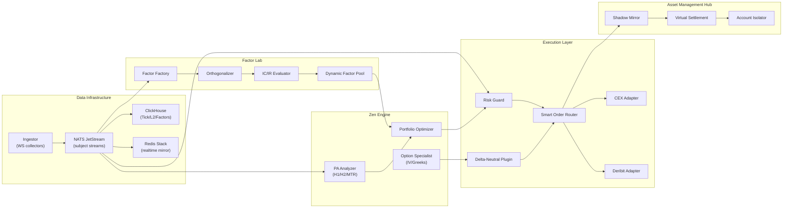
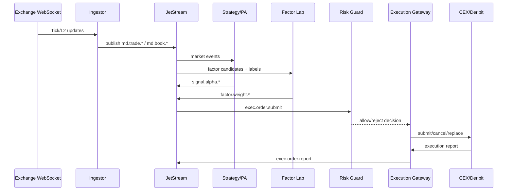
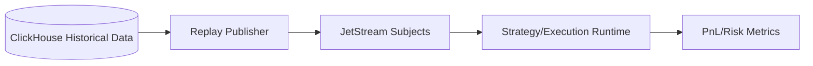

# ZenQuant 3.0

> **Codename:** `disaster-kernel-v3`  
> **Positioning:** Cross-market, deterministic, asset-management-grade quantitative trading infrastructure  
> **Audience:** Quant engineers, infra engineers, risk engineers, and technical partners

---

## 1. Why ZenQuant Exists

Crypto markets are fragmented, always-on, and highly volatile. Traditional script-based stacks fail under pressure because they couple strategy, execution, and state management in one runtime.

ZenQuant is designed as a **dataflow kernel**, not a script bundle:

- Determinism over raw latency spikes
- Physical decoupling of signal generation and execution
- Replay-consistent backtest/live behavior
- Kernel-grade risk isolation for external capital management

---

## 2. Design Principles

### 2.1 Core Principles

1. **Determinism over Latency**  
   Predictable state transitions are prioritized over unstable micro-optimizations.
2. **Compute/Execution Decoupling**  
   Factor generation and order routing are independent pipelines.
3. **Data as an Asset**  
   Tick/L2 data is first-class infrastructure with strict schema and retention policy.
4. **Risk as a System Service**  
   Risk logic is a dedicated gatekeeper, not embedded in strategy scripts.

### 2.2 Engineering Constraints

- Stateless message transport, stateful risk/execution reconciliation
- Strongly typed wire contracts (`Protocol Buffers`)
- No hidden side effects in order lifecycle transitions
- Every critical path supports replay and audit

---

## 3. Architecture At a Glance



---

## 4. End-to-End Event Flow



---

## 5. System Modules

### 5.1 Data Infrastructure

### Ingestor

- Asynchronous WebSocket collectors (`ccxt.pro` compatible design)
- Produces normalized `TradeTick` and `OrderBookSnapshot`
- Carries both `exchange_timestamp` and `local_timestamp` for jitter monitoring

### Persistence

- **ClickHouse** for historical Tick/L2/factor analysis
- **Redis Stack** for ultra-fast latest-state mirror (book, Greeks, limits, risk states)

### Event Bus

- **NATS JetStream** stream segmentation:
  - `STREAM_MARKET_DATA` -> `md.>`
  - `STREAM_SIGNALS` -> `signal.>`
  - `STREAM_ORDERS` -> `exec.order.>`
  - `STREAM_FACTORS` -> `factor.>`

---

### 5.2 Factor Lab

### Factor Factory

Typical plugin factors:

- CVD
- Funding Rate
- Liquidation pressure
- Microstructure imbalance
- PA discrete patterns (as factorized events)

### Orthogonalization

- Rolling cross-factor correlation matrix
- If `|corr(new, existing)| > 0.8`, apply down-weight or residualization

### IC/IR Evaluator

- Rolling Information Coefficient on labeled forward returns
- IR from IC mean and rolling IC volatility
- Factors below significance threshold are excluded from active pool

### Dynamic Weight

\[
W_i = \text{Base} \times \frac{\sum_j(Factor_j \times IC_j)}{\sigma_{portfolio}}
\]

---

### 5.3 Zen Engine

### PA Analyzer (Al Brooks Formalization)

- Context inference: `BULL_TREND`, `BEAR_TREND`, `RANGE`
- Micro-channel lock to avoid naive counter-trend entries
- Deterministic signal events:
  - `H1_PULLBACK`
  - `H2_RESUMPTION`
  - `MAJOR_TREND_REVERSAL`

### Portfolio Optimizer

- Converts factor pool + risk state into target position deltas
- Supports risk-parity-style volatility scaling

### Option Specialist

- Deribit option chain ingestion
- IV surface estimation
- Real-time Greeks aggregation for hedge trigger

---

### 5.4 Execution Layer

### Risk Guard (Hard Gate)

- Max order size/notional constraints
- Max symbol exposure
- Drawdown kill-switch (high-water-mark based)
- Reduce-only integrity checks
- API rate-limit smoothing (token bucket)

### Smart Order Router (SOR)

- Venue-aware route selection
- Slippage and fee-aware decisioning
- Optional synthetic path (spot/perp/options parity route)

### Delta-Neutral Plugin

\[
\Delta_{Total} = \sum \Delta_{Option} + \sum \Delta_{Perp} + \sum Spot
\]

When `|ΔTotal|` exceeds threshold, hedge orders are generated automatically.

---

### 5.5 Asset Management Hub

### Shadow Mirror

- Master account event stream mirrored to follower accounts with scale factors

### Virtual Settlement

- Per-account NAV, fee, and PnL attribution logic

### Account Isolator

- Sandbox isolation by container/pod
- API key/material isolation and blast-radius containment

---

## 6. Interface Contracts (Protocol Buffers)

The canonical contracts are stored in:

- `/Users/disaster/workspace/code/zenQuant/proto/market_data.proto`
- `/Users/disaster/workspace/code/zenQuant/proto/strategy_signal.proto`
- `/Users/disaster/workspace/code/zenQuant/proto/execution.proto`

### 6.1 Market Data Highlights

- `TradeTick`
  - `symbol`
  - `exchange`
  - `price`
  - `size`
  - `trade_id`
  - `is_buyer_maker`
  - `exchange_timestamp`
  - `local_timestamp`

### 6.2 Strategy Signal Highlights

- `AlphaSignal`
  - `factor_id`
  - `symbol`
  - `SignalType`
  - `continuous_value`
  - `PA_Pattern`
  - `confidence_ic`
  - `timestamp`

### 6.3 Execution Highlights

- `SubmitOrder`
- `ExecutionReport`
- `OrderType`: `MARKET`, `LIMIT`, `POST_ONLY`, `FOK`, `IOC`

---

## 7. ClickHouse Schema (Factor Lab + Market Data)

SQL assets are in:

- `/Users/disaster/workspace/code/zenQuant/sql/clickhouse/001_market_data.sql`
- `/Users/disaster/workspace/code/zenQuant/sql/clickhouse/002_orderbook.sql`
- `/Users/disaster/workspace/code/zenQuant/sql/clickhouse/003_factors.sql`

### 7.1 Design Notes

- Columnar compression (`ZSTD`, `Gorilla`) for high compression and scan efficiency
- `LowCardinality(String)` for symbol/exchange dimensions
- Materialized columns for common derived features (`mid_price`, `spread`, aggregate depth)
- TTL policy to control hot/cold storage lifecycle

---

## 8. Deterministic Replay Model

Replay is mandatory for strategy reliability.



Requirements:

- Preserved ordering by source timestamp
- Optional timing-preserved playback
- Identical message contract between replay and live ingestion

---

## 9. Reliability and Risk Invariants

1. Every order state transition is explicit and auditable.
2. Risk rejection is final on the critical path.
3. Strategy cannot bypass Risk Guard.
4. Replay and live paths use identical event contracts.
5. Position/account snapshots are monotonic and reconciled with execution reports.

---

## 10. Current Repository Status (Reference Implementation)

This repository currently includes a deterministic local MVP:

- In-memory JetStream-compatible event bus
- Synthetic market data ingestor
- PA analyzer (H1/H2/MTR)
- Rolling Factor Lab runtime (IC/IR + orthogonalization penalty + dynamic weights)
- Execution gateway with idempotent order handling
- Risk guard with kill-switch and exposure checks
- Deterministic replay utility
- Real-time web console (chart, order book, signal feed, execution feed, factor weights)
- Unit tests for core state machines and dataflow

Main entry points:

- Demo: `/Users/disaster/workspace/code/zenQuant/zenquant/app/demo.py`
- Pipeline: `/Users/disaster/workspace/code/zenQuant/zenquant/app/pipeline.py`
- Web server: `/Users/disaster/workspace/code/zenQuant/zenquant/app/server.py`

---

## 11. Runbook

### 11.1 Run Demo

```bash
python3 -m zenquant.app.demo
```

### 11.2 Run Tests

```bash
python3 -m unittest discover -s tests -v
```

### 11.3 Run Web Console

```bash
zenquant-web
```

Open:

- [http://127.0.0.1:8090](http://127.0.0.1:8090)

### 11.4 (Optional) Generate Protobuf Python Stubs

```bash
python3 -m grpc_tools.protoc -I="./proto" \
  --python_out="./generated" \
  "./proto/market_data.proto" \
  "./proto/strategy_signal.proto" \
  "./proto/execution.proto"
```

---

## 12. Phased Roadmap

### Phase 1: Infrastructure

- Production NATS JetStream deployment
- ClickHouse + Redis integration
- BTC/ETH/SOL/BNB full-tick persistence

### Phase 2: Factor and Strategy

- CVD/Funding/Liquidation factor plugins
- Full PA feature extraction and quality validation
- Factor governance (auto onboarding/deprecation)

### Phase 3: Derivatives and Hedging

- Deribit option specialist
- Greeks service and delta-neutral execution hooks

### Phase 4: Asset Management Commercialization

- Shadow mirror for follower accounts
- Virtual settlement and fee accounting
- Tenant isolation and control-plane tooling

---

## 13. Recommended Next Technical Steps

1. Replace in-memory bus with a concrete NATS adapter while preserving subject contracts.
2. Add ClickHouse writers/readers for historical replay parity.
3. Move risk/execution state to a replicated state service with snapshot + WAL.
4. Add canary/reconciliation jobs and SLO dashboards.

---

## 14. Repository Layout

```text
zenQuant/
├─ proto/
├─ sql/clickhouse/
├─ zenquant/
│  ├─ app/
│  ├─ domain/
│  ├─ execution/
│  ├─ factor_lab/
│  ├─ ingestor/
│  ├─ infra/
│  ├─ pa_analyzer/
│  ├─ risk/
│  ├─ strategy/
│  └─ web/
├─ tests/
├─ pyproject.toml
└─ README.md
```

---

## 15. License and Disclaimer

This project is infrastructure software. It is not investment advice.  
Production deployment requires exchange-specific compliance, secure key management, and legal review for managed-account operations.
