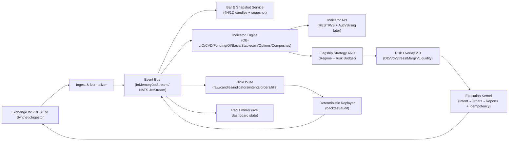

# ZenQuant 4.0 — Indicator‑First, Deterministic Crypto Quant Kernel (BTC/ETH • 4H/1D)

> **Codename:** `zen-alpha-v1`  
> **Positioning:** a *deterministic* event‑driven quant kernel + **indicator subscription service** + a **flagship 4H/1D strategy** designed to capture *large volatility* moves in major coins (BTC/ETH; optional SOL/BNB).  
> **Not HFT:** Alpha decisions are made at **4H / 1D bar close**; higher‑frequency data is used only for **risk triggers** and **execution slicing**.

---

## Why this repo exists

Most open-source trading repos can backtest, but fail when moving from backtest → replay → live:

- hidden lookahead (time alignment bugs)
- inconsistent feature definitions
- strategy code bypassing risk
- “it worked in backtest” execution assumptions
- impossible audit when users ask “why did it trade here?”

ZenQuant’s core requirement is:

> **Deterministic behavior across simulation, replay, and live-like runtime paths.**  
> Same event stream + same indicator version → same decisions.

This is a rewrite/upgrade of the ZenQuant 3.0 MVP into an **indicator-first** product architecture:
- Sell **indicators & market regime dashboards** (membership)
- Run a **single flagship strategy** on major coins and publish a real account track record (exchanges’ native copy-trade is optional, but the platform itself is *not* a copy-trade platform)

---


## Business model (strategy-first)

This project is **strategy-first**, not “indicators-first” in isolation:

- The *primary* growth driver in crypto is **a flagship strategy that makes money** (a credible track record).
- Members join mainly to **follow/copy** the real account (via exchanges’ native copy-trade), and the website’s indicators become a **supporting product** that increases trust, understanding, and retention.
- Therefore Phase 1 success criteria are:
  1) a robust, auditable BTC/ETH perp strategy on **4H/1D** that can **size up in big-volatility regimes**, and  
  2) an indicator dashboard that explains *why* the strategy is allowed to size up (regime + risk budget).

Indicators are built to serve the flagship strategy and the member dashboard—not to be sold as standalone “magic predictors”.


## What we build first (focus)

**Phase‑1 goal:**  
✅ A *profitable* flagship strategy on BTC/ETH (4H/1D) **+** a set of paid indicators with a front-end dashboard.

**Everything else** (multi-venue SOR, options specialist, cross-asset portfolio factory, etc.) is a later phase.

---

## Key concepts (non-negotiable invariants)

1) **Bar‑close decisions (4H/1D):**  
   All directional decisions happen only on `clock.bar_close.{4h|1d}`.

2) **Intent → Execution separation:**  
   Strategy outputs **TargetPosition** (target notional/leverage & constraints), not “submit order”.

3) **Risk overlay can rewrite intent:**  
   Risk is not only “order rejection”, it can *reduce leverage*, switch to reduce‑only, or freeze new exposure.

4) **Point‑in‑time indicators:**  
   Every indicator output includes:
   - `cutoff_time` (data watermark)
   - `indicator_version` + `formula_hash`
   - `quality_flags` (missing/late/outlier)

5) **Replay parity:**  
   The replay tool must reproduce:
   - indicator streams
   - strategy intents
   - execution reports
   with identical ordering and deterministic state transitions.

---

## Repository scope: what’s implemented vs planned

> This repo is a **reference implementation + production blueprint**.  
> The MVP runs locally with an in-memory bus + synthetic market data, then upgrades to exchange adapters & persistence.

### Implemented (current MVP baseline)
- In-memory subject-based event bus (JetStream-like)
- Synthetic trade + L2 orderbook generator
- Strategy engine (tick-driven in v3 baseline)
- Factor Lab runtime (tick-horizon labeling, IC/IR)
- Execution stack (signal→order routing, risk guard, deterministic execution reports)
- Deterministic replayer
- FastAPI + WebSocket web console dashboard
- Unit tests for determinism/risk/PA state machine

### ZenQuant 4.0 additions (this README defines the target)
- Bar/Clock service (**4H/1D candle + snapshot**)
- Indicator engine + indicator API for members (WS/REST)
- Flagship strategy **ARC** (Adaptive Regime Core) outputs TargetPosition
- Risk Overlay 2.0 (DD/vol/stress/crowding) controlling leverage
- ClickHouse indicator/intents schema + replay loader (production path)

---

## System architecture

### Runtime graph (ZenQuant 4.0 target)



### Core dataflow (high level)

1) `md.*` events (trades/book/funding/OI/options/stablecoin)  
2) `clock.bar_close.*` → `md.candle.*` + `md.snapshot.*`  
3) `indicator.*` computed point-in-time  
4) `intent.target_position.*` emitted by strategy  
5) `risk.overlay.*` may rewrite intent  
6) `exec.order.*` submit/ack/fill/reject  
7) persisted to ClickHouse + replayable

---

## Event subjects (recommended)

### Market data & clock
- `md.trade.{venue}.{symbol}`
- `md.book.{venue}.{symbol}`
- `md.funding.{venue}.{symbol}`
- `md.oi.{venue}.{symbol}`
- `md.options.{venue}.btc` (optional)
- `md.stablecoin.supply` (optional)
- `clock.bar_close.4h`
- `clock.bar_close.1d`
- `md.candle.4h.{symbol}`
- `md.candle.1d.{symbol}`
- `md.snapshot.4h` / `md.snapshot.1d`

### Indicators (paid product stream)
- `indicator.pack.v1.4h.{symbol}`
- `indicator.pack.v1.1d.{symbol}`
- `indicator.composite.4h` / `indicator.composite.1d`
- `indicator.alerts` (stress / data quality / regime changes)

### Strategy intents (flagship)
- `intent.target_position.{portfolio}.{symbol}`
- `intent.reason.{portfolio}` (human-readable reasons for audit)
- `strategy.regime.{portfolio}`

### Execution & risk
- `risk.overlay.decision`
- `risk.snapshot`
- `exec.order.submit`
- `exec.order.report`

---

## Indicator Pack v1 (paid)

> **Perp-first（合约优先）:** Phase 1 默认以 **USDT 永续合约** 为主（带单最核心），现货仅作为 **指标/基准** 的辅助数据源；现货交易执行与 spot-based 套利放到后续阶段。

### Data sources (Phase 1 minimal set)

**Exchanges**
- **Binance USDT-M Perpetual** (primary)
- **OKX Perpetual** (secondary, for cross-venue robustness)

**Data types (Perp-first MVP)**
- Trades (for CVD, volume, realized vol)
- L2 Orderbook (top N levels or depth bands, for OB‑LIQ)
- Perp funding rate (sentiment/crowding)
- Open interest (OI) (crowding weighting / risk)
- Mark price / index price (risk proxies)
- Perp klines (optional; recommended to build your own 4H/1D bars from trades for determinism)

**Optional (Phase 2+)**
- Spot prices (reference/benchmark; not required for execution)
- Deribit options (skew/term structure stress signals)
- Stablecoin supply / USDC-USDT premium (liquidity tide)

---

## Data → Indicators matrix (Indicator Pack v1)

> 每个指标都必须是一个**可版本化数据产品**：`cutoff_time + indicator_version + formula_hash + quality_flags + coverage`。  
> 指标计算以 `md.candle.*` + `md.snapshot.*` 为输入（point‑in‑time），保证 replay parity。

### Phase 1 indicator list (sellable + strategy-ready)

| Indicator | Purpose | Required Data | Phase 1 Sources | Update | Degrade / Fallback |
|---|---|---|---|---|---|
| `Candle(4H/1D)` | deterministic decision anchor (point-in-time) | trades or klines | Binance+OKX (perp) | **bar_close** | venue down → use other; both down → freeze adds + flag |
| `RealizedVol` | risk budget (vol targeting), stress detect | candle close | Binance (primary) | bar_close | missing → lower `lev_cap`, `reduce-only` if stressed |
| `ATR / Range` | stops, range filters | OHLC | Binance (primary) | bar_close | missing → disable range module, keep trend-only low lev |
| `OB_LIQ_z` | orderbook liquidity imbalance (range/turning risk) | L2 book | Binance+OKX | 1–5s sample → **snapshot @ bar_close** | `BOOK_STALE`/coverage low → ignore OB‑LIQ; range heavy bets disabled |
| `Overall_OB_LIQ_z` | market-wide liquidity (index) | OB_LIQ basket | Binance+OKX | bar_close | coverage < threshold → suppress overall; publish per-symbol only |
| `CVD_slope(4H/1D)` | market-order trend pressure; anti-fade filter | trades (+ aggressor side) | Binance+OKX | 1–5s agg → bar_close | if side inference unreliable → lower weight; avoid contrarian heavy bets |
| `funding_oi_weighted` | cross-venue crowding; leverage discount | funding + OI | Binance+OKX | 1–5min poll/WS → bar_close | missing OI → use funding avg; apply conservative `lev_cap` |
| `ZenPulse(0..100)` | composite dashboard score (tactical) | above components | Binance+OKX | bar_close | missing component → auto reweight + emit `components/weights/coverage` |

**Implementation notes (recommended defaults)**
- **Robust normalization:** rolling `median + MAD` z-score; clip extreme tails before composing indices.
- **Coverage-aware aggregation:** for funding/OI across venues, publish `venue_count`, `oi_coverage`, `staleness_ms`.
- **Hysteresis thresholds:** enter/exit bands to avoid “signal chattering” (esp. OB‑LIQ & composites).

---

## Development order (Phase 1: profit + sell indicators)

> “最快闭环 + 最能卖钱 + 最能提升策略稳定性”的顺序。

### Step 0 — Contracts & determinism (today)
- Standardize envelope: `event_time`, `ingest_time`, `venue`, `symbol`, `stream_seq`, `schema_version`
- All indicator outputs must include: `cutoff_time`, `indicator_version`, `formula_hash`, `quality_flags[]`, `coverage{...}`

### Step 1 — Show something on UI fast (1–2 weeks)
1. `Clock + BarBuilder` for **4H/1D** (`clock.bar_close.*`, `md.candle.*`)
2. `SnapshotBuilder` (`md.snapshot.*`) from book/trades/funding/OI (perp-first)
3. Indicator API:
   - `GET /api/indicators/latest`
   - `GET /api/indicators/history`
   - `WS /ws/indicators` (push on bar_close)

### Step 2 — Core sellable indicators (2–4 weeks)
4. `funding_oi_weighted` + crowding states
5. `CVD_slope` (trend filter)
6. `OB_LIQ_z` (with strict quality flags)
7. `ZenPulse` composite (transparent components)

### Step 3 — Flagship strategy + production-grade risk (4–8 weeks)
8. ARC v1 outputs `TargetPosition` (not orders)
9. RiskOverlay 2.0: DD steps + vol shock + crowding discount + reduce-only
10. Execution slicing: simple TWAP/participation caps (not too many child orders; copy-trade-friendly)

---

## UI (keep it simple first)

Phase 1 UI should be minimal but *trustworthy*:

- Candle chart (4H/1D)
- A small panel showing:
  - `ZenPulse`, `regime`, `lev_cap`
  - `funding_oi_weighted` + `crowding_state`
  - `CVD_slope`
  - `OB_LIQ_z` (with `book_age_ms`, `venue_count`, `quality_flags`)
- Alerts timeline:
  - `STRESS`, `BOOK_STALE`, `MISSING_OI`, `VENUE_DOWN`
- A “why” card (optional): last bar-close `intent.reason` summary

No drag/drop, no complex layout required in Phase 1 — optimize for **clarity + auditability**.


> Design principle: **don’t sell “magic predictors”**.  
> Sell **market state** (trend/range/stress), **risk budget**, and **crowding/liquidity context** that is strongly related to long/short edge.

The pack is *inspired by* CoinKarma’s indicator taxonomy (LIQ/Overall LIQ, CVD, OI‑weighted funding, rolling APY, stablecoin supply, USDC/USDT premium, options skew/term structure, Market Pulse/Karma Index) but implemented with our own **transparent, versioned, point‑in‑time** formulas.

### Indicator engineering notes (research/production grade)

This repo treats indicators as **versioned data products**, not ad-hoc chart toys.

**Point-in-time & watermark**
- Every indicator is computed from `md.candle.*` + `md.snapshot.*` built at bar-close.
- `cutoff_time` (watermark) defines exactly which upstream events are included.
- Late/out-of-order data is handled deterministically (either into next bar or flagged).

**Robust normalization**
- Use robust z-scores (`median` + `MAD`) instead of mean/std where outliers are common
- Clip/winsorize extreme tails before composing indices
- Add hysteresis (enter/exit thresholds) to avoid signal chattering

**Cross-venue aggregation**
- Aggregate funding/OI across venues with *coverage-aware* weights:
  - weight by OI (for sentiment) / depth (for liquidity) / volume (fallback)
- Publish `coverage` metrics so the UI can display “data quality: 70% venues covered”

**Data-quality as first-class output**
- Every indicator carries `quality_flags` (e.g., `BOOK_STALE`, `MISSING_OI`, `VENUE_DOWN`)
- Strategy & risk overlay read those flags to auto-degrade risk:
  - missing OI → crowding discount disabled (conservative)
  - stale book → OB-LIQ ignored (conservative)

**Evaluation discipline (avoid overfitting)**
- Use walk-forward + purged/embargoed splits for any supervised labeling
- Report not only Sharpe, but also max drawdown, tail metrics (e.g., ES), and turnover/cost sensitivity
- Track drift: when indicator distributions shift, alert + lower confidence in composites

### 1) OB‑LIQ (Orderbook Liquidity Imbalance, per symbol)
**Goal:** quantify “how expensive it is to push price up vs down” using L2 depth.

**Compute (concept):**
- Take multiple price bands around mid (e.g., ±0.10%, ±0.25%, ±0.50%, ±1.0%)
- Compute depth imbalance `I = log(bid_depth / ask_depth)`
- Standardize by **robust** rolling stats (median + MAD) to resist outliers
- Output `ob_liq_z` + `state` (HIGH/LOW/NEUTRAL)

**Notes:**
- OB‑LIQ is most useful in **ranging** regimes; it can “go dull” in strong trends.
- Always publish `quality_flags`: book staleness, missing depth, venue coverage.

### 2) Overall‑LIQ (market-wide liquidity)
**Goal:** capture “whole market liquidity” rather than one coin.

**Compute (concept):**
- Aggregate OB‑LIQ across an index basket (BTC/ETH + majors) with weights:
  - market-cap (preferred) or volume weights (fallback)
- Output `overall_liq_z`

### 3) CVD (Cumulative Volume Delta, per symbol)
**Goal:** measure **market-order** buy vs sell pressure during a trend.

**Compute (concept):**
- For each trade, infer aggressor side (exchange side flag if available; else tick rule)
- `delta = +size` for buyer-initiated, `-size` for seller-initiated
- Aggregate into CVD per bar/time window; smooth with EWMA
- Output `cvd_slope`, `cvd_trend_state`

**Use:** trend confirmation + *anti-fade* filter for OB‑LIQ mean reversion.

### 4) Crowding: OI‑Weighted Funding (per symbol / market)
**Goal:** a better funding sentiment gauge by weighting by open interest.

**Compute (concept):**
- Across venues: `sum( funding_rate_v * oi_v ) / sum( oi_v )`
- Standardize to `funding_oi_z`
- Output crowding states: `LONG_CROWDED / SHORT_CROWDED / NEUTRAL`

**Use:** leverage discounting (avoid heavy leverage when crowding is extreme).

### 5) Carry: Basis Rolling APY (optional; best for BTC/ETH)
**Goal:** futures vs spot basis annualized → sentiment & carry conditions.

**Compute (concept):**
- `basis = (F - S) / S`
- `rolling_apy = basis * (365 / days_to_expiry)`
- Monitor regime drift (thresholds can shift after structural changes)

**Use:** crowding/sentiment context; avoid late-cycle leverage.

### 6) Stablecoin Liquidity Tide (optional)
**Goal:** market-wide liquidity inflow/outflow proxy.

**Compute (concept):**
- Track stablecoin circulating supply (USDT/USDC) + rate-of-change
- Produce `stablecoin_flow_state` (INFLOW/OUTFLOW/FLAT)

**Use:** cycle context; risk budget modulation.

### 7) USDC/USDT Premium (optional)
**Goal:** short-term funding pressure / settlement demand proxy.

**Compute (concept):**
- `premium = price(USDC) / price(USDT) - 1`
- Output `premium_state` and alert on sign flips.

**Use:** risk-off gating; helps interpret short-term stress.

### 8) Options Stress (optional; Deribit)
**Goal:** detect stress regimes from options market (not a direct buy/sell trigger).

**Metrics:**
- `25Δ skew` (put IV - call IV at ±0.25 delta)
- `term_structure_slope` (short-tenor ATM IV - long-tenor ATM IV)
- Output `options_stress_state`: NORMAL/WARNING/INVERTED_STRESS

**Use:** tail-risk gating (reduce leverage / freeze new exposure).

### 9) Composite Indices: ZenPulse & CycleIndex
**Goal:** package multiple indicators into an interpretable dashboard number.

**Rules:**
- Index range 0..100
- Always publish component breakdown for transparency:
  - `components[]`, `weights[]`, `version`
- ZenPulse: tactical (4H/1D)
- CycleIndex: macro (1D/1W)

---


## Research-backed modules (practical, 4H/1D-friendly)

> These are **not** “hard research projects”. Each item below is implementable with a small code footprint, and is extremely useful for a strategy that wants to **size up only in the right regimes**.

### 1) Regime engine upgrades (Phase 2, high ROI)

**Why:** correlations and market behavior in crypto are regime-dependent. A regime engine is the most reliable way to avoid over-leveraging in the wrong environment.

**Implementable options (pick one to start):**
- **HMM / Markov switching (2–3 states)** on (returns, realized vol, trend strength): outputs `P(TREND)`, `P(RANGE)`, `P(STRESS)`.
- **Change-point detection** on realized vol and/or rolling beta/corr: detects structural breaks and triggers `risk_off` or leverage caps.

**Deliverables:**
- `indicator.regime.probabilities` (per bar close)
- `risk.overlay.regime_gate` (uses regime probabilities to cap leverage)

> MVP-friendly: start with *threshold + hysteresis* for states, then replace with HMM/change-point when stable.

### 2) Macro risk score (Phase 2, optional but valuable)

**Goal:** use Nasdaq / DXY / Treasury yields / Gold not as direction predictors, but as **risk-on/off gating** for leverage.

**Implementation (low complexity):**
- compute rolling `beta_BTC_vs_QQQ`, `beta_BTC_vs_DXY`, `beta_BTC_vs_10Y_yield` (daily)
- apply a change-point detector / simple regime rule to decide when macro should influence `lev_cap`
- output `macro_risk_score ∈ [0,1]` that only scales leverage, never forces direction

### 3) Evaluation discipline (must-have for any “heavy bet on big moves” strategy)

To avoid “looks great in backtest, dies in production”:
- **walk-forward** evaluation by time blocks (e.g., train 12–18 months, test 3 months, roll)
- if using supervised labels: **purged/embargoed splits** (avoid leakage from overlapping horizons)
- always report:
  - max drawdown, tail metrics (ES/expected shortfall proxy), turnover, fee/slippage sensitivity
  - regime-conditional performance (TREND vs RANGE vs STRESS)

### 4) Capacity / slippage model (Phase 1.5, protects the track record)

When the strategy becomes popular, edge can be eaten by impact.
- estimate per-bar max participation and impact from orderbook depth + volume
- enforce `max_trade_notional_per_bar` and `max_participation_rate`
- publish these limits in the dashboard (build trust + avoids overpromising)


## Flagship strategy (ARC v1): Adaptive Regime Core (4H/1D)

**Objective:** capture big volatility moves while allowing *selective* heavy exposure in the right regime, but maintain long-run survival.

### 1) Regime Engine (state machine)
States:
- **TREND:** structure breaks + CVD confirms (momentum-driven)
- **RANGE:** structure stable + liquidity extremes (mean-reversion-friendly)
- **STRESS:** volatility/liq/options stress (risk-off)

Outputs:
- `regime` + `confidence`
- `allowed_actions` (add, hold, reduce-only)

### 2) Trend module (captures big moves)
- Entry: breakout/structure shift at bar close (4H/1D)
- Filter: CVD confirms (avoid fading strong market-order flow)
- Add: pyramiding only when price continues favorably
- Exit: trailing ATR stop + structure break

### 3) Range module (optional; carefully constrained)
- Entry: OB‑LIQ extreme + price stretched, **only if CVD does not show strong trend**
- Breakout kill rule: if breakout + vol expands → exit mean reversion positions immediately
- This module is where many systems die; we keep it conservative by default.

### 4) Position sizing = risk budget (not “signal excitement”)
Target leverage/notional is computed from:
- `vol_target / realized_vol`
- regime confidence
- crowding discount (funding/basis/skew)
- drawdown throttle (DD steps)
- stress throttle

The output is always **TargetPosition**, never raw orders.

---

## Risk overlay 2.0 (survival-first)

Risk overlay operates *above* order-level RiskGuard:

- **Daily loss limit:** reduce leverage to a safe cap (not necessarily hard-stop)
- **Drawdown steps:** DD deeper → lower max leverage
- **Volatility shock:** realized vol spikes → reduce / freeze adds
- **Liquidity shock:** spread/depth deteriorates → reduce-only
- **Crowding extremes:** leverage discount; no “late-cycle” heavy exposure
- **Kill switch:** final hard-stop (exposure increase blocked)

---

## Frontend dashboard & indicator display

### What members see
- 4H/1D candles
- Indicator Pack v1 overlays
- Composite indices (ZenPulse/CycleIndex)
- Regime state (TREND/RANGE/STRESS) + leverage envelope
- Alerts timeline (risk-off, data quality, threshold crossings)
- (Optional) a “strategy intent” explanation feed (no “signals”, only reasons)

### API contracts (REST + WS)
Recommended endpoints:
- `GET /api/indicators/latest?symbol=BTCUSDT_PERP&tf=4h`
- `GET /api/indicators/history?symbol=BTCUSDT_PERP&tf=4h&from=...&to=...`
- `WS  /ws/indicators?symbol=BTCUSDT_PERP&tf=4h` (push on bar close)
- `GET /api/state` (positions, risk, last reports)

Example payload (indicator pack):

```json
{
  "ts": "2026-02-24T08:00:00Z",
  "symbol": "BTCUSDT_PERP",
  "tf": "4h",
  "cutoff_time": "2026-02-24T08:00:00Z",
  "indicator_version": "pack.v1",
  "formula_hash": "sha256:…",
  "quality_flags": ["OK"],
  "values": {
    "ob_liq_z": 2.8,
    "overall_liq_z": 1.6,
    "cvd_slope": 0.42,
    "funding_oi_z": 1.9,
    "basis_apy": 0.12,
    "stablecoin_flow": "INFLOW",
    "usdc_usdt_premium": -0.0004,
    "options_stress": "NORMAL",
    "zen_pulse": 72,
    "cycle_index": 54,
    "regime": "TREND",
    "regime_conf": 0.78,
    "lev_cap": 2.5
  }
}
```

### Frontend stack suggestion
- Keep the backend as **FastAPI** (already in repo)
- UI can stay minimal (existing web console) or upgrade to:
  - React/Next.js + TradingView Lightweight Charts (candles)
  - ECharts/Recharts for indicator panels

---

## Storage (ClickHouse) — minimum viable schema

Tables (recommended):
- `md_trades`, `md_orderbook` (raw)
- `md_candles_4h`, `md_candles_1d`
- `indicators_pack_v1` (point-in-time)
- `strategy_intents` (TargetPosition + reason codes)
- `risk_snapshots`
- `orders`, `fills`, `execution_reports`

A hard rule: **everything needed to reproduce a decision must be stored**:
- input snapshot id / cutoff_time
- indicator version + formula hash
- intent id & reason codes

---

## Deterministic replay & research workflow

1) **Ingest → persist event envelopes**
2) **Compute indicators point-in-time**
3) **Emit intents**
4) **Replay the exact stream** to reproduce:
   - indicators
   - intents
   - execution reports
5) Run evaluation with:
   - walk-forward tests
   - purged/embargoed CV for labels (avoid leakage)
   - slippage/fees models (capacity realism)

---

## Getting started

### Prerequisites
- Python `>= 3.11`

### Install
```bash
python3 -m pip install -e .
```

### Run local demo (synthetic market)
```bash
python3 -m zenquant.app.demo
# or
zenquant-demo
```

### Run web console
```bash
zenquant-web
```
Open: `http://127.0.0.1:8090`

### Run tests
```bash
python3 -m unittest discover -s tests -v
```

---

## Migration plan from ZenQuant 3.0 → 4.0 (pragmatic)

1) Add `Clock + BarBuilder` (4H/1D) and publish `md.candle.*`
2) Add `SnapshotBuilder` and publish `md.snapshot.*`
3) Implement `IndicatorEngine` producing `indicator.pack.v1.*`
4) Change strategy output contract:
   - from `AlphaSignal` → `TargetPosition`
5) Add `RiskOverlay 2.0` that can rewrite TargetPosition
6) Keep existing `ExecutionGateway + RiskGuard` but change router to consume intent deltas
7) Extend web console to show indicator panels (members view)

---

## Roadmap (prioritized for “profit + indicators”)

### Phase 1 — BTC/ETH profit + member indicators
- [ ] 4H/1D bars + snapshots
- [ ] Indicator Pack v1: OB‑LIQ, Overall‑LIQ, CVD, OI‑weighted funding, composites
- [ ] Flagship strategy ARC v1 (trend-first)
- [ ] Risk overlay 2.0
- [ ] Dashboard: indicator panels + alerts + intent explanations
- [ ] Real exchange adapters (Binance/OKX) + read-only public account page

### Phase 2 — refine edge & robustness
- [ ] Basis rolling APY (carry)
- [ ] Stablecoin tide + USDC/USDT premium
- [ ] Better regime detection (change-point / HMM)
- [ ] Capacity-aware execution (TWAP/POV + participation caps)

### Phase 3 — optional expansion
- [ ] SOL/BNB expansion
- [ ] Options stress (skew/term structure) via Deribit
- [ ] Portfolio-level allocation & hedging layer

---

## Disclaimer

This repository is **infrastructure + research code** for quantitative trading.
It is **not** investment advice. Crypto markets are highly volatile; any strategy may experience large drawdowns or liquidation if misused. Use at your own risk.