# ZenQuant 4.0

Deterministic crypto trading infrastructure for building a serious, auditable, and extensible trading product around major crypto perpetuals.

ZenQuant is being built to do one thing well first:

1. Deliver a flagship strategy engine whose decisions are explainable, replayable, and inspectable.
2. Deliver a dashboard that shows why the system is increasing risk, reducing risk, or refusing to trade.

This repository is intentionally opinionated.

It is **not**:
- an HFT engine,
- a black-box AI trading bot,
- a copy-trading platform,
- or a “support every idea from day one” trading framework.

The goal is to build a trading product that is trustworthy before it is flashy, and modular before it is overcomplicated.

---

## 1. Who This Is For

ZenQuant is for people who care about real trading system behavior, not just backtest screenshots.

This project is aimed at:

- traders and researchers who want backtest -> replay -> live behavior to remain coherent,
- engineers who need deterministic event contracts and reproducible state transitions,
- reviewers and collaborators who want system design explained in plain language,
- builders who prefer a strong base architecture first, with additional features added later as modules instead of hacks.

If you care about explainability, auditability, and realistic system boundaries, this repository is for you.

---

## 2. Why This Project Exists

Many open-source trading systems look fine in research but collapse when pushed closer to live operation.

The usual reasons are predictable:

- hidden lookahead,
- unstable factor definitions,
- inconsistent time alignment,
- strategy logic bypassing risk controls,
- execution assumptions that do not survive contact with the real market,
- weak auditability,
- and code that grows faster than the owner’s understanding.

ZenQuant is built around one hard rule:

> Same event stream + same indicator version + same formula config -> same decisions.

That principle matters more than adding more features quickly.

A slower but deterministic system is more valuable than a fast-growing system nobody can fully trust.

---

## 3. Project Direction

ZenQuant is intended to become a **strategy operating system** for crypto trading.

That means the repository should eventually support:

- robust strategy logic,
- disciplined risk rewriting,
- consistent execution behavior,
- explainable dashboard output,
- and modular extension points for later research.

The project direction is practical:

- survive bearish or hostile market conditions without relying on blind long-only exposure,
- participate meaningfully in bullish trend expansion when persistence is strong,
- keep strategy, risk, and execution clearly separated,
- preserve deterministic behavior across replay and live-like operation,
- and avoid turning the codebase into a bag of disconnected experiments.

The first success condition is not “maximum complexity.”
The first success condition is “one coherent product that behaves consistently.”

---

## 4. Phase 1 Goal

### Business goal

Ship a strategy + dashboard package that users can understand and trust.

That means the system should not only emit positions; it should also explain:
- what it thinks the market regime is,
- how much confidence it has,
- what risk caps are active,
- and why it changed or rejected a trade.

### Engineering goal

Deliver a deterministic vertical slice:

market ingest -> bars / snapshots -> indicators -> target intent -> risk rewrite -> execution reports -> API / dashboard

The Phase 1 build should prove that the kernel can carry a full decision path from data to inspectable trading output.

### Product goal

Build the base product first.

The architecture should be stable enough that future additions can be plugged in later, including:
- new major assets,
- additional factor packs,
- 1H confirmation logic,
- microstructure observation modules,
- optional AI-assisted scoring,
- and improved execution adapters.

Phase 1 is not about winning every possible market.
It is about building a trustworthy core.

---

## 5. Phase 2 Goal

### Business goal

Enhance the strategy engine with multi-timeframe coordination and profit protection mechanisms to improve risk-adjusted returns.

Phase 2 adds:
- multi-timeframe directional filtering (1d bias blocks conflicting 4h trades)
- swing structure analysis for better trend identification
- trailing stops to protect profits
- momentum confirmation to reduce false signals

### Engineering goal

Implement stateful 4h position tracking and cross-timeframe coordination while preserving determinism and replay parity.

Key additions:
- `SwingStructure` detection with N-bar pivot confirmation
- `DirectionalBias` published by the 1d timeframe
- `OpenPositionState` tracking for active 4h trailing-stop logic
- Enhanced direction logic combining structure + momentum

### Product goal

Build a more intelligent strategy that:
- avoids counter-trend trades (1d/4h coordination)
- protects winning positions (trailing stops)
- confirms trends with multiple signals (structure + momentum)
- maintains full auditability and replay consistency

Phase 2 is about making the strategy smarter without sacrificing determinism.

---

## 6. Current Scope

### Asset scope

The broader product may later support multiple major assets such as:

- BTC
- ETH
- SOL
- BNB

However, the practical validation path should remain narrower at first.

The recommended path is:

1. validate the kernel on one major asset first,
2. make behavior understandable,
3. stabilize replay and risk interactions,
4. then widen asset coverage.

In practice, **BTC should be treated as the primary validation asset** even if parts of the current code already mention both BTC and ETH.

### Timeframe scope

Current directional decision-making is centered on:

- `4h`
- `1d`

These are the primary strategy timeframes because they support:
- lower operational complexity,
- stronger explainability,
- better fit for deterministic bar-close decisions,
- and a cleaner product surface for an early trading system.

A future `1h` layer may be added later as a confirmation or timing layer, but it should not become the main directional engine until it has been validated carefully.

### Data scope

The current system is built around a compact set of market data families:

- trades,
- orderbook depth,
- funding,
- open interest.

This is enough to support a serious first version without turning the system into a data-collection monster.

---

## 7. Non-Negotiable Invariants

These rules are not optional and should not be weakened casually.

### 1. Bar-close decisions only

Directional strategy decisions happen only on confirmed bar close for supported decision timeframes.

This protects consistency and reduces ambiguity around partial-bar state.

### 2. Intent before orders

The strategy emits a `TargetPosition`, not exchange-specific raw order behavior.

This keeps strategy logic separate from execution logic.

### 3. Risk can rewrite strategy output

Risk is allowed to:
- reduce leverage,
- cap exposure,
- force reduce-only,
- or block new risk entirely.

Risk is not decorative.
It has real authority over strategy output.

### 4. Point-in-time indicators

Every indicator output should carry enough metadata to prove what the system knew at that point, including fields such as:

- `cutoff_time`
- `indicator_version`
- `formula_hash`
- `quality_flags`
- `coverage`

### 5. Replay parity

Replay must reproduce indicator stream, intents, and execution reports in deterministic order.

If replay cannot reconstruct the decision path, the kernel is not good enough.

### 6. Auditability is a feature

The system should leave behind enough evidence to answer:

- what did the strategy believe,
- what did risk change,
- what was actually executed,
- and why?

### 7. Execution realism matters

The repository should resist unrealistic assumptions that would fail immediately in real trading.

A “good” backtest built on fake assumptions is not a good system.

---

## 8. Implementation Maturity

ZenQuant already contains a meaningful amount of real implementation work.

There is already a functioning Phase 1 vertical slice and a clear architecture path through:

- ingestion,
- snapshot generation,
- indicators,
- target intent,
- risk overlay,
- execution reports,
- and API / UI surfaces.

At the same time, the project is still in an important owner-review phase.

That means:

- parts of the codebase are still evolving,
- some implementation details are still being tightened,
- some code paths were accelerated with AI assistance,
- and the owner has not yet fully reviewed every module end to end.

Because of that, this README should be read as:

- a description of project intent,
- a summary of current architecture,
- a guide to current behavior and boundaries,
- not a claim that every line of code is frozen or production-final.

The practical source of truth remains:

- code,
- tests,
- replay behavior,
- and explicit owner review.

---

## 9. High-Level Architecture

```text
md.trade / md.book / md.funding / md.oi
  -> BarClockService
  -> SnapshotBuilder
  -> IndicatorEngine
  -> StrategyEngine
  -> RiskOverlay
  -> ExecutionKernel
  -> API / Dashboard State
```

### Current runtime diagram

```mermaid
flowchart LR
    A["Synthetic / live market data<br/>trade, book, funding, OI"] --> B["BarClockService"]
    A --> C["SnapshotBuilder"]
    B --> D["Candle stream"]
    C --> E["MarketSnapshot stream"]
    D --> F["IndicatorEngine"]
    E --> F
    F --> G["1d DirectionalBias"]
    F --> H["4h IndicatorPack"]
    G --> I["ARCStrategyEngine"]
    H --> I
    I --> J["TargetPosition intent (4h only)"]
    J --> K["RiskOverlay<br/>timeframe-aware rewrite"]
    K --> L["Final target intent"]
    L --> M["ExecutionKernel"]
    M --> N["ExecutionReport"]
    N --> I
    N --> K
    F --> O["IndicatorStore / API state"]
    K --> O
    N --> O
    O --> P["FastAPI + Web Dashboard"]
```



The current Phase 2 runtime uses the `1d` stream for directional bias and the `4h` stream for executable target intents.

### Layer responsibilities

**Market data layer**

Responsible for ingesting and normalizing raw market feeds such as:
- trades
- orderbook updates
- funding
- open interest
- candles
- snapshot inputs

**Bar / snapshot layer**

Responsible for:
- bar-close timing
- point-in-time cutoffs
- deterministic aggregation windows
- snapshot construction

**Indicator layer**

Responsible for:
- point-in-time factor computation
- quality flags
- coverage metadata
- factor versioning
- formula hashes
- auditable output contracts

**Strategy layer**

Responsible for:
- regime interpretation
- directional posture
- exposure intent
- leverage intent
- reason codes

**Risk layer**

Responsible for rewriting or constraining strategy output based on:
- drawdown
- volatility shock
- crowding
- matching timeframe indicator state
- actual filled exposure
- kill-switch conditions
- live portfolio state

**Execution layer**

Responsible for:
- acting on final rewritten intent
- trading deltas
- respecting quantity caps
- emitting deterministic execution reports

**API / dashboard layer**

Responsible for making state understandable to humans.

The dashboard should explain behavior, not obscure it.

---

## 10. Core Runtime Modules

The core runtime currently centers around modules such as:

- `zenquant/market/bar_clock.py`
- `zenquant/market/snapshot.py`
- `zenquant/indicator/engine.py`
- `zenquant/strategy/engine.py`
- `zenquant/risk/guard.py`
- `zenquant/execution/router.py`
- `zenquant/app/server.py`

These modules form the core runtime spine of the current kernel.

As the project grows, new capabilities should be added around this spine through stable interfaces rather than invasive rewrites.

---

## 11. Event Subjects (Current)

The system is event-driven and uses explicit subjects to keep runtime behavior understandable.

**Market + clock**

- `md.trade.{venue}.{symbol}`
- `md.book.{venue}.{symbol}`
- `md.funding.{venue}.{symbol}`
- `md.oi.{venue}.{symbol}`
- `clock.bar_close.4h`
- `clock.bar_close.1d`
- `md.candle.4h.{symbol}`
- `md.candle.1d.{symbol}`
- `md.snapshot.4h`
- `md.snapshot.1d`

**Indicators**

- `indicator.pack.v1.4h.{symbol}`
- `indicator.pack.v1.1d.{symbol}`
- `indicator.structure.4h.{symbol}`
- `indicator.structure.1d.{symbol}`

**Intents + risk + execution**

- `strategy.bias.1d.{symbol}`
- `intent.target_position.{portfolio}.{symbol}`
- `intent.target_position.final.{symbol}`
- `intent.reason.{portfolio}`
- `risk.overlay.decision`
- `risk.snapshot`
- `exec.order.submit`
- `exec.order.report`

Event naming should remain boring, explicit, and stable.

---

## 12. Indicator Pack (Phase 1 + Phase 2)

The indicator pack has evolved from Phase 1 to Phase 2 with additional market structure signals.

### Phase 1 outputs

The Phase 1 factor pack includes:

- `realized_vol`
- `atr`
- `ob_liq_z`
- `overall_ob_liq_z`
- `cvd_slope`
- `funding_oi_z`
- `funding_oi_weighted`
- `zen_pulse`

### Phase 2 additions

Phase 2 adds market structure and momentum signals:

- `structure_state` - UPTREND / DOWNTREND / NEUTRAL based on swing points
- `structure_break` - boolean flag when structure changes
- `last_swing_high` - most recent swing high price
- `last_swing_low` - most recent swing low price
- `bars_since_break` - bars since last structure change
- `momentum_roc` - rate of change over N bars
- `momentum_roc_z` - z-score normalized momentum

These additions enable:
- better trend identification through swing structure
- multi-timeframe coordination (1d bias filtering)
- momentum confirmation to reduce false signals

### Quality and coverage fields

The system is designed to expose not just indicator values, but also confidence and data-health context.

Examples of `quality_flags` include:

- `OK`
- `BOOK_STALE`
- `VENUE_DOWN`
- `MISSING_OI`
- `LOW_OI_COVERAGE`
- `DATA_STALE`
- `DATA_FUTURE`

Coverage metadata may include:

- `venue_count`
- `oi_coverage`
- `staleness_ms`

This matters because a factor value without quality context is often misleading.

### Important implementation notes

- robust normalization uses median + MAD
- formula hashes include key configuration values
- pending / aggregation buffers are garbage-collected to avoid unbounded growth

This reflects the project’s bias toward deterministic and inspectable feature generation.

---

## 13. Strategy and Risk (Phase 1 + Phase 2)

### Strategy layer

The current strategy path emits `TargetPosition` and includes fields such as:

- `intent_id`
- `target_qty`
- `target_leverage`
- `regime`
- `regime_confidence`
- `reason_codes`

This is the right abstraction for the system at this stage.

It means the strategy is responsible for declaring intent, not for making low-level exchange decisions.

### Current regime logic

At the moment, regime behavior is still intentionally simple.

The current path uses threshold + hysteresis logic rather than a more advanced regime model such as HMM or change-point machinery.

That is acceptable for Phase 1.

The job of Phase 1 is not to prove that the world’s most advanced strategy model has already been built. The job is to prove that the product kernel can carry deterministic trading decisions from factors to execution reports without ambiguity.

### Dynamic sizing

Dynamic sizing already reads current equity from `risk.snapshot`, which is an important design choice.

This helps ensure that sizing logic is anchored to actual portfolio state rather than abstract static assumptions.

### Phase 2: Multi-timeframe coordination

Phase 2 implements directional bias filtering:

- 1d timeframe publishes `DirectionalBias` based on structure + momentum
- 1d updates context only and does not emit executable target intents
- 4h strategy checks 1d bias before taking positions
- conflicting directions are blocked with `BIAS_DIRECTION_BLOCK` reason code
- this prevents counter-trend trades and improves win rate

### Phase 2: Trailing stops

Phase 2 adds profit protection through trailing stops:

- `OpenPositionState` tracks active 4h filled positions per symbol
- trailing stop distance = ATR × multiplier (default 2.5)
- stop only moves in favorable direction (never widens)
- triggers `EXIT_TRAILING_STOP` when price crosses stop level
- activates after minimum bars held (default 1 bar)

### Phase 2: Enhanced direction logic

Direction computation now combines multiple signals:

- TREND regime: prioritizes structure + momentum confirmation
- requires UPTREND + positive momentum for long
- requires DOWNTREND + negative momentum for short
- falls back to CVD slope if structure is unclear
- RANGE regime: unchanged (liquidity imbalance mean reversion)

### Risk overlay

The current risk overlay is one of the most important parts of the system.

It can already apply controls such as:

- drawdown step throttles
- volatility shock throttle
- crowding discount
- severe crowding reduce-only behavior
- daily loss limit safe cap
- hard kill-switch gating

This is a strong design choice and should remain central to the product.

### Why the risk layer matters

Many trading systems treat risk as a passive afterthought.

ZenQuant should do the opposite.

Risk is not there to decorate the architecture diagram. Risk is there to rewrite, constrain, and protect the strategy when the environment becomes hostile or the portfolio enters a dangerous state.

### Execution kernel

The execution kernel currently:

- consumes `intent.target_position.final.*`
- trades deltas rather than blindly reopening full positions
- applies per-bar quantity caps when adding risk
- allows `reduce_only` exits to flatten fully instead of leaving residual exposure behind
- emits deterministic execution reports

This keeps the execution path compatible with replay, audit, and strategy/risk separation.

---

## 14. Multi-Timeframe Design Intent

ZenQuant should support multi-timeframe inputs, but timeframe roles should remain disciplined.

### Current primary roles

**1d**

Should define broader context and risk posture:

- structural bias
- broader regime
- trend backdrop
- whether the system should be generally aggressive or defensive
- no direct executable target intents in the current Phase 2 runtime

**4h**

Should drive primary strategy actions:

- adds
- reductions
- entries
- exits
- tactical changes in target exposure

### Future tactical layer: 1h

A future 1h layer may be introduced later for:

- confirmation
- filtering
- timing
- sizing modulation

But unless explicitly validated and promoted later, 1h should remain a supporting layer, not the main directional engine.

This helps keep the first product coherent and avoids turning early development into an overfit multi-timeframe maze.

---

## 15. What Is Deliberately Not Core V1

To keep the product focused, the following are intentionally not core V1 priorities:

- HFT or market-making-first architecture
- microstructure-driven primary alpha
- full black-box AI trading decisions
- complex multi-asset optimization from day one
- advanced execution slicing
- full portfolio allocator machinery
- every possible factor idea added at once
- a giant research playground disguised as a product

These ideas may matter later. They should not distort the first real product.

---

## 16. API and Dashboard

### REST

- `GET /api/indicators/latest?symbol=BTCUSDT_PERP&tf=4h`
- `GET /api/indicators/history?symbol=BTCUSDT_PERP&tf=4h&from=...&to=...`
- `GET /api/state?symbol=BTCUSDT_PERP&tf=4h`

### WebSocket

- `WS /ws/indicators?symbol=BTCUSDT_PERP&tf=4h`
- `WS /ws` (state stream)

### Dashboard design intent

The UI should remain simple, readable, and trustworthy.

It should help a user understand:

- current market context
- key indicator readings
- regime and leverage cap
- alert timeline
- intent reason card
- execution reports
- whether risk is currently acting as a limiter

The dashboard exists to make the system feel explainable. It should not become a visual smokescreen.

---

## 17. Storage Contracts (Phase 1 SQL)

Phase 1 storage is designed around preserving enough information to reconstruct and audit the decision path.

Current SQL definitions include:

- `indicators.pack_v1`
- `strategy.intents`
- `risk.snapshots`

The practical storage rule is simple:

Store enough data to reproduce decisions and audit indicator → intent → risk rewrite → execution linkage.

If storage is too thin to support that, the system is not retaining enough truth.

---

## 18. Getting Started

### Prerequisites

- Python 3.11+

### Install

```bash
python3 -m pip install -e .
```

### Run local simulation

```bash
python3 -m zenquant.app.demo
```

### Run web app

```bash
zenquant-web
# open http://127.0.0.1:8090
```

### Run tests

```bash
python3 -m unittest discover -s tests -v
```

---

## 19. Current Status vs Future Work

### What exists now

The repository contains:

- a working deterministic Phase 1 + Phase 2 vertical slice
- versioned and auditable core contracts
- replay-oriented indicator / intent / execution flow
- Phase 1 factor pack (vol, cvd, funding, zen_pulse)
- Phase 2 structure pack (swing points, momentum ROC)
- multi-timeframe coordination (1d bias filtering)
- trailing stop mechanism with position tracking
- strategy and risk logic with inspectable outputs
- API and UI entry points for state inspection

### What is still under active review

The following still need continued owner review and tightening:

- full end-to-end verification of module behavior
- confirmation that implementation fully matches intended architecture
- careful review of AI-assisted code paths
- rationalization of what is stable versus provisional
- validation that current simplicity choices are correct before adding more complexity

### Deliberately deferred (later phases)

The following are intentionally deferred:

- HMM / change-point regime engine
- options trading strategies (note: options observation for regime enhancement is Phase 3.5, but options trading is deferred)
- stablecoin macro features
- advanced execution slicing
- multi-portfolio allocator logic
- full production persistence adapters
- broader plugin ecosystem

The right order is:

1. validate the kernel
2. understand the behavior
3. then expand

---

## 20. Product Development Roadmap (Phase 3+)

This roadmap defines the build sequence for advancing ZenQuant beyond Phase 2. Each phase is structured around measurable objectives, clear success criteria, and explicit adoption rules.

### Core Adjustment Principles

1. **Reorder priorities** based on data accessibility and real product value
2. **Downgrade microstructure** from core strategy logic to auxiliary or research-only status
3. **Postpone ML** until a clear rule-based baseline exists
4. **Keep the medium-term framework dominant**: `4h` and `1d` remain the core decision horizons

---

### Phase 3: Funding-OI Intelligence (Build Now)

**Objective**

Introduce perp-native positioning intelligence that improves regime awareness and risk conditioning.

**Focus**

- Funding rate momentum (velocity and acceleration, not just static level)
- OI delta vs price delta divergence (smart money positioning detection)
- Crowding-aware positioning context (detect buildup before extreme)

**Why now**

- Data is relatively accessible (public exchange APIs)
- Signal family fits crypto perpetuals naturally
- Highly compatible with medium-term framework (4h/1d)
- Strong explainability with low infrastructure burden
- Directly actionable for directional strategy and risk overlay

**Technical implementation**

Add to indicator pack:

- `funding_momentum`: 8h rate of change in funding rate
- `funding_acceleration`: second derivative, detects regime shifts
- `funding_divergence_z`: z-score vs 30d historical norm
- `oi_price_divergence`: rolling 24h OI delta vs 24h price delta correlation

Integration points:

- Regime confidence scoring (not primary direction signal)
- Risk overlay throttles (reduce size when funding momentum extreme)
- Dashboard warning signals (show funding velocity + OI divergence)

**Success criteria**

- Sharpe improvement: +0.2 to +0.4
- Earlier crowding detection: 2-4 bars lead time
- Reduced drawdown in overcrowded regimes: -3% to -5%
- Lower adverse excursion when entering against smart money flow

**Estimated duration**

2-3 weeks

**Data requirements**

Already available (exchange APIs: funding rate history, OI snapshots)

---

### Phase 3.5: Options Observation Layer (Optional Enhancement, Staged Implementation)

**Objective**

Introduce options market intelligence as a regime confidence enhancer and risk overlay input, without adding options trading complexity. Implement progressively across three stages to manage risk and validate value incrementally.

**Strategic positioning**

Options data should serve as:

- Forward-looking risk thermometer (IV prices future volatility expectations)
- Regime confidence modifier (options market often leads spot/perp)
- Risk overlay input (tail risk pricing informs position sizing)
- Market stress detector (term structure inversion, skew extremes)

Options data should NOT be:

- Primary directional signal (4h/1d structure + momentum remains core)
- Direct entry/exit trigger (no options-driven trade signals)
- Standalone options trading strategy (observation only, no options execution)

**Condition for starting**

Only pursue after Phase 3 (Funding-OI Intelligence) is validated and shows measurable improvement. This is an enhancement, not a core requirement.

---

#### Stage 1: Observation Only (1 week, minimal risk)

**Objective:** Establish data pipeline and dashboard visibility without any strategy integration.

**Implementation:**

Data ingestion from Deribit public API:

```python
# Endpoints (no authentication required)
GET /public/get_book_summary_by_currency?currency=BTC&kind=option
GET /public/ticker?instrument_name=BTC-{expiry}-{strike}-{C/P}
GET /public/get_instruments?currency=BTC&kind=option&expired=false

# Polling frequency: every 15 minutes (sufficient for 4h/1d)
```

Compute basic indicators:

```python
class OptionsObservationV1:
    timestamp: datetime
    symbol: str  # "BTC"

    # Core metrics
    atm_iv_level: float          # Near-month ATM IV (weighted avg call/put)
    atm_iv_percentile: float     # Percentile vs 90d rolling history (0-100)

    # Metadata
    data_quality: str            # "OK" / "STALE" / "MISSING"
    coverage: dict               # {"near_month_expiry": "2026-03-28", "instruments_count": 45}
```

Dashboard integration:

- Add "Options Market" panel showing ATM IV level + percentile
- Color coding: green (< 40th percentile), yellow (40-70), red (> 70)
- Historical chart: 30-day ATM IV trend
- NO integration into strategy or risk overlay yet

**Success criteria:**

- Data pipeline stable for 1 week (> 95% uptime)
- Dashboard displays correctly
- User can observe IV behavior during market moves
- No impact on existing strategy (pure observation)

**Rollback condition:**

- Deribit API reliability < 90%
- Data quality issues (frequent stale/missing data)
- Operational burden too high

**Estimated duration:** 1 week

---

#### Stage 2: Risk Overlay Integration (1-2 weeks, after Stage 1 validation)

**Objective:** Use options signals to modulate risk overlay, improving position sizing during stress periods.

**Implementation:**

Expand indicator outputs:

```python
class OptionsObservationV2:
    # Stage 1 fields +

    # Term structure
    iv_term_structure: str       # "NORMAL" / "FLAT" / "INVERTED"
    near_month_iv: float         # Near-month ATM IV
    far_month_iv: float          # 2-3 month out ATM IV
    term_structure_ratio: float  # near / far (> 1.0 = inverted)

    # Skew
    put_call_skew: float         # 25-delta put IV - 25-delta call IV
    put_call_skew_z: float       # Z-score vs 30d history

    # Composite
    stress_score: float          # 0-1, combines IV percentile + term structure + skew
```

Risk overlay integration:

```python
# In RiskOverlay.apply()

# 1. High IV environment = reduce max leverage
if options_obs.atm_iv_percentile > 80:
    max_leverage *= 0.8
    reason_codes.append("OPTIONS_HIGH_IV")

# 2. Term structure inversion = stress signal
if options_obs.iv_term_structure == "INVERTED":
    max_leverage *= 0.7
    reason_codes.append("OPTIONS_TERM_INVERSION")

# 3. Extreme put skew = tail risk pricing
if options_obs.put_call_skew_z > 2.0:
    position_size_multiplier *= 0.85
    reason_codes.append("OPTIONS_TAIL_RISK")

# 4. Composite stress score
if options_obs.stress_score > 0.7:
    max_leverage *= 0.75
    reason_codes.append("OPTIONS_STRESS_HIGH")
```

Dashboard enhancement:

- Show IV term structure status (normal/flat/inverted)
- Show put/call skew indicator
- Show composite stress score
- Highlight when risk overlay is triggered by options signals

**Success criteria:**

- Earlier stress detection: 1-2 bars lead time vs spot-only signals
- Reduced drawdown during vol regime shifts: -2% to -4%
- Risk overlay triggers are explainable and not too frequent (< 20% of bars)
- A/B test: strategy with options risk overlay vs without shows improvement

**Rollback condition:**

- Options signals add noise instead of value (A/B test shows degradation)
- Too many false positives (risk overlay triggered > 30% of time)
- User feedback: signals are confusing or not actionable

**Estimated duration:** 1-2 weeks

---

#### Stage 3: Regime Confidence Integration (1-2 weeks, after Stage 2 validation)

**Objective:** Use options signals to enhance regime classification confidence, improving directional decision quality.

**Implementation:**

Regime confidence modifier:

```python
# In StrategyEngine regime confidence calculation

base_confidence = compute_base_confidence(structure, momentum, funding)

# Options-based adjustments
if options_obs.atm_iv_percentile > 80:
    # High IV = lower confidence in trend continuation
    confidence_multiplier *= 0.85
    reason_codes.append("OPTIONS_HIGH_IV_UNCERTAINTY")

if options_obs.iv_term_structure == "INVERTED":
    # Term structure stress = lower confidence
    confidence_multiplier *= 0.80
    reason_codes.append("OPTIONS_TERM_STRESS")

if current_regime == "BULL_TREND" and options_obs.put_call_skew_z > 2.0:
    # Expensive puts during bull = market hedging tail risk
    confidence_multiplier *= 0.85
    reason_codes.append("OPTIONS_BULL_HEDGING")

if current_regime == "BEAR_TREND" and options_obs.put_call_skew_z < -2.0:
    # Expensive calls during bear = potential reversal pricing
    confidence_multiplier *= 0.90
    reason_codes.append("OPTIONS_BEAR_REVERSAL_SIGNAL")

final_confidence = base_confidence * confidence_multiplier
```

Dashboard enhancement:

- Show regime confidence breakdown (base vs options-adjusted)
- Explain which options signals are affecting confidence
- Historical view: regime confidence with/without options layer

**Success criteria:**

- Improved regime confidence accuracy: correlation with forward returns +0.1 to +0.2
- Fewer false regime transitions (options signals help filter noise)
- Better timing of regime exits (options market leads spot by 1-2 bars)
- User feedback: regime confidence feels more reliable

**Rollback condition:**

- Regime confidence becomes less accurate (correlation degrades)
- Options signals cause premature regime exits
- Complexity outweighs benefit (user can't explain decisions)

**Estimated duration:** 1-2 weeks

---

#### Stage 4: Advanced Enhancements (Future, conditional)

**Only pursue if Stage 1-3 show clear value and user requests more depth.**

Possible additions:

- Greeks aggregation (total gamma, vega exposure by expiry)
- Strike concentration analysis (OI clustering near key levels)
- Historical IV percentile ranking (vs 6-month, 1-year history)
- Multi-expiry term structure (full curve, not just near/far)
- Options flow analysis (requires trade-level data, more complex)

**Important:** Do not build Stage 4 unless Stage 1-3 are fully validated and show measurable improvement.

---

#### Data Requirements

**Source:** Deribit public API (free, no authentication for public endpoints)

**Endpoints:**
- `/public/get_book_summary_by_currency` - IV, OI, volume by instrument
- `/public/ticker` - Real-time IV, Greeks, mark price
- `/public/get_instruments` - Instrument metadata (strike, expiry, underlying)

**Polling frequency:** Every 15 minutes (sufficient for 4h/1d strategy)

**Storage:** Minimal (only aggregated indicators, not full orderbook)

**Fallback:** If Deribit API unavailable, system continues with spot/perp data only (graceful degradation)

---

#### Important Constraints

1. **NO options trading** - This is observation only, no options execution
2. **NO complex modeling** - Keep it simple (ATM IV, term structure, skew)
3. **NO primary signals** - Options data only modulates confidence and risk, never triggers trades directly
4. **Graceful degradation** - System must work without options data if API fails
5. **Explainability required** - Every options-driven decision must be dashboard-visible

---

#### Overall Success Metrics (After Stage 3)

- Sharpe improvement: +0.1 to +0.3 (incremental to Phase 3)
- Max drawdown reduction: -2% to -4% (especially during vol regime shifts)
- Earlier stress detection: 1-2 bars lead time
- Regime confidence accuracy: +0.1 to +0.2 correlation improvement
- User satisfaction: options signals are understandable and actionable

---

#### Estimated Total Duration

- Stage 1 (Observation): 1 week
- Stage 2 (Risk Overlay): 1-2 weeks
- Stage 3 (Regime Confidence): 1-2 weeks
- **Total: 3-5 weeks** (staged over time, not all at once)

---

#### Recommendation

**Start with Stage 1 only** after Phase 3 (Funding-OI) is validated. Observe for 2-4 weeks before deciding on Stage 2. This staged approach minimizes risk and allows validation at each step.

**Skip entirely if:**
- Phase 3 (Funding-OI) already provides sufficient regime confidence
- Phase 4 (Regime Engine) is more urgent
- Operational complexity is a concern
- Deribit API reliability is questionable in your region

---

### Phase 4: Regime Engine Refinement (Next)

**Objective**

Build a clear and deterministic rule-based regime state machine before attempting any ML replacement.

**Focus**

- Explicit regime definitions with clear entry/exit conditions
- Deterministic transition rules with hysteresis
- Regime confidence scoring (high/medium/low)
- Stronger threshold + hysteresis logic to prevent oscillation

**Why now**

A clear baseline must exist before any ML regime classifier can be meaningfully judged. Current threshold logic needs operational clarity and explainability.

**Technical implementation**

Define explicit regime state machine:

```
BULL_TREND:
- 1d structure = UPTREND
- 4h structure = UPTREND or NEUTRAL
- momentum_roc_z > 0.5 on both timeframes
- funding < 0.15% (not overcrowded)
- Transition out: structure break OR funding > 0.25%

BEAR_TREND:
- 1d structure = DOWNTREND
- 4h structure = DOWNTREND or NEUTRAL
- momentum_roc_z < -0.5 on both timeframes
- funding > -0.10% (not extreme short crowding)
- Transition out: structure break OR funding < -0.20%

RANGE:
- 1d structure = NEUTRAL
- 4h structure = NEUTRAL
- |momentum_roc_z| < 0.3 on both timeframes
- realized_vol < 30d median
- Transition out: structure break + momentum confirmation

VOLATILE_CHOP:
- realized_vol > 30d median * 1.5
- OR funding abs > 0.20%
- OR structure breaks > 2 in last 10 bars
- Transition out: vol normalizes for 5+ bars
```

Regime transition hysteresis:

- Require N bars confirmation before regime change (default N=2)
- Prevent rapid regime oscillation
- Log all regime transitions with reason codes

Regime confidence scoring:

- High confidence: all signals aligned, no conflicting indicators
- Medium confidence: primary signals aligned, some noise
- Low confidence: mixed signals, near transition threshold
- Use confidence to modulate position sizing (feed into risk overlay)

Dashboard enhancement:

- Show current regime + confidence level
- Show distance to regime transition thresholds
- Show regime history timeline (last 20 bars)
- Highlight conflicting signals when confidence is low

**Success criteria**

- More stable regime labeling (< 10% false transitions)
- Fewer contradictory state flips
- Improved explainability in dashboard and logs
- Clearer mapping between regime and position/risk changes
- Regime confidence correlation with forward returns > 0.3

**Estimated duration**

3-4 weeks

---

Use confidence to modulate position sizing (already in risk overlay).

### Phase 5: Enhanced Position Management (After Validation)

**Objective**

Improve realized trade quality through better exit and profit-management logic.

**Focus**

- Profit-taking ladder (scale out at multiple targets)
- Asymmetric exit rules by regime
- Better reduction logic during weakening trend persistence
- Explicit exit module design

**Why now**

Entry logic alone does not determine product quality; exit logic often dominates realized performance. Current trailing stops are basic (single ATR multiplier).

**Technical implementation**

Profit-taking ladder:

- First target: 1.0 ATR (take 30% off, lock in quick wins)
- Second target: 2.0 ATR (take 40% off, capture trend move)
- Final target: trailing stop on remaining 30%

Asymmetric exit logic by regime:

- BULL_TREND: wide trailing stops (3.0 ATR), let winners run
- BEAR_TREND: tighter trailing stops (2.0 ATR), bears are choppier
- RANGE: quick profit targets (0.5-1.0 ATR), mean reversion
- VOLATILE_CHOP: very tight stops (1.0 ATR), capital preservation

Time-based exit enhancement:

- Minimum hold period: 1 bar (already implemented)
- Maximum hold period: 20 bars (force review of stale positions)
- Time decay on conviction: reduce size if position not working after N bars

**Success criteria**

- Improved trade expectancy
- Lower give-back after profitable moves
- Improved win/loss asymmetry
- Cleaner position decay behavior
- Win rate improvement: +5% to +10%
- Profit factor improvement: +0.2 to +0.3

**Estimated duration**

2-3 weeks

**Risk**

More complex exit logic = more parameters to tune. Keep it simple initially.

---

### Phase 6: 1H Confirmation Layer (Optional)

**Objective**

Add a tactical confirmation layer without allowing lower timeframe noise to dominate the system.

**Focus**

- Confirmation filtering
- Timing modulation
- First-tranche sizing refinement

**Rule**

`1h` may support decisions, but it must not become the primary directional engine unless explicitly promoted after validation.

**Condition**

Only build this if Phases 3-5 reveal a clear need for tactical confirmation.

**Technical implementation**

1H as entry timing filter (when 4h signals entry, check 1h for):

- Structure alignment (don't enter 4h long if 1h just broke down)
- Momentum confirmation (1h momentum_roc_z same sign as 4h)
- Volatility check (don't enter if 1h vol spike in progress)

1H as exit warning:

- 1h structure break = tighten 4h trailing stop
- 1h momentum divergence = reduce position size by 30%
- 1h funding spike = warning signal to dashboard

**Important constraints**

- 1H never overrides 4h/1d directional bias
- 1H only modulates timing and sizing, not direction
- If 1H adds noise instead of value, remove it

**Validation required**

A/B test with and without 1H layer, compare Sharpe and drawdown.

**Estimated duration**

3-4 weeks

---

### Phase 7: ML Regime Classifier (Late, Conditional)

**Objective**

Allow ML to challenge the rule-based regime baseline only after the baseline is stable and well understood.

**Focus**

- Explainable regime classification (gradient boosting)
- Fixed-version inference (deterministic)
- Replay-compatible model lifecycle
- Feature importance / explainability preservation

**Adoption rule**

ML is adopted only if it materially outperforms the rule-based baseline across multiple metrics without degrading determinism or explainability.

**Technical implementation**

Only implement if Phase 4 rule-based engine shows clear weaknesses:

```
Inputs:
- Current factor pack (vol, CVD, funding, structure, momentum)
- Cross-asset context (BTC-ETH correlation, BTC dominance)
- Macro proxy (if available: BTC-SPX correlation)

Outputs:
- Regime probability distribution: [BULL, BEAR, RANGE, VOLATILE]
- Feature importance (SHAP values for explainability)
- Confidence score (entropy-based)

Training approach:
- Use Phase 4 rule-based labels as initial training set
- Manual review of ambiguous periods (not full manual labeling)
- Walk-forward validation (strict no-lookahead)
- Quarterly retraining with expanding window

Determinism preservation:
- Fixed model weights between retrains
- Model version tracked in indicator metadata
- Replay uses historical model version
```

**Minimum standards**

- Clear out-of-sample improvement (>10% better regime classification)
- Stable regime classification behavior
- No replay inconsistency
- Explicit model versioning
- Fully inspectable feature inputs
- SHAP values must be interpretable and stable

**If ML doesn't beat baseline clearly, don't use it.**

**Estimated duration**

4-6 weeks (including validation)

### Phase 8: Microstructure Signals (Research Reserve, Non-Core)

**Objective**

Study microstructure as an auxiliary layer rather than a primary alpha engine.

**Possible uses**

- Execution timing (delay entry if adverse flow detected)
- Short-horizon risk warning (liquidity withdrawal detection)
- Adverse-selection filtering (detect bad fill patterns)
- Tactical trade gating (don't enter if OFI shows opposite flow)

**Rule**

Microstructure signals must not become the primary directional signal for the medium-term system.

**Reason**

They require heavier data infrastructure (high-frequency orderbook feeds) and are less aligned with the core `4h` / `1d` product horizon. Individual traders have limited access to quality microstructure data.

**Technical implementation (if pursued)**

Order Flow Imbalance (OFI):

- Multi-level OFI at top 5 bid/ask levels
- OFI acceleration (detect sudden flow changes)
- Use case: delay entry if OFI shows adverse flow
- Use case: tighten stops if OFI reverses sharply

Liquidity fragmentation metrics:

- Bid-ask spread volatility across venues
- Liquidity withdrawal detection (spread spikes)
- Use case: reduce position size when liquidity fragments
- Use case: widen stops when liquidity is thin

**Important constraints**

- Never let microstructure override 4h/1d directional bias
- Only use as execution timing or risk warning
- If data quality is poor, don't use at all
- Dashboard: show as auxiliary signals, not primary

**Estimated duration**

6-8 weeks (including data pipeline)

**Data requirements**

High-frequency orderbook feeds (expensive, complex)

**Recommendation**

Skip unless you have reliable data access and Phase 3-7 are fully validated.

---

### Phase 9: Advanced Research Topics (Long-term, Conditional)

Possible later topics include:

**Cross-Asset Intelligence**

Only after BTC strategy is fully validated:

- BTC-ETH correlation regime tracking
- Cross-asset funding spread (already mentioned in Phase 3)
- BTC vs SPX correlation (risk-on/risk-off detection)
- Use for portfolio-level risk management, not single-asset direction

**Volatility Surface Features**

Only if options data becomes accessible:

- Realized vs implied vol spread (vol risk premium)
- Skew changes as directional signal
- Requires reliable options data pipeline (expensive)

**Adaptive Signal Weighting**

High risk, defer to very late stage:

- Track recent performance of signal components
- Adjust weights based on recent Sharpe
- Risk: over-sensitivity to recent noise, hard to explain behavior
- Only consider if Phase 3-7 show clear need for dynamic adaptation

**Important:** These are research directions, not commitments. Only pursue if earlier phases reveal specific weaknesses that these would address.

---

### Global Principles

1. **Validate before expanding**: Each phase must prove value before moving to next
2. **Data accessibility matters**: Don't design for data you can't reliably access
3. **Medium-term focus comes first**: 4h/1d is the core, don't let short-term noise distract
4. **Explainability > sophistication**: Rule-based beats black-box unless proven otherwise
5. **Determinism is mandatory**: Every enhancement must maintain replay parity
6. **Risk integration**: New signals must integrate through existing risk and decision architecture, not bypass it

---

### Adoption Rule for Every Phase

No phase should be promoted to the permanent system unless it demonstrates measurable value.

Each phase must define:

- **Objective**: What problem does it solve?
- **Integration point**: Where does it fit in the architecture?
- **Success metrics**: How do we measure improvement?
- **Rollback condition**: When do we remove it if it fails?

Only validated improvements should survive.


## 21. Practical Notes for Reviewers

If you are reviewing this project for correctness, start here:

- event ordering around bar close and snapshot cutoff
- point-in-time indicator metadata and quality flags
- intent rewrite path (target_position → final)
- execution delta logic and fee / equity interactions
- replay parity
- actual-filled-position usage inside risk logic
- whether current implementation still respects the stated architecture boundaries

If these pass, the kernel is behaving close to its intended design.

---

## 22. Design Philosophy in One Sentence

ZenQuant is not trying to be the smartest-looking crypto trading repo.

It is trying to be a trading kernel that:

- behaves consistently
- explains itself clearly
- survives review
- can grow into a real product without collapsing under its own complexity

---

## 23. Disclaimer

This repository is infrastructure and research code for quantitative trading.

- It is not investment advice.
- Crypto markets are highly volatile, and misuse can lead to large losses.
