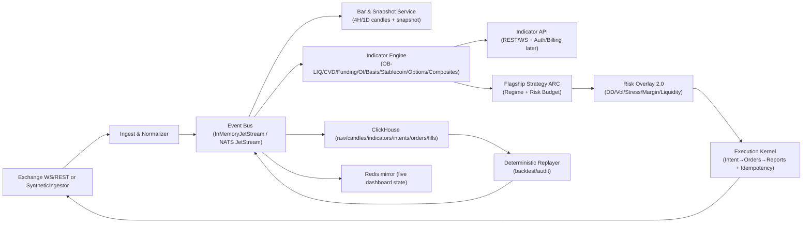

# ZenQuant 4.0 — Indicator‑First, Deterministic Crypto Quant Kernel (BTC/ETH • 4H/1D)

> **Codename:** `zen-alpha-v1`  
> **Positioning:** a *deterministic* event‑driven quant kernel + **indicator subscription service** + a **flagship 4H/1D strategy** designed to capture *large volatility* moves in major coins (BTC/ETH; optional SOL/BNB).  
> **Not HFT:** Alpha decisions are made at **4H / 1D bar close**; higher‑frequency data is used only for **risk triggers** and **execution slicing**.

---

## Why this repo exists

Most open-source trading repos can backtest, but fail when moving from backtest → replay → live:

- hidden lookahead (time alignment bugs)
- inconsistent feature definitions
- strategy code bypassing risk
- “it worked in backtest” execution assumptions
- impossible audit when users ask “why did it trade here?”

ZenQuant’s core requirement is:

> **Deterministic behavior across simulation, replay, and live-like runtime paths.**  
> Same event stream + same indicator version → same decisions.

This is a rewrite/upgrade of the ZenQuant 3.0 MVP into an **indicator-first** product architecture:
- Sell **indicators & market regime dashboards** (membership)
- Run a **single flagship strategy** on major coins and publish a real account track record (exchanges’ native copy-trade is optional, but the platform itself is *not* a copy-trade platform)

---


## Business model (strategy-first)

This project is **strategy-first**, not “indicators-first” in isolation:

- The *primary* growth driver in crypto is **a flagship strategy that makes money** (a credible track record).
- Members join mainly to **follow/copy** the real account (via exchanges’ native copy-trade), and the website’s indicators become a **supporting product** that increases trust, understanding, and retention.
- Therefore Phase 1 success criteria are:
  1) a robust, auditable BTC/ETH perp strategy on **4H/1D** that can **size up in big-volatility regimes**, and  
  2) an indicator dashboard that explains *why* the strategy is allowed to size up (regime + risk budget).

Indicators are built to serve the flagship strategy and the member dashboard—not to be sold as standalone “magic predictors”.


## What we build first (focus)

**Phase‑1 goal:**  
✅ A *profitable* flagship strategy on BTC/ETH (4H/1D) **+** a set of paid indicators with a front-end dashboard.

**Everything else** (multi-venue SOR, options specialist, cross-asset portfolio factory, etc.) is a later phase.

---

## Key concepts (non-negotiable invariants)

1) **Bar‑close decisions (4H/1D):**  
   All directional decisions happen only on `clock.bar_close.{4h|1d}`.

2) **Intent → Execution separation:**  
   Strategy outputs **TargetPosition** (target notional/leverage & constraints), not “submit order”.

3) **Risk overlay can rewrite intent:**  
   Risk is not only “order rejection”, it can *reduce leverage*, switch to reduce‑only, or freeze new exposure.

4) **Point‑in‑time indicators:**  
   Every indicator output includes:
   - `cutoff_time` (data watermark)
   - `indicator_version` + `formula_hash`
   - `quality_flags` (missing/late/outlier)

5) **Replay parity:**  
   The replay tool must reproduce:
   - indicator streams
   - strategy intents
   - execution reports
   with identical ordering and deterministic state transitions.

---

## Repository scope: what’s implemented vs planned

> This repo is a **reference implementation + production blueprint**.  
> The MVP runs locally with an in-memory bus + synthetic market data, then upgrades to exchange adapters & persistence.

### Implemented (current MVP baseline)
- In-memory subject-based event bus (JetStream-like)
- Synthetic multi-venue trade/L2/funding/OI generator
- Bar/Clock + Snapshot services (`clock.bar_close.*`, `md.candle.*`, `md.snapshot.*.{symbol}`)
- Indicator Pack v1 engine + API (`/api/indicators/latest`, `/api/indicators/history`, `WS /ws/indicators`)
- ARC strategy producing `TargetPosition` + reason stream
- Risk Overlay + execution kernel consuming final intents and emitting deterministic reports
- Deterministic replayer
- FastAPI + WebSocket web console dashboard
- Unit tests for determinism/risk/API paths

### ZenQuant 4.0 additions (this README defines the target)
- Bar/Clock service (**4H/1D candle + snapshot**)
- Indicator engine + indicator API for members (WS/REST)
- Flagship strategy **ARC** (Adaptive Regime Core) outputs TargetPosition
- Risk Overlay 2.0 (DD/vol/stress/crowding) controlling leverage
- ClickHouse indicator/intents schema + replay loader (production path)

---

## System architecture

### Runtime graph (ZenQuant 4.0 target)



### Core dataflow (high level)

1) `md.*` events (trades/book/funding/OI/options/stablecoin)  
2) `clock.bar_close.*` → `md.candle.*` + `md.snapshot.*.{symbol}`  
3) `indicator.*` computed point-in-time  
4) `intent.target_position.*` emitted by strategy  
5) `risk.overlay.*` may rewrite intent  
6) `exec.order.*` submit/ack/fill/reject  
7) persisted to ClickHouse + replayable

---

## Event subjects (recommended)

### Market data & clock
- `md.trade.{venue}.{symbol}`
- `md.book.{venue}.{symbol}`
- `md.funding.{venue}.{symbol}`
- `md.oi.{venue}.{symbol}`
- `md.options.{venue}.btc` (optional)
- `md.stablecoin.supply` (optional)
- `clock.bar_close.4h`
- `clock.bar_close.1d`
- `md.candle.4h.{symbol}`
- `md.candle.1d.{symbol}`
- `md.snapshot.4h.{symbol}` / `md.snapshot.1d.{symbol}`

### Indicators (paid product stream)
- `indicator.pack.v1.4h.{symbol}`
- `indicator.pack.v1.1d.{symbol}`
- `indicator.composite.4h` / `indicator.composite.1d`
- `indicator.alerts` (stress / data quality / regime changes)

### Strategy intents (flagship)
- `intent.target_position.{portfolio}.{symbol}`
- `intent.reason.{portfolio}` (human-readable reasons for audit)
- `strategy.regime.{portfolio}`

### Execution & risk
- `risk.overlay.decision`
- `risk.snapshot`
- `exec.order.submit`
- `exec.order.report`

---

## Indicator Pack v1 (paid)

> **Perp-first（合约优先）:** Phase 1 默认以 **USDT 永续合约** 为主（带单最核心），现货仅作为 **指标/基准** 的辅助数据源；现货交易执行与 spot-based 套利放到后续阶段。

### Data sources (Phase 1 minimal set)

**Exchanges**
- **Binance USDT-M Perpetual** (primary)
- **OKX Perpetual** (secondary, for cross-venue robustness)

**Data types (Perp-first MVP)**
- Trades (for CVD, volume, realized vol)
- L2 Orderbook (top N levels or depth bands, for OB‑LIQ)
- Perp funding rate (sentiment/crowding)
- Open interest (OI) (crowding weighting / risk)
- Mark price / index price (risk proxies)
- Perp klines (optional; recommended to build your own 4H/1D bars from trades for determinism)

**Optional (Phase 2+)**
- Spot prices (reference/benchmark; not required for execution)
- Deribit options (skew/term structure stress signals)
- Stablecoin supply / USDC-USDT premium (liquidity tide)

---

## Data → Indicators matrix (Indicator Pack v1)

> 每个指标都必须是一个**可版本化数据产品**：`cutoff_time + indicator_version + formula_hash + quality_flags + coverage`。  
> 指标计算以 `md.candle.*` + `md.snapshot.*.{symbol}` 为输入（point‑in‑time），保证 replay parity。

### Phase 1 indicator list (sellable + strategy-ready)

| Indicator | Purpose | Required Data | Phase 1 Sources | Update | Degrade / Fallback |
|---|---|---|---|---|---|
| `SwingStructure` | **[NEW]** trend structure (HH/HL/LH/LL), breakout detection | OHLC (candle history) | Binance (primary) | bar_close | missing → fall back to CVD-only regime (lower confidence) |
| `Momentum_ROC` | **[NEW]** rate-of-change (N-bar), trend strength confirmation | candle close | Binance (primary) | bar_close | missing → reduce trend confidence by 20% |
| `Candle(4H/1D)` | deterministic decision anchor (point-in-time) | trades or klines | Binance+OKX (perp) | **bar_close** | venue down → use other; both down → freeze adds + flag |
| `RealizedVol` | risk budget (vol targeting), stress detect | candle close | Binance (primary) | bar_close | missing → lower `lev_cap`, `reduce-only` if stressed |
| `ATR / Range` | stops, range filters | OHLC | Binance (primary) | bar_close | missing → disable range module, keep trend-only low lev |
| `OB_LIQ_z` | orderbook liquidity imbalance (range/turning risk) | L2 book | Binance+OKX | 1–5s sample → **snapshot @ bar_close** | `BOOK_STALE`/coverage low → ignore OB‑LIQ; range heavy bets disabled |
| `Overall_OB_LIQ_z` | market-wide liquidity (index) | OB_LIQ basket | Binance+OKX | bar_close | coverage < threshold → suppress overall; publish per-symbol only |
| `CVD_slope(4H/1D)` | market-order trend pressure; anti-fade filter | trades (+ aggressor side) | Binance+OKX | 1–5s agg → bar_close | if side inference unreliable → lower weight; avoid contrarian heavy bets |
| `funding_oi_weighted` | cross-venue crowding; leverage discount | funding + OI | Binance+OKX | 1–5min poll/WS → bar_close | missing OI → use funding avg; apply conservative `lev_cap` |
| `ZenPulse(0..100)` | composite dashboard score (tactical) | above components | Binance+OKX | bar_close | missing component → auto reweight + emit `components/weights/coverage` |

#### NEW: `SwingStructure` indicator (Phase 1, strategy-critical)

The regime engine and trend module both require price-structure awareness. Without it, the system is blind to whether price is making higher-highs or lower-lows — it only sees flow (CVD) and volatility.

**Definition:**
- Detect swing pivots using N-bar lookback (default: N=3 for 4H, N=2 for 1D).
- A **swing high** is confirmed when bar[i] has `high > high[i-1]` and `high > high[i+1]` ... for N bars on each side (lagged by N bars for point-in-time safety).
- Track the last 4 swing points: `[SH_prev, SL_prev, SH_curr, SL_curr]`.
- Output:
  - `structure_state`: `UPTREND` (HH+HL) / `DOWNTREND` (LH+LL) / `NEUTRAL` (mixed)
  - `last_swing_high`, `last_swing_low` (price levels for stop placement)
  - `structure_break`: boolean — true on the bar where structure flips
  - `bars_since_break`: count since last structure change

**Event:** `indicator.swing_structure.{tf}.{symbol}`

**Why this is non-negotiable for 4H+ profitability:**
- On 4H/1D timeframes, trend-following edge comes from riding structural trends, not from reacting to flow spikes.
- CVD slope alone can spike on a single large market order and revert — structure doesn't lie as easily.
- The trailing stop needs swing levels as anchors (stop below last swing low in uptrend).

#### NEW: `Momentum_ROC` indicator (Phase 1, simple but high-value)

**Definition:**
- `roc_n = (close - close[n]) / close[n]` for configurable N (default: 6 for 4H = 24h lookback, 5 for 1D).
- Normalize to z-score over rolling window (same robust z as other indicators).
- Output: `momentum_roc`, `momentum_roc_z`

**Purpose:**
- Confirms trend strength independently of CVD (price-based vs flow-based).
- Used in regime classification: `TREND` requires `abs(momentum_roc_z) > 0.8` OR `swing_structure = UPTREND/DOWNTREND`.
- Used in ZenPulse composite as additional trend component.

#### Fix: `RealizedVol` annualization unit mismatch

> **Current code issue (`indicator/engine.py:285-304`):** annualizer = `sqrt(365 * bars_per_day)`. For 4H bars, `bars_per_day = 6`, so annualizer = `sqrt(2190) ≈ 46.8`. This is correct for annualized vol, but the strategy's `target_vol_4h = 0.025` is ambiguous — is this annualized or per-bar? If per-bar, the vol-budget calculation `target_vol / realized_vol` is comparing per-bar target to annualized realized, which is a unit mismatch that makes leverage ~47x too small.

**Required clarification in README + code:**
- Explicitly state: all vol numbers are **annualized**.
- Typical crypto vol-target for a 4H strategy aiming for moderate leverage: `target_annual_vol ≈ 0.40` (40% annualized).
- Current `0.025` is almost certainly a per-bar number being compared to an annualized number.
- Add a unit comment in `IndicatorEngineConfig` and `ARCStrategyConfig`.

#### Fix: `ZenPulse` composite — degraded component handling

> **Current code (`indicator/engine.py:326-353`):** weights are hardcoded `{trend: 0.33, liquidity: 0.23, crowding: 0.22, volatility: 0.22}`. When a component is missing (quality degraded), the code applies a flat penalty but does NOT redistribute weights to surviving components.

**Required fix:** when a component is flagged as degraded:
- Set its contribution to neutral (0.5) instead of using the degraded value.
- Redistribute its weight proportionally to surviving components.
- Publish `effective_weights` in the IndicatorPack so the dashboard shows what's actually driving the score.

**Implementation notes (recommended defaults)**
- **Robust normalization:** rolling `median + MAD` z-score; clip extreme tails before composing indices.
- **Coverage-aware aggregation:** for funding/OI across venues, publish `venue_count`, `oi_coverage`, `staleness_ms`.
- **Hysteresis thresholds:** enter/exit bands to avoid “signal chattering” (esp. OB‑LIQ & composites).

---

## Development order (Phase 1: profit + sell indicators)

> “最快闭环 + 最能卖钱 + 最能提升策略稳定性”的顺序。

### Step 0 — Contracts & determinism (today)
- Standardize envelope: `event_time`, `ingest_time`, `venue`, `symbol`, `stream_seq`, `schema_version`
- All indicator outputs must include: `cutoff_time`, `indicator_version`, `formula_hash`, `quality_flags[]`, `coverage{...}`

### Step 1 — Show something on UI fast (1–2 weeks)
1. `Clock + BarBuilder` for **4H/1D** (`clock.bar_close.*`, `md.candle.*`)
2. `SnapshotBuilder` (`md.snapshot.*.{symbol}`) from book/trades/funding/OI (perp-first)
3. Indicator API:
   - `GET /api/indicators/latest`
   - `GET /api/indicators/history`
   - `WS /ws/indicators` (push on bar_close)

### Step 2 — Core sellable indicators (2–4 weeks)
4. `funding_oi_weighted` + crowding states
5. `CVD_slope` (trend filter)
6. `OB_LIQ_z` (with strict quality flags)
7. `ZenPulse` composite (transparent components)
8. **[NEW]** `SwingStructure` (pivot detection + structure state)
9. **[NEW]** `Momentum_ROC` (rate-of-change z-score)

### Step 2.5 — Backtest evaluation pipeline (MUST before Step 3)

> **Current gap:** the README defers evaluation discipline to Phase 2/research, but without a proper backtest pipeline, Step 3 (strategy) is flying blind. You cannot tune entry/exit/sizing parameters without seeing walk-forward results. This is a Phase 1 blocker.

**Deliverables:**
1. **Historical data loader:** download Binance/OKX 4H/1D klines + funding + OI into ClickHouse (or local parquet for MVP). Minimum 2 years of BTC/ETH data.
2. **Replay-based backtest runner:** feed historical events through the existing `DeterministicReplayer` → full pipeline → collect `ExecutionReport` stream.
3. **Mark-to-market equity curve:** compute equity at every bar close (requires the PnL fix from Risk Overlay section).
4. **Metrics calculator (non-negotiable minimum):**
   - Net PnL, Sharpe ratio (annualized), Sortino ratio
   - Max drawdown (peak-to-trough), max drawdown duration
   - Win rate, avg win / avg loss, profit factor
   - Regime-conditional performance: Sharpe in TREND vs RANGE vs STRESS periods
   - Turnover (trades/day), total fees paid, fee drag as % of gross PnL
   - **Tail risk:** expected shortfall (ES) at 5th percentile of daily returns
5. **Walk-forward harness:**
   - Train window: 12–18 months, test window: 3 months, roll forward by 3 months.
   - Report out-of-sample metrics for each fold + aggregate.
   - Flag if any fold has Sharpe < 0 or max DD > 25%.
6. **Parameter sensitivity report:**
   - Vary key parameters (stop_atr_mult, target_vol, crowding_threshold, trend entry thresholds) by ±20%.
   - If Sharpe drops > 40% on any single parameter perturbation → flag as fragile.

**CLI entry point:** `zenquant-backtest --symbol BTCUSDT_PERP --start 2023-01-01 --end 2025-01-01 --walk-forward`

### Step 3 — Flagship strategy + production-grade risk (4–8 weeks)
8. **[UPDATED]** ARC v1 with multi-timeframe confluence (1D bias + 4H entry) + SwingStructure-based regime
9. **[UPDATED]** ARC v1 with stateful position tracking (entry price, trailing stop, pyramid count)
10. RiskOverlay 2.0: **mark-to-market PnL** + DD steps + vol shock + crowding discount + reduce-only
11. Execution slicing: simple TWAP/participation caps (not too many child orders; copy-trade-friendly)
12. **[NEW]** Run walk-forward backtest on 2+ years BTC/ETH data; iterate until out-of-sample Sharpe > 0.8

---

## UI (keep it simple first)

Phase 1 UI should be minimal but *trustworthy*:

- Candle chart (4H/1D)
- A small panel showing:
  - `ZenPulse`, `regime`, `lev_cap`
  - `funding_oi_weighted` + `crowding_state`
  - `CVD_slope`
  - `OB_LIQ_z` (with `book_age_ms`, `venue_count`, `quality_flags`)
- Alerts timeline:
  - `STRESS`, `BOOK_STALE`, `MISSING_OI`, `VENUE_DOWN`
- A “why” card (optional): last bar-close `intent.reason` summary

No drag/drop, no complex layout required in Phase 1 — optimize for **clarity + auditability**.


> Design principle: **don’t sell “magic predictors”**.  
> Sell **market state** (trend/range/stress), **risk budget**, and **crowding/liquidity context** that is strongly related to long/short edge.

The pack is *inspired by* CoinKarma’s indicator taxonomy (LIQ/Overall LIQ, CVD, OI‑weighted funding, rolling APY, stablecoin supply, USDC/USDT premium, options skew/term structure, Market Pulse/Karma Index) but implemented with our own **transparent, versioned, point‑in‑time** formulas.

### Indicator engineering notes (research/production grade)

This repo treats indicators as **versioned data products**, not ad-hoc chart toys.

**Point-in-time & watermark**
- Every indicator is computed from `md.candle.*` + `md.snapshot.*.{symbol}` built at bar-close.
- `cutoff_time` (watermark) defines exactly which upstream events are included.
- Late/out-of-order data is handled deterministically (either into next bar or flagged).

**Robust normalization**
- Use robust z-scores (`median` + `MAD`) instead of mean/std where outliers are common
- Clip/winsorize extreme tails before composing indices
- Add hysteresis (enter/exit thresholds) to avoid signal chattering

**Cross-venue aggregation**
- Aggregate funding/OI across venues with *coverage-aware* weights:
  - weight by OI (for sentiment) / depth (for liquidity) / volume (fallback)
- Publish `coverage` metrics so the UI can display “data quality: 70% venues covered”

**Data-quality as first-class output**
- Every indicator carries `quality_flags` (e.g., `BOOK_STALE`, `MISSING_OI`, `VENUE_DOWN`)
- Strategy & risk overlay read those flags to auto-degrade risk:
  - missing OI → crowding discount disabled (conservative)
  - stale book → OB-LIQ ignored (conservative)

**Evaluation discipline (avoid overfitting)**
- Use walk-forward + purged/embargoed splits for any supervised labeling
- Report not only Sharpe, but also max drawdown, tail metrics (e.g., ES), and turnover/cost sensitivity
- Track drift: when indicator distributions shift, alert + lower confidence in composites

### 1) OB‑LIQ (Orderbook Liquidity Imbalance, per symbol)
**Goal:** quantify “how expensive it is to push price up vs down” using L2 depth.

**Compute (concept):**
- Take multiple price bands around mid (e.g., ±0.10%, ±0.25%, ±0.50%, ±1.0%)
- Compute depth imbalance `I = log(bid_depth / ask_depth)`
- Standardize by **robust** rolling stats (median + MAD) to resist outliers
- Output `ob_liq_z` + `state` (HIGH/LOW/NEUTRAL)

**Notes:**
- OB‑LIQ is most useful in **ranging** regimes; it can “go dull” in strong trends.
- Always publish `quality_flags`: book staleness, missing depth, venue coverage.

### 2) Overall‑LIQ (market-wide liquidity)
**Goal:** capture “whole market liquidity” rather than one coin.

**Compute (concept):**
- Aggregate OB‑LIQ across an index basket (BTC/ETH + majors) with weights:
  - market-cap (preferred) or volume weights (fallback)
- Output `overall_liq_z`

### 3) CVD (Cumulative Volume Delta, per symbol)
**Goal:** measure **market-order** buy vs sell pressure during a trend.

**Compute (concept):**
- For each trade, infer aggressor side (exchange side flag if available; else tick rule)
- `delta = +size` for buyer-initiated, `-size` for seller-initiated
- Aggregate into CVD per bar/time window; smooth with EWMA
- Output `cvd_slope`, `cvd_trend_state`

**Use:** trend confirmation + *anti-fade* filter for OB‑LIQ mean reversion.

### 4) Crowding: OI‑Weighted Funding (per symbol / market)
**Goal:** a better funding sentiment gauge by weighting by open interest.

**Compute (concept):**
- Across venues: `sum( funding_rate_v * oi_v ) / sum( oi_v )`
- Standardize to `funding_oi_z`
- Output crowding states: `LONG_CROWDED / SHORT_CROWDED / NEUTRAL`

**Use:** leverage discounting (avoid heavy leverage when crowding is extreme).

### 5) Carry: Basis Rolling APY (optional; best for BTC/ETH)
**Goal:** futures vs spot basis annualized → sentiment & carry conditions.

**Compute (concept):**
- `basis = (F - S) / S`
- `rolling_apy = basis * (365 / days_to_expiry)`
- Monitor regime drift (thresholds can shift after structural changes)

**Use:** crowding/sentiment context; avoid late-cycle leverage.

### 6) Stablecoin Liquidity Tide (optional)
**Goal:** market-wide liquidity inflow/outflow proxy.

**Compute (concept):**
- Track stablecoin circulating supply (USDT/USDC) + rate-of-change
- Produce `stablecoin_flow_state` (INFLOW/OUTFLOW/FLAT)

**Use:** cycle context; risk budget modulation.

### 7) USDC/USDT Premium (optional)
**Goal:** short-term funding pressure / settlement demand proxy.

**Compute (concept):**
- `premium = price(USDC) / price(USDT) - 1`
- Output `premium_state` and alert on sign flips.

**Use:** risk-off gating; helps interpret short-term stress.

### 8) Options Stress (optional; Deribit)
**Goal:** detect stress regimes from options market (not a direct buy/sell trigger).

**Metrics:**
- `25Δ skew` (put IV - call IV at ±0.25 delta)
- `term_structure_slope` (short-tenor ATM IV - long-tenor ATM IV)
- Output `options_stress_state`: NORMAL/WARNING/INVERTED_STRESS

**Use:** tail-risk gating (reduce leverage / freeze new exposure).

### 9) Composite Indices: ZenPulse & CycleIndex
**Goal:** package multiple indicators into an interpretable dashboard number.

**Rules:**
- Index range 0..100
- Always publish component breakdown for transparency:
  - `components[]`, `weights[]`, `version`
- ZenPulse: tactical (4H/1D)
- CycleIndex: macro (1D/1W)

---


## Research-backed modules (practical, 4H/1D-friendly)

> These are **not** “hard research projects”. Each item below is implementable with a small code footprint, and is extremely useful for a strategy that wants to **size up only in the right regimes**.

### 1) Regime engine upgrades (Phase 2, high ROI)

**Why:** correlations and market behavior in crypto are regime-dependent. A regime engine is the most reliable way to avoid over-leveraging in the wrong environment.

**Implementable options (pick one to start):**
- **HMM / Markov switching (2–3 states)** on (returns, realized vol, trend strength): outputs `P(TREND)`, `P(RANGE)`, `P(STRESS)`.
- **Change-point detection** on realized vol and/or rolling beta/corr: detects structural breaks and triggers `risk_off` or leverage caps.

**Deliverables:**
- `indicator.regime.probabilities` (per bar close)
- `risk.overlay.regime_gate` (uses regime probabilities to cap leverage)

> MVP-friendly: start with *threshold + hysteresis* for states, then replace with HMM/change-point when stable.

### 2) Macro risk score (Phase 2, optional but valuable)

**Goal:** use Nasdaq / DXY / Treasury yields / Gold not as direction predictors, but as **risk-on/off gating** for leverage.

**Implementation (low complexity):**
- compute rolling `beta_BTC_vs_QQQ`, `beta_BTC_vs_DXY`, `beta_BTC_vs_10Y_yield` (daily)
- apply a change-point detector / simple regime rule to decide when macro should influence `lev_cap`
- output `macro_risk_score ∈ [0,1]` that only scales leverage, never forces direction

### 3) Evaluation discipline (must-have for any “heavy bet on big moves” strategy)

To avoid “looks great in backtest, dies in production”:
- **walk-forward** evaluation by time blocks (e.g., train 12–18 months, test 3 months, roll)
- if using supervised labels: **purged/embargoed splits** (avoid leakage from overlapping horizons)
- always report:
  - max drawdown, tail metrics (ES/expected shortfall proxy), turnover, fee/slippage sensitivity
  - regime-conditional performance (TREND vs RANGE vs STRESS)

### 4) Capacity / slippage model (Phase 1.5, protects the track record)

When the strategy becomes popular, edge can be eaten by impact.
- estimate per-bar max participation and impact from orderbook depth + volume
- enforce `max_trade_notional_per_bar` and `max_participation_rate`
- publish these limits in the dashboard (build trust + avoids overpromising)


## Flagship strategy (ARC v1): Adaptive Regime Core (4H/1D)

**Objective:** capture big volatility moves while allowing *selective* heavy exposure in the right regime, but maintain long-run survival.

### 0) Multi-timeframe confluence (4H ↔ 1D)

> **Current gap:** the code treats 4H and 1D as independent signal paths — each bar close produces its own IndicatorPack → TargetPosition with no cross-reference. This means a 4H TREND-LONG can fire while 1D is RANGE or even bearish, leading to whipsaw entries against the dominant structure.

**Required design (Phase 1 must-have):**

| Layer | Timeframe | Role |
|---|---|---|
| **Directional bias** | 1D | Sets the *allowed direction*: LONG-only / SHORT-only / FLAT |
| **Entry timing** | 4H | Triggers entry/add/exit within the 1D-allowed direction |
| **Risk gating** | Both | 1D regime gates max leverage; 4H regime gates per-bar action |

Rules:
- If 1D regime = STRESS → 4H is forced reduce-only regardless of its own regime.
- If 1D direction = LONG → 4H SHORT entries are blocked; only 4H LONG entries or flat allowed.
- If 1D regime = RANGE and 4H regime = TREND → use reduced confidence (e.g., `conf *= 0.6`).
- Strategy must subscribe to both `indicator.pack.v1.4h.*` and `indicator.pack.v1.1d.*` and maintain a `DirectionalBias` state per symbol.

**Event contract addition:**
- `strategy.bias.1d.{symbol}` — publishes `{direction: LONG|SHORT|FLAT, regime: ..., confidence: ...}` on every 1D bar close.
- 4H strategy logic reads the latest 1D bias before computing its own TargetPosition.

### 1) Regime Engine (state machine)
States:
- **TREND:** structure breaks + CVD confirms (momentum-driven)
- **RANGE:** structure stable + liquidity extremes (mean-reversion-friendly)
- **STRESS:** volatility/liq/options stress (risk-off)

Outputs:
- `regime` + `confidence`
- `allowed_actions` (add, hold, reduce-only)

> **Current gap (code):** regime classification in `strategy/engine.py:108-132` uses only `cvd_slope` magnitude and `zen_pulse` with fixed thresholds. There is no price-structure input (higher-highs/lower-lows, swing detection). This means the regime engine cannot distinguish a genuine breakout from a CVD spike inside a range.

**Upgrade — add structure-based trend detection:**
- Compute `swing_high` / `swing_low` from the candle history (e.g., N-bar pivot detection, N=3 for 4H, N=2 for 1D).
- TREND entry requires: `new swing_high > prev swing_high` (uptrend) or `new swing_low < prev swing_low` (downtrend), **AND** CVD confirms.
- TREND exit (→ RANGE): structure break = price closes below the last swing_low (for uptrend) by more than a noise filter (e.g., 0.5 × ATR).
- This replaces the current `trend_strength = min(1.0, abs(cvd_slope) * 10.0)` which is purely flow-based and has no structural anchor.

**New indicator required:** `swing_structure` — see indicator upgrades below.

### 2) Trend module (captures big moves)

**Entry (concrete rules, not vague):**
- Trigger: 4H bar close where `swing_structure` confirms new HH/LL **AND** `cvd_slope` sign matches **AND** 1D bias allows direction.
- Filter: `funding_oi_z` < crowding threshold (avoid entering at peak crowding).
- Confirmation: `zen_pulse >= 55` (avoid low-conviction entries).

**Pyramiding (add to winners):**
- Allowed only when: price has moved ≥ 1.0 × ATR in favor since last entry, **AND** regime is still TREND, **AND** drawdown < DD_STEP_1.
- Each pyramid reduces size: `add_size = base_size × 0.5^(pyramid_count)`.
- Max pyramid layers: 3 (total max = 1 + 0.5 + 0.25 + 0.125 = 1.875× base).
- Publish `reason_code: PYRAMID_ADD_N` for audit.

**Exit (the most critical missing piece):**
- **Trailing ATR stop:** initial stop = entry_price − direction × `stop_atr_mult` × ATR (default `stop_atr_mult = 2.5`). Trail: on each favorable bar close, ratchet stop to `max(current_stop, close − direction × trail_atr_mult × ATR)` where `trail_atr_mult = 2.0`.
- **Structure break exit:** if `swing_structure` flips (e.g., uptrend but new LL confirmed) → exit at next bar close regardless of stop.
- **Regime flip exit:** if regime transitions TREND → STRESS → immediate reduce-only; TREND → RANGE → tighten stop to `1.5 × ATR` and exit if hit within 2 bars.
- **Time decay exit:** if position held > `max_hold_bars` (default 30 for 4H = 5 days) without making new HH/LL → exit 50% at market, tighten stop on remainder.

> **Current gap (code):** `strategy/engine.py` has zero exit logic. Every bar close recomputes `target_qty` from scratch based on current indicators. There is no trailing stop, no structure break detection, no concept of "current position entry price". The strategy is effectively a "rebalance to target" system with no memory of where it entered — this destroys edge on 4H timeframes because it will flip-flop on every bar.

**Required state additions to `ARCStrategyEngine`:**
```
_open_positions: dict[str, OpenPositionState]  # entry_price, entry_bar, pyramid_count, trailing_stop, direction
```

### 3) Range module (optional; carefully constrained)
- Entry: OB‑LIQ extreme + price stretched, **only if CVD does not show strong trend**
- Breakout kill rule: if breakout + vol expands → exit mean reversion positions immediately
- This module is where many systems die; we keep it conservative by default.

> **Recommendation:** disable range module entirely in Phase 1. The current code already has range logic (`_direction` returns mean-reversion signal when `abs(cvd_slope) < 0.03 and abs(ob_liq_z) > 1.2`), but without proper structure detection this will generate losing trades in trending markets. Enable only after swing_structure indicator is proven and backtested.

### 4) Position sizing = risk budget (not "signal excitement")
Target leverage/notional is computed from:
- `vol_target / realized_vol`
- regime confidence
- crowding discount (funding/basis/skew)
- drawdown throttle (DD steps)
- stress throttle
- **[NEW] 1D bias alignment discount:** if 4H direction matches 1D bias → full size; if 1D is FLAT → 60% size; if misaligned → blocked.
- **[NEW] win-rate adaptive sizing:** after N consecutive losses (e.g., 3), reduce base size by 30% for next 2 trades. Reset on first winner. (Simple anti-tilt, not curve-fitting.)

The output is always **TargetPosition**, never raw orders.

---

## Risk overlay 2.0 (survival-first)

Risk overlay operates *above* order-level RiskGuard:

- **Daily loss limit:** reduce leverage to a safe cap (not necessarily hard-stop)
- **Drawdown steps:** DD deeper → lower max leverage
- **Volatility shock:** realized vol spikes → reduce / freeze adds
- **Liquidity shock:** spread/depth deteriorates → reduce-only
- **Crowding extremes:** leverage discount; no "late-cycle" heavy exposure
- **Kill switch:** final hard-stop (exposure increase blocked)

### CRITICAL GAP: Mark-to-Market PnL

> **Current state (`risk/guard.py:162-171`):** equity only moves via `apply_fee()` deductions. There is NO mark-to-market PnL calculation. This means:
> - Drawdown is always monotonically increasing (fees only go one way)
> - The drawdown ladder triggers prematurely and never recovers
> - All risk decisions based on equity/drawdown are wrong in backtest and live
> - The strategy cannot "size up in big-volatility regimes" because the risk overlay will have already throttled leverage from accumulated fee-only drawdown

**Required fix (Phase 1 blocker — without this, no backtest result is meaningful):**

1. `RiskOverlay` must track `_positions: dict[str, PositionState]` with `entry_price`, `qty`, `direction`.
2. On every `indicator.pack` (which contains `last_price`), compute unrealized PnL:
   ```
   unrealized_pnl = sum(pos.qty * pos.direction * (current_price - pos.entry_price) for pos in positions)
   equity = starting_equity + realized_pnl + unrealized_pnl - total_fees
   ```
3. On every fill, update `realized_pnl` (close portion of position at fill price vs entry price).
4. `high_water_mark` updates only when `equity` makes a new high.
5. Drawdown = `(hwm - equity) / hwm` — this now correctly reflects actual portfolio performance.

**New domain model:**
```python
@dataclass(slots=True)
class PositionState:
    symbol: str
    qty: float           # signed: positive = long, negative = short
    avg_entry_price: float
    realized_pnl: float  # accumulated from partial closes
```

**New event:**
- `risk.equity.update` — published on every price update with `{equity, unrealized_pnl, realized_pnl, drawdown, hwm}`

### Additional risk enhancements for 4H+ profitability

**Correlation-aware exposure (Phase 1.5):**
- BTC and ETH are highly correlated (typically ρ > 0.7). If both are TREND-LONG, the portfolio is effectively 2× concentrated.
- Add: `portfolio_gross_leverage = sum(abs(lev) for all symbols)` cap (e.g., 4.0×).
- Add: if `rolling_correlation(BTC, ETH, 20bars) > 0.8` → treat combined exposure as single-asset and apply single-asset leverage cap.

**Intra-bar risk trigger (Phase 1):**
- The README says "higher-frequency data is used only for risk triggers" but neither the README nor code defines what these triggers are.
- Define: subscribe to `md.trade.>` in RiskOverlay. If price moves > `3 × ATR` within a single 4H bar (flash crash/pump), emit `risk.emergency.reduce` and force reduce-only until next bar close.
- This requires RiskOverlay to maintain `bar_open_price` per symbol per active bar.

---

## Frontend dashboard & indicator display

### What members see
- 4H/1D candles
- Indicator Pack v1 overlays
- Composite indices (ZenPulse/CycleIndex)
- Regime state (TREND/RANGE/STRESS) + leverage envelope
- Alerts timeline (risk-off, data quality, threshold crossings)
- (Optional) a “strategy intent” explanation feed (no “signals”, only reasons)

### API contracts (REST + WS)
Recommended endpoints:
- `GET /api/indicators/latest?symbol=BTCUSDT_PERP&tf=4h`
- `GET /api/indicators/history?symbol=BTCUSDT_PERP&tf=4h&from=...&to=...`
- `WS  /ws/indicators?symbol=BTCUSDT_PERP&tf=4h` (push on bar close)
- `GET /api/state` (positions, risk, last reports)

Example payload (indicator pack):

```json
{
  "ts": "2026-02-24T08:00:00Z",
  "symbol": "BTCUSDT_PERP",
  "tf": "4h",
  "cutoff_time": "2026-02-24T08:00:00Z",
  "indicator_version": "pack.v1",
  "formula_hash": "sha256:…",
  "quality_flags": ["OK"],
  "values": {
    "ob_liq_z": 2.8,
    "overall_liq_z": 1.6,
    "cvd_slope": 0.42,
    "funding_oi_z": 1.9,
    "basis_apy": 0.12,
    "stablecoin_flow": "INFLOW",
    "usdc_usdt_premium": -0.0004,
    "options_stress": "NORMAL",
    "zen_pulse": 72,
    "cycle_index": 54,
    "regime": "TREND",
    "regime_conf": 0.78,
    "lev_cap": 2.5
  }
}
```

### Frontend stack suggestion
- Keep the backend as **FastAPI** (already in repo)
- UI can stay minimal (existing web console) or upgrade to:
  - React/Next.js + TradingView Lightweight Charts (candles)
  - ECharts/Recharts for indicator panels

---

## Storage (ClickHouse) — minimum viable schema

Tables (recommended):
- `md_trades`, `md_orderbook` (raw)
- `md_candles_4h`, `md_candles_1d`
- `indicators_pack_v1` (point-in-time)
- `strategy_intents` (TargetPosition + reason codes)
- `risk_snapshots`
- `orders`, `fills`, `execution_reports`

A hard rule: **everything needed to reproduce a decision must be stored**:
- input snapshot id / cutoff_time
- indicator version + formula hash
- intent id & reason codes

---

## Deterministic replay & research workflow

1) **Ingest → persist event envelopes**
2) **Compute indicators point-in-time**
3) **Emit intents**
4) **Replay the exact stream** to reproduce:
   - indicators
   - intents
   - execution reports
5) Run evaluation with:
   - walk-forward tests
   - purged/embargoed CV for labels (avoid leakage)
   - slippage/fees models (capacity realism)

---

## Execution model gaps (must fix for realistic backtest + live)

> **Current state (`execution/gateway.py`):** the gateway is a pure mock — every order fills instantly at `mark_price` with zero slippage. The router (`execution/router.py`) has `max_trade_qty_per_bar` but no participation rate or impact model.

**Why this matters for 4H+ profitability:**
- On 4H bars, a single TargetPosition delta can be large (e.g., 0.5 BTC at 3× leverage on $100k equity). Filling this at mark_price with no slippage overstates backtest PnL.
- When the strategy "sizes up in big-volatility regimes", the fills are even larger — exactly when slippage is worst.
- Without a slippage model, backtest Sharpe is inflated and the strategy will underperform live.

**Phase 1 minimum viable execution model (for backtest realism):**

1. **Slippage estimator (simple, conservative):**
   - `estimated_slippage_bps = base_spread_bps + (trade_notional / avg_bar_volume) * impact_coefficient`
   - Default: `base_spread_bps = 1.0`, `impact_coefficient = 50.0` (calibrate from historical book data later).
   - Fill price = `mark_price * (1 + direction * slippage_bps / 10000)`.

2. **Participation rate cap:**
   - `max_participation = 0.05` (5% of bar volume).
   - If `trade_notional > max_participation * bar_volume` → split into multiple bars (carry unfilled portion to next bar close).
   - This prevents the backtest from assuming fills that would move the market.

3. **Fee model (already exists, but incomplete):**
   - Current: taker fee only. Add: maker fee for limit orders (Phase 2 when real exchange adapters exist).
   - Add: funding fee deduction — if holding a perp position across a funding interval, deduct `position_notional * funding_rate` from equity. This is a significant cost in crypto that the current system ignores entirely.

**New domain model addition:**
```python
@dataclass(slots=True)
class FillModel:
    base_spread_bps: float = 1.0
    impact_coefficient: float = 50.0
    max_participation_rate: float = 0.05
    taker_fee_rate: float = 0.0004
    maker_fee_rate: float = 0.0002
```

**Funding fee integration:**
- RiskOverlay subscribes to `md.funding.>`.
- On each funding update, compute: `funding_cost = abs(position_qty) * mark_price * funding_rate`.
- Deduct from equity (positive funding = long pays, negative = short pays, depending on sign convention).
- This is critical because in trending markets, crowded positions pay significant funding — the strategy's edge can be entirely eaten by funding costs if not modeled.

---

## Summary of critical gaps (priority-ordered)

> This section consolidates all gaps identified above into a single actionable checklist. Each item references the detailed section where the fix is specified.

### P0 — Without these, no backtest result is trustworthy

| # | Gap | Section | Impact |
|---|---|---|---|
| 1 | **No mark-to-market PnL** — equity only moves via fees | Risk Overlay 2.0 | All drawdown/sizing decisions are wrong; strategy cannot recover leverage after profitable trades |
| 2 | **No exit logic** — strategy recomputes target from scratch every bar with no memory | ARC v1 §2 Trend module | Destroys trend-following edge; causes whipsaw on every bar close |
| 3 | **No trailing stop / structure break exit** | ARC v1 §2 Trend module | Gives back all open profits on trend reversals |
| 4 | **Vol unit mismatch** — `target_vol` likely per-bar vs `realized_vol` annualized | Indicator Pack §Fix: RealizedVol | Leverage is ~47× too small or too large depending on interpretation |
| 5 | **No backtest pipeline** — cannot evaluate strategy before going live | Development order §Step 2.5 | Flying blind; no way to iterate on parameters |

### P1 — Without these, live performance will significantly underperform backtest

| # | Gap | Section | Impact |
|---|---|---|---|
| 6 | **No multi-timeframe confluence** — 4H and 1D are independent | ARC v1 §0 | 4H entries against 1D trend; whipsaw in ranging 1D markets |
| 7 | **No swing structure indicator** — regime is CVD-only | Indicator Pack §SwingStructure | Cannot distinguish breakout from flow spike; false TREND signals |
| 8 | **No slippage model** — fills at mark_price | Execution model gaps | Backtest Sharpe inflated; especially in "size up" regimes |
| 9 | **No funding cost model** — holding cost ignored | Execution model gaps | Edge eaten by funding in crowded trending markets |
| 10 | **No position state in strategy** — no entry_price, no pyramid tracking | ARC v1 §2 | Cannot implement pyramiding, trailing stops, or time-decay exits |

### P2 — Important for robustness, can follow after P0/P1

| # | Gap | Section | Impact |
|---|---|---|---|
| 11 | **BTC/ETH correlation exposure** — no portfolio-level leverage cap | Risk Overlay §Correlation | Effective 2× concentration when both trend same direction |
| 12 | **No intra-bar emergency risk trigger** | Risk Overlay §Intra-bar | Flash crash/pump can wipe out position before next bar close |
| 13 | **ZenPulse degraded component handling** — no weight redistribution | Indicator Pack §Fix: ZenPulse | Composite score biased when components are missing |
| 14 | **Range module enabled without structure detection** | ARC v1 §3 | Mean-reversion trades in trending markets = losses |

---

## Getting started

### Prerequisites
- Python `>= 3.11`

### Install
```bash
python3 -m pip install -e .
```

### Run local demo (synthetic market)
```bash
python3 -m zenquant.app.demo
# or
zenquant-demo
```

### Run web console
```bash
zenquant-web
```
Open: `http://127.0.0.1:8090`

### Run tests
```bash
python3 -m unittest discover -s tests -v
```

---

## Migration plan from ZenQuant 3.0 → 4.0 (pragmatic)

1) Add `Clock + BarBuilder` (4H/1D) and publish `md.candle.*`
2) Add `SnapshotBuilder` and publish `md.snapshot.*.{symbol}`
3) Implement `IndicatorEngine` producing `indicator.pack.v1.*`
4) Change strategy output contract:
   - from `AlphaSignal` → `TargetPosition`
5) Add `RiskOverlay 2.0` that can rewrite TargetPosition
6) Keep existing `ExecutionGateway + RiskGuard` but change router to consume intent deltas
7) Extend web console to show indicator panels (members view)

---

## Roadmap (prioritized for "profit + indicators")

### Phase 1A — Fix foundations (before any strategy tuning)
- [x] 4H/1D bars + snapshots
- [x] Indicator Pack v1 base: OB-LIQ, CVD, OI-weighted funding, ZenPulse
- [ ] **[P0] Mark-to-market PnL in RiskOverlay** (equity = realized + unrealized - fees)
- [ ] **[P0] Vol unit clarification** — ensure target_vol and realized_vol use same unit (annualized)
- [ ] **[P0] SwingStructure indicator** — pivot detection, structure state (HH/HL/LH/LL)
- [ ] **[P0] Momentum_ROC indicator** — rate-of-change z-score
- [ ] **[P0] Backtest pipeline** — historical data loader + replay-based runner + metrics calculator
- [ ] **[P0] Walk-forward harness** — train/test splits + out-of-sample reporting

### Phase 1B — Strategy with real edge
- [ ] **[P0] Stateful position tracking** in ARCStrategyEngine (entry_price, trailing_stop, pyramid_count)
- [ ] **[P0] Exit logic** — trailing ATR stop, structure break exit, regime flip exit, time decay
- [ ] **[P1] Multi-timeframe confluence** — 1D directional bias gates 4H entries
- [ ] **[P1] Pyramiding rules** — add to winners with decaying size, max 3 layers
- [ ] **[P1] Slippage + participation model** in execution gateway (for backtest realism)
- [ ] **[P1] Funding cost model** — deduct funding fees from equity on each funding interval
- [ ] **[P1] Disable range module** until SwingStructure is proven in backtest
- [ ] Walk-forward validation: out-of-sample Sharpe > 0.8 on 2+ years BTC/ETH

### Phase 1C — Dashboard + go-live
- [ ] Risk overlay 2.0 with all P0/P1 fixes
- [ ] Dashboard: indicator panels + alerts + intent explanations
- [ ] Real exchange adapters (Binance/OKX) + read-only public account page
- [ ] Paper trading validation: 4+ weeks matching backtest expectations

### Phase 2 — refine edge & robustness
- [ ] BTC/ETH correlation-aware portfolio leverage cap
- [ ] Intra-bar emergency risk triggers (flash crash/pump detection)
- [ ] ZenPulse degraded component weight redistribution
- [ ] Basis rolling APY (carry)
- [ ] Stablecoin tide + USDC/USDT premium
- [ ] Better regime detection (change-point / HMM)
- [ ] Capacity-aware execution (TWAP/POV + participation caps)

### Phase 3 — optional expansion
- [ ] SOL/BNB expansion
- [ ] Options stress (skew/term structure) via Deribit
- [ ] Portfolio-level allocation & hedging layer

---

## Disclaimer

This repository is **infrastructure + research code** for quantitative trading.
It is **not** investment advice. Crypto markets are highly volatile; any strategy may experience large drawdowns or liquidation if misused. Use at your own risk.
