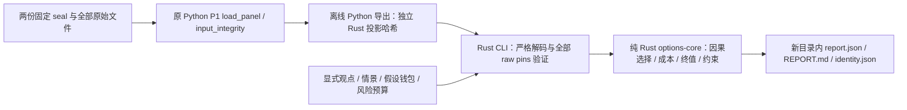

# Rust 离线期权工作台

**历史文档：**Rust 源码和 CLI 正在从当前工作树移除，下方路径、构建/运行命令及测试结果仅记录当时的实现与证据，不能在当前工作树直接使用。独立报价成本、到期情景和封存面板报告 CLI 没有等价 Go 命令。当前 Go/Svelte 期权及人工 paper 工作流见 [Go 运维说明](GO_OPERATIONS.md)；历史跨语言结果不代表移除后可重新运行差分测试或证明完整兼容。

这是 D2 的离线经济诊断工具：比较同一观点下的现金和四种买入期权表达，检查同平台 vertical 的静态终值约束。它不连接账户、不发订单。条件情景 EV 不是市场盈利证据。

2026-10-10 的后续集成修复已通过本地全仓 0/A/B/C/D/E/F 门禁；复跑命令、历史输入指纹和仍未验收的边界见 [集成修复报告](reports/options-workbench-gate-repair-20261010/README.md)。

2026-10-11 云端 Rust 迭代新增不需要 View 的独立报价成本入口，保留原 v1 观点/场景契约。Linux 实测和本轮边界见 [云端验收报告](reports/options-quote-diagnostics-20261011/README.md)。

同日继续增加独立单腿到期情景入口：只用规格和场景证据计算条件毛收益，报价及显式终值费用仅用于条件净损益。第一模块提交 `2866f86` 已推送，远端 [Rust CI](https://github.com/infdahai/zenQuant/actions/runs/38135176664) 通过。第二模块、消融和测试证据见 [单腿到期诊断验收](reports/options-terminal-diagnostics-20261011/README.md)。

后续独立模拟步骤：[意图记录](SIMULATED_INTENTS_RUST_GUIDE.md) 与 [资金及现金预留](SIMULATED_RESERVATIONS_RUST_GUIDE.md)。诊断输出不构成交易授权，仍需显式输入并重新验证；这些步骤不发订单，也不使用真实账户。



`options-core` 不访问文件、网络、时钟、环境或进程；Rust 可执行文件不调用 Python。Python 只负责一次离线数据导出。旧 Python P1、ledger、策略路径、golden 和历史产物保持原样。

## 运行

在本分支的仓库根目录执行；输出目录必须不存在。所有路径须先取真实路径：macOS `/tmp`、`/var` 是符号链接，应使用 `/private/tmp` 或 `Path.resolve()` 后的路径。原始参数含 `..` 或任何符号链接组件都会拒绝。

```sh
cargo +1.90.0 build --manifest-path rust/Cargo.toml --locked -p options-workbench
cargo +1.90.0 run --manifest-path rust/Cargo.toml --locked -p options-workbench -- \
  --request-file rust/options-workbench/fixtures/terminal-eth-call.json \
  --output-dir results/options_platform/new-call
```

另外两份完整输入是 [straddle](../rust/options-workbench/fixtures/terminal-eth-straddle.json) 和 [vertical](../rust/options-workbench/fixtures/terminal-vertical.json)。替换 `--request-file`，每次选一个新的输出目录即可。输入已明确写出资本、损失、钱包和全局预算；CLI 不按名称补造金融参数。

真实封存面板的导出需要原始仓库的 P1 loader 和固定数据目录同时存在。下面是在当前 Mac 上实际验证过的调用方式；父目录须先存在，导出文件须不存在。

```sh
cd /private/tmp
PYTHONPATH=/Users/disaster/workspace/code/zenQuant \
/Users/disaster/workspace/code/zenQuant/.venv/bin/python \
/Users/disaster/workspace/code/zenQuant/.worktrees/options-workbench-rust/scripts/export_options_workbench_panel.py \
  --panel-root /Users/disaster/workspace/code/zenQuant/results/crypto_opportunity/20261009_options_liquidity_panel_v1 \
  --output-file /Users/disaster/workspace/code/zenQuant/.worktrees/options-workbench-rust/results/options_platform/new-panel.json
```

导出脚本依原 loader 的源码位置确定允许根目录；上述导出不复制固定 P1 panel/scout 数据到 worktree，也不修改 loader pin。允许的 panel/scout seal 分别是 `b61d04c898cd53545e2bc95ffdede6da6861b18d602d49cb83d57eb52816423b` 和 `c35edb8ad23c8d958fe8f2383786f963160842c55ea8c3489e36efb96d25b983`。完整传输为 480 条报价、48 份规格、541 个文件和两份 seal，共 543 pins。Rust 用 linked-worktree 的 Git 上下文找到原始数据根目录，重新读全部文件；传输中的绝对路径不是读文件授权。

`--panel-file` 只能配合 `fixture_name=null`、`quotes=[]` 的显式请求。候选 descriptor 和 scenario 的 `spec_hash` 必须绑定导出中已归一化的 spec，观点哈希必须绑定实际观点。实际验收请求在 `results/options_platform/rust_d2_execution_20261010/task5/sealed-request.json`；对应面板为 `sealed-panel.json`。在证据目录保留这些文件时可直接执行：

```sh
rust/target/debug/options-workbench \
  --request-file results/options_platform/rust_d2_execution_20261010/task5/sealed-request.json \
  --panel-file results/options_platform/rust_d2_execution_20261010/task5/sealed-panel.json \
  --output-dir results/options_platform/new-sealed-diagnostic
```

原 v1 入口接受 `--request-file PATH --output-dir PATH [--panel-file PATH]`；新增独立入口见下节，三种请求模式互斥。退出码 2 表示输入/预检拒绝，1 表示发布未完成或发布后持久性未确认，0 表示诊断报告已完整发布；0 不代表交易成立。已有目标不会覆盖；Rust 使用原生 no-replace 目录发布，失败保留可辨认的 incomplete 目录。Python 导出使用同目录临时文件和独占 hard-link 发布，不覆盖目标；两边都限制读取量、拒绝原始 `..` 和符号链接、保护 source/output 重叠。

## 独立报价成本诊断

当问题只是“在给定时点与原生数量下，盘口显示的权利金、费用和换算总额是多少”，使用独立输入，不需要指标、观点、情景概率或假设账户预算。人工和算法均可生成相同契约，来源不授予执行权限。

在仓库根目录执行以下命令。`rust/rust-toolchain.toml` 固定已验证的 Rust 1.90.0；首次需要 rustup、C 链接器及下载工具链/锁定依赖所需的网络。构建、原生测试和这个诊断运行均不需要 Python。

```sh
cd rust
cargo build --workspace --locked
cargo run --locked -p options-workbench -- \
  --quote-request-file options-workbench/fixtures/quote-costs.json \
  --output-dir results/options_platform/new-quote-costs
```

该示例在 `rust/results/options_platform/new-quote-costs` 创建报告，目录必须不存在；不要在参数中使用 `..`，即使它最终指向允许位置也会被路径保护拒绝。

完整示例为 [quote-costs.json](../rust/options-workbench/fixtures/quote-costs.json)，类型和验证入口为 [quote_diagnostics.rs](../rust/options-core/src/quote_diagnostics.rs)。示例是数学输入，零值 raw/metadata hash 不是已验证的真实市场证据。

| 必填字段 | 契约 |
|---|---|
| `schema_version` | `options-quote-diagnostic-request.rust.v1` |
| `cutoff_ns`, `report_currency` | 显式纳秒截止和结果币种 |
| `requests` | 1–64 个独立诊断，每项唯一 `request_id` 和一条 `leg`：完整 instrument descriptor、BUY/SELL、精确十进制字符串 `quantity_native` |
| `quotes` | 0–512 条原有 `QuoteInput`；缺报价可报告，但不能以任意同名合约替代精确 spec hash |
| `source_identities` | 来源标签；允许空数组，不是原始字节认证 |

使用同一严格 JSON 解码器：拒绝未知字段、重复键、float、布尔代整数、尾随内容；1 MiB、深度/字符串/盘口层数及金额精度限制继续适用。`decode_request` 与 `analyze` 均执行结构准入，公开 typed 输入不会绕过重验。结构冲突（包括相同 spec/time 的冲突报价）拒绝整份请求。将 View 或 authority 等字段加到该 schema 也拒绝；原 `options-workbench-request.rust.v1` 仍要求 View 和绑定它的场景，没有放宽未知字段规则。

输出 schema 为 `options-quote-diagnostic-report.rust.v1`，仍原子发布 `report.json`、`REPORT.md` 和 `identity.json`。每项 `quote_diagnostics` 包含请求 hash、全输入 hash、所选完整报价 hash、状态和可选 `cost`。选择 received/available 已到截止时点的最新精确规格报价；更新但不可用的记录保留在输入及哈希中。选中记录缺费用时不会向旧报价借费率。知识时点、来源年龄、显式 FX/index、合法 lot/tick 和深度仍由现有成本计算器判断。

`cost.premium_native` 与 `fee_native` 均以 spec 的 quote currency 计价；`total_report_currency` 对 BUY 表示含费显示支出，对 SELL 表示扣费显示净收入。费用沿用现有显式模型 `min(rate × index × base_quantity, premium_cap × premium)`，不是交易所费率认证。示例数量 `0.01`、ask `2`、bid `1.9`、费用 `0.0003`，分别得到 `0.0203` 和 `0.0187`。每项独立，不做组合资金或成交净额推断。

缺少可见报价时 `cost=null`，状态为 `NOT_EVALUABLE`；缺费率/知识时间、过期或未来证据、深度不足时总额为 null，已能确定的权利金可保留。非法手数产生 `REJECTED`。报告成功退出也可能包含这些状态。UNKNOWN 行权/结算和 proxy 标签保持原值；显示成本可计算不代表终值模型支持该产品。所有账户/执行状态仍为 `UNVERIFIED`，无真实或模拟 PnL、收益率、容量或生命周期套利结论。

本入口只接收内联数据，拒绝与 `--request-file` 或 `--panel-file` 混用。它不读取输入中声称的源路径、不提供封存数据适配器，也不改变原 seal/pin 检查或受保护输出根目录。报告固定 `NOT_INDEPENDENTLY_VERIFIED` / `MANUAL_UNATTESTED`；即使传入 `sealed_proxy` 标签也不会变成原始来源验证。

## 独立单腿到期诊断

问题是“这条买入期权在这些到期交割价下会产生多少条件收益”。它不需要 View、指标、主观概率、假设钱包或风险预算；不自行选择买入标的、数量或交割价。独立版本只增加准入边界，复用已有精确数量、终值和显示成本计算。

从仓库根目录进入 `rust` 后运行；输出目录必须不存在：

```sh
cargo build --workspace --locked
cargo run --locked -p options-workbench -- \
  --terminal-request-file options-workbench/fixtures/terminal-call-scenarios.json \
  --output-dir results/options_platform/new-terminal-scenarios
```

完整数学示例见 [terminal-call-scenarios.json](../rust/options-workbench/fixtures/terminal-call-scenarios.json)，契约和纯函数见 [terminal_diagnostics.rs](../rust/options-core/src/terminal_diagnostics.rs)。构建、测试、运行均为 Rust；不读取外部源文件或 panel，不需要 Python。三个请求参数 `--request-file` / `--quote-request-file` / `--terminal-request-file` 严格互斥，只有旧 v1 可以配 `--panel-file`。

| 字段 | 新契约 |
|---|---|
| `schema_version` | `options-terminal-diagnostic-request.rust.v1` |
| `request_id`, `cutoff_ns`, `report_currency` | 显式请求身份、证据截止和币种 |
| `leg`, `spec` | 一条原生数量的腿、完整且完全匹配 descriptor/spec hash 的规格 |
| `metadata_known_ns` | 规格知识时点；可为 null，缺失或晚于截止时不可计算毛收益 |
| `scenarios` | `options-terminal-scenarios.rust.v1` 的 `RecordMeta`、精确 `spec_hash`、1–64 个唯一 ID / `at_ns` / `delivery_price`；只接收 revision=1 的独立快照，不接受未验证修订链 |
| `quotes` | 0–512 个原有 `QuoteInput`，均须属于这一个精确规格；空数组仍可计算毛收益 |
| `terminal_fee` | null 或 `{amount_report, known_ns, source_ref}`；金额是整条腿在报告币种下的显式终值总费用假设，并非费率或每单位费用 |
| `source_identities` | 可为空的来源标签，不等于原始字节验证 |

仅支持 `BUY`、线性 European、`LinearCash` 或 `LinearViaFuture` 的原有现金等价终值域。quote/strike/settlement/margin/report 币种须一致；规格在截止时点已知、在到期仍有效、fixing 明确、数量符合原生 lot/step。所有场景必须恰好在同一规格的到期时点，且分析截止早于到期；交割价非负。`LinearViaFuture` 只表示到期现金等价数学，不建模未来合约事件或账户权限。

设转换后的 base quantity 为 Q，strike 为 K，场景交割价为 S：call 毛收益 `max(S-K,0)×Q`，put 毛收益 `max(K-S,0)×Q`。合同数量按规格 multiplier 转换；所有金额、数量和计算均为有界精确十进制，不用 float、不四舍五入。只有显示开仓总成本和截至分析时点已知的终值总费用假设都完整，才计算 `conditional_model_pnl = gross_payoff - opening_cost - terminal_fee`。不对场景设置概率，不计算 EV 或持有期估值。

输入结构、hash、重复身份、知识时序、未知字段、float、超精度、超限或冲突报价错误拒绝整份请求，且不创建输出目录。可解码但不支持的产品、SELL 或任意非到期场景产生 `UNSUPPORTED` 且整组 payoff=null；缺规格知识/有效期/fixing 产生 `NOT_EVALUABLE`；不合法 lot 产生 `REJECTED`。报价或费用证据缺失/迟到/不完整只使 `net_status` 不可评估、净值为 null，已可确定的毛收益保留。独立显示成本可在终值不支持时保留，它不证明支持终值或执行。

输出 `options-terminal-diagnostic-report.rust.v1`，模型 `single_paid_long_terminal.rust.v1`。`terminal_diagnostic` 包含全输入/规格/场景/所选报价 hash、状态列、独立成本、净值状态和各场景结果。重放同一输入逐字节一致；原始输入 hash 与规范化输入 hash 分列。原子发布、输出目录保护、证据身份和来源未独立验证的标签沿用原工作台。

`modeled_feasibility` 始终 `NOT_EVALUABLE/FUNDING_NOT_ASSESSED`，账户和执行始终 `UNVERIFIED`。所有报告仍无执行权限、不可排行、不可实盘；实际/模拟 PnL、Sharpe、容量和生命周期套利均为空。条件净损益不代表成交、资金占用、行权实现或真实账户结果。未传入钱包不意味着钱包可用；静态公式也不意味着可交易套利。

## 输入、精度和身份

完整字段以 [call 请求](../rust/options-workbench/fixtures/terminal-eth-call.json) 和 [Rust contracts](../rust/options-core/src/contracts.rs) 为准；不接受未知字段、重复键、JSON float、布尔代整数或尾随内容。

| 请求字段 | 必须明确提供的内容 |
|---|---|
| `schema_version` | `options-workbench-request.rust.v1` |
| `cutoff_ns`, `view_id`, `views` | 纳秒分析截止、目标观点、完整有 parent hash 的修订链 |
| `scenarios` | `options-workbench-scenarios.rust.v1`、实际 view hash、用途、概率来源和按 spec hash 的终值 |
| `candidates` | request/template/version、完整 descriptor、BUY/SELL 与原生数量、exit policy、terminal fee 或 null、sleeve |
| `quotes` | 完整 spec/book、index/FX 的显式币种和 pair、各自知识时间、费用和来源；panel 模式必须为空 |
| `hypothetical_balances`, `risk_policy` | 各钱包的明确币种现金，以及 per-intent/global/tail/window 预算 |
| `source_identities`, `fixture_name` | 来源标签/摘要；真实 panel 的 fixture name 必须 null |

现金使用 `template_id="cash"`、`template_version="v1"`、`legs=[]`、`exit_policy="expiry_only"`，可从完整请求经 decode/load 和实际 CLI 生成报告。沿用显式预算、非空情景和概率规则；不产生利息。其他模板的空 legs 是无效输入；未知现金版本（包括 `"1"`）保留为 `UNSUPPORTED`，不会别名匹配到 v1。

`AnalysisInput` 可公开构造或反序列化，因此本身不是准入证明。公开 `analyze_expression`、`certify_vertical` 和报告 `render` 都强制重新验证完整观点历史、实际选中观点、scenario view hash/知识时钟、非空情景、规格/候选绑定和准入数值规则。候选参数必须完整匹配 `input.requests` 中的一项。无效结构返回 `INVALID` 和固定类型的 `INPUT_ADMISSION_*` 原因，没有资金化结果/净收益/有效证书；报告直接返回 typed error，CLI 在发布前拒绝。缺失或较晚的报价费用/规格知识仍保留证据，由成本与模型判断 `NOT_EVALUABLE`，不会视作零费用。

批量库调用可用 `inputs::ValidatedAnalysis::new(&input)?`，再调用句柄上的同名分析方法；只读借用阻止验证后的修改，报告每次只做一次全输入准入。改变观点必须同时更新历史和 scenario 的观点哈希；改变候选必须更新 admitted requests。adapter 添加的 `gaps` 是诊断注释，不要求与 loader 重建的 gaps 逐字相同，也不能提升账户或执行权限。输入字段和报告身份结构保持原样；新源码会正常改变 code source hash。

Panel schema 是 `options-workbench-panel.rust.v1`，exporter 是 `options-workbench-exporter.rust.v1`，字段为 `raw_source_integrity`、`projection_trust`、`pinned_sources`、`projection_sha256`、`quotes`、`gaps`。报告 schema 是 `options-workbench-report.rust.v1`。

新数学方法 `exact_decimal.rust.v1` 用任意精度有理数计算。输入只有有限十进制字符串，最多 64 位有效数字、28 位小数，不接受指数。加减乘精确；除法只有能在最多 256 位小数内终止才成功。`1/8=.125`，`1/3` 返回数值限制；中间表示超过 1024 位也拒绝。不可表达的 break-even 不默默舍入。新 Python 导出只做无上下文舍入的十进制规范化，不承担 Rust 数学运行时职责。

原生 SHA 是 `exact_decimal.rust.v1` 加一个 NUL 字节，再加递归排序键、紧凑 UTF-8、无 float、规范化 Dec 字符串的 JSON。数组顺序保留。`projection_sha256` 只绑定投影报价；它可被重新计算，不是签名。`p1_spec_fingerprint`、`p1_book_fingerprint`、`p1_panel_fingerprint` 是独立的原 P1 身份，不能改称原生哈希。新方法不承诺 P1 固定 50 位上下文在全数域内的哈希或金额舍入等价。

请求最多 1 MiB，panel/单个来源最多 16 MiB，全部来源最多 64 MiB/1024 pins；最多 128 观点修订、64 候选、64 情景、512 报价、16 legs/候选、128 levels/单侧、JSON 深度 64、单字符串 4096 bytes。

报告身份区分请求原始字节、canonical input、原始来源、code source、数学版本和 Cargo.lock。code source hash 是源码身份，不能证明二进制或可复现编译。D2 初次在 macOS 验证；2026-10-11 本轮在 Linux 编译并运行原生测试及发布故障测试，不等于真实封存数据或其他平台已重新验收。

## 模型与证据界限

同一场景的共同 fixing 必须一致，终值点必须恰好等于合约到期。只有线性 European、共同 fixing、quote/strike/settlement/margin/report 币种一致、全部 BUY 的 `long_call`、`long_put`、`long_straddle`、`long_strangle` 支持资金化终值模型；现金不计利息。跨币种、inverse、提前平仓、路径/IV 模型、多账户及未知规则不自动转成另一种模型。

完整资本检查含开仓成本和 terminal reserve，并检查损失、per-intent/global/tail 和每个独立假设钱包。候选是互斥比较，不能加总为组合，也不实际占用资金。SELL 只可作成本/静态约束诊断；vertical 的正数学下界没有 short intent、真实保证金、融资或生命周期套利许可。

| 支持列/字段 | 含义 |
|---|---|
| `input_validity` | 输入和因果结构是否有效 |
| `model_support` | 该经济产品是否被当前模型支持 |
| `modeled_feasibility` | 明确假设预算内是否资金可行 |
| `account_eligibility`, `execution_evidence` | 始终 `UNVERIFIED` |
| `RAW_PINNED_BYTES_VERIFIED` | 原始封存字节完整性；不是交易所/账户真实性 |
| `EXPORTED_PROJECTION_UNATTESTED` | Python 派生投影未经独立语义证明；重新哈希不能增加权限 |

真实 panel 在哈希前把 spec 归一化为 `sealed_proxy` / `UNKNOWN` 行权和结算规则，原规则主张保留在 assumptions。原 index 观察与知识时钟也保留为标签，但其 quote denomination 缺独立证据：`index_in_quote/index_currency/quote_to_report/fx_pair` 保持 null。不由值为 1 推断币种，不证明 USD=USDT=USDC。费用和 cap 来自冻结 preregistration 的 proxy；`fee_known_ns`、terminal fee 缺证据保持 null。metadata 知识时间是观察下界，不是规则生效证明。

这份真实面板的终值 `model_support` 和 `modeled_feasibility` 是 `UNSUPPORTED`，成本为 `NOT_EVALUABLE`。即使改 spec/fee/book 后重新计算投影哈希，并保留有效 543 raw pins，Rust 仍归一化 UNKNOWN/proxy；投影没有获得模型或执行授权。序列连续性、账户规则、手续费等级、稳定币可达换算、终值结算证据和实际成交仍缺失。

每份报告固定 `diagnostic_only=true`、`rankable=false`、`live_eligible=false`、`execution_authority=NONE`；`actual_pnl/paper_pnl/sharpe/capacity/lifecycle_arbitrage_edge` 均为 null。EV 仅在 forecast + subjective + 完整非负权重精确合计 1 时计算；风险中性、经验或 stress 权重不生成主观 EV。

## 检查与手算结果

当前 Rust 独立门禁从 `rust/` 目录运行，以自动采用固定工具链；[Rust CI](../.github/workflows/rust.yml) 使用相同命令，不安装或调用 Python：

```sh
cargo fmt --all -- --check
cargo clippy --workspace --all-targets --locked -- -D warnings
cargo test --workspace --locked
cargo build --workspace --locked
```

测试包含真实 CLI 集成、旧 v1 报告语义基线、严格契约/时点/精确费用和原子发布故障路径。日志内竞态测试的预期 `INCOMPLETE_PUBLICATION` 不代表测试失败，应查看最终退出码。第一模块已推送，GitHub CI 在提交 `2866f86` 上通过；第二模块对应 SHA 与验证证据见单腿到期诊断验收报告。

以下为原 D2 的历史跨语言验收命令和结果，本轮未重新运行 Python 门禁；新入口的验证依据是 Rust 原生测试。

```sh
cargo fmt --manifest-path rust/Cargo.toml --all --check
cargo test --manifest-path rust/Cargo.toml --locked
cargo clippy --manifest-path rust/Cargo.toml --locked --all-targets -- -D warnings
PYTHONPATH=. /Users/disaster/workspace/code/zenQuant/.venv/bin/python -m pytest \
  tests/options tests/test_import_boundaries.py tests/test_parity.py -q
/Users/disaster/workspace/code/zenQuant/.venv/bin/ruff check \
  scripts/export_options_workbench_panel.py tests/options/test_rust_workbench_compatibility.py
```

D2 初次验证原生 62 tests、fmt/clippy 通过；后续准入修复及本轮集成回归均为 70 tests，见验收报告。Python 定向 459 通过/1 skip，新增兼容 22 通过。P1 已有 23 保护文件和主目录 110 文件 SHA 未变；旧 call/straddle 各三份 CLI 产物逐字节一致。worktree 的原 P1 本地面板测试因无本地原始目录跳过，实际导出从原仓库载入，完整 native panel 则独立实跑通过。

| 实际 CLI fixture | 独立手算 |
|---|---|
| call | 开仓 `.0203`；break-even `102.03`；90/100/110 净值 `-.0203/-.0203/.0797` |
| straddle | 开仓 `.0356`；roots `96.44/103.56`；90/100/110 净值 `.0644/-.0356/.0644` |
| vertical | 开仓 spend `-.0094`；条件终值下/上界 `.0094/.1094`；仍无 short execution 支持 |

以下是字段/模型边界实验，未检验市场 alpha。对应 [economics tests](../rust/options-core/tests/economics.rs) 与 [跨语言 tests](../tests/options/test_rust_workbench_compatibility.py)。

| 对照/消融 | 预期变化 |
|---|---|
| 同观点 cash / call / put / straddle / strangle | 比较不同终值形状，不替策略选出盈利表达 |
| 去掉主观概率 | EV null |
| terminal fee 缺失 | gross 可见，net/EV/loss bound 未知 |
| fee/index/FX/depth 缺失或迟到 | 成本 `NOT_EVALUABLE` |
| terminal reserve/global/tail/wallet 不足 | 假设资金检查拒绝 |
| 超精度输入或非终止除法 | 输入拒绝或显式数值限制；不舍入为可交易数值 |

全 `zenquant-check` 本次只跑一次：0/B/C/D PASS；A 因三个旧文件 format FAIL；E 为 `1837 passed/10 skipped/1 error`，错误是全仓收集未加载旧 `--require-local-options-panel` 选项；排除新增测试的默认 root discovery 控制运行（只选该旧测试）仍重现同一错误，见 `task5/full-discovery-control.log`；F 缺 BTCUSDT 历史 Parquet FAIL。日志在 `results/options_platform/rust_d2_execution_20261010/task5/zenquant-check.log`。上述为 D2 初次运行的历史状态；随后独立 A/E/F 修复及真实历史快照复跑已通过全部本地门禁，详见开头链接的集成修复报告。原始日志保持不变。

## 扩展与迁移

独立的 [模拟意图记录器](SIMULATED_INTENTS_RUST_GUIDE.md) 已提供显式文件请求准入、幂等持久记录和重启重放。它不自动消费本工作台报告生成订单；诊断结果或记录成功均不授予风控、资金或执行权限。

新增交易所先提供完整 spec 身份、原生数量/乘数/tick/lot、index/FX 币种及各自知识时间；不能跨记录借费用或 index。新增表达在 `options-core` 保持纯函数、增加模板版本与可核对的终值/失效测试，再扩展显式请求 fixture。新增 report 字段同时升级 typed schema、codec 和 identity，避免 UI 中隐藏经济逻辑。

换入真实经济数据前，先补独立规则、费用生效时间、同币种 fixing 与 terminal reserve 证据，再做因果/replay、精度反例、完整原始来源验证和独立审查。真实账户、执行、缺失数据冲击、费用滑点、容量及实盘增量验证是后续各自的验收门；本工具未完成这些门。开发分支按授权推送并验证 CI，保持隔离；未合并或部署。
