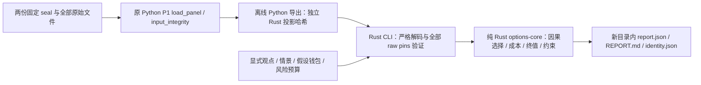

# Rust 离线期权工作台

这是 D2 的离线经济诊断工具：比较同一观点下的现金和四种买入期权表达，检查同平台 vertical 的静态终值约束。它不连接账户、不发订单。条件情景 EV 不是市场盈利证据。



`options-core` 不访问文件、网络、时钟、环境或进程；Rust 可执行文件不调用 Python。Python 只负责一次离线数据导出。旧 Python P1、ledger、策略路径、golden 和历史产物保持原样。

## 运行

在本分支的仓库根目录执行；输出目录必须不存在。所有路径须先取真实路径：macOS `/tmp`、`/var` 是符号链接，应使用 `/private/tmp` 或 `Path.resolve()` 后的路径。原始参数含 `..` 或任何符号链接组件都会拒绝。

```sh
cargo build --manifest-path rust/Cargo.toml --locked -p options-workbench
cargo run --manifest-path rust/Cargo.toml --locked -p options-workbench -- \
  --request-file rust/options-workbench/fixtures/terminal-eth-call.json \
  --output-dir results/options_platform/new-call
```

另外两份完整输入是 [straddle](../rust/options-workbench/fixtures/terminal-eth-straddle.json) 和 [vertical](../rust/options-workbench/fixtures/terminal-vertical.json)。替换 `--request-file`，每次选一个新的输出目录即可。输入已明确写出资本、损失、钱包和全局预算；CLI 不按名称补造金融参数。

真实封存面板的导出需要原始仓库的 P1 loader 和固定数据目录同时存在。下面是在当前 Mac 上实际验证过的调用方式；父目录须先存在，导出文件须不存在。

```sh
cd /private/tmp
PYTHONPATH=/Users/disaster/workspace/code/zenQuant \
/Users/disaster/workspace/code/zenQuant/.venv/bin/python \
/Users/disaster/workspace/code/zenQuant/.worktrees/options-workbench-rust/scripts/export_options_workbench_panel.py \
  --panel-root /Users/disaster/workspace/code/zenQuant/results/crypto_opportunity/20261009_options_liquidity_panel_v1 \
  --output-file /Users/disaster/workspace/code/zenQuant/.worktrees/options-workbench-rust/results/options_platform/new-panel.json
```

导出脚本依原 loader 的源码位置确定允许根目录；不把主目录数据复制到 worktree，也不修改 loader pin。允许的 panel/scout seal 分别是 `b61d04c898cd53545e2bc95ffdede6da6861b18d602d49cb83d57eb52816423b` 和 `c35edb8ad23c8d958fe8f2383786f963160842c55ea8c3489e36efb96d25b983`。完整传输为 480 条报价、48 份规格、541 个文件和两份 seal，共 543 pins。Rust 用 linked-worktree 的 Git 上下文找到原始数据根目录，重新读全部文件；传输中的绝对路径不是读文件授权。

`--panel-file` 只能配合 `fixture_name=null`、`quotes=[]` 的显式请求。候选 descriptor 和 scenario 的 `spec_hash` 必须绑定导出中已归一化的 spec，观点哈希必须绑定实际观点。实际验收请求在 `results/options_platform/rust_d2_execution_20261010/task5/sealed-request.json`；对应面板为 `sealed-panel.json`。在证据目录保留这些文件时可直接执行：

```sh
rust/target/debug/options-workbench \
  --request-file results/options_platform/rust_d2_execution_20261010/task5/sealed-request.json \
  --panel-file results/options_platform/rust_d2_execution_20261010/task5/sealed-panel.json \
  --output-dir results/options_platform/new-sealed-diagnostic
```

二进制仅接受 `--request-file PATH --output-dir PATH [--panel-file PATH]`。退出码 2 表示输入/预检拒绝，1 表示发布未完成或发布后持久性未确认，0 表示诊断报告已完整发布；0 不代表交易成立。已有目标不会覆盖；Rust 使用原生 no-replace 目录发布，失败保留可辨认的 incomplete 目录。Python 导出使用同目录临时文件和独占 hard-link 发布，不覆盖目标；两边都限制读取量、拒绝原始 `..` 和符号链接、保护 source/output 重叠。

## 输入、精度和身份

完整字段以 [call 请求](../rust/options-workbench/fixtures/terminal-eth-call.json) 和 [Rust contracts](../rust/options-core/src/contracts.rs) 为准；不接受未知字段、重复键、JSON float、布尔代整数或尾随内容。

| 请求字段 | 必须明确提供的内容 |
|---|---|
| `schema_version` | `options-workbench-request.rust.v1` |
| `cutoff_ns`, `view_id`, `views` | 纳秒分析截止、目标观点、完整有 parent hash 的修订链 |
| `scenarios` | `options-workbench-scenarios.rust.v1`、实际 view hash、用途、概率来源和按 spec hash 的终值 |
| `candidates` | request/template/version、完整 descriptor、BUY/SELL 与原生数量、exit policy、terminal fee 或 null、sleeve |
| `quotes` | 完整 spec/book、index/FX 的显式币种和 pair、各自知识时间、费用和来源；panel 模式必须为空 |
| `hypothetical_balances`, `risk_policy` | 各钱包的明确币种现金，以及 per-intent/global/tail/window 预算 |
| `source_identities`, `fixture_name` | 来源标签/摘要；真实 panel 的 fixture name 必须 null |

Panel schema 是 `options-workbench-panel.rust.v1`，exporter 是 `options-workbench-exporter.rust.v1`，字段为 `raw_source_integrity`、`projection_trust`、`pinned_sources`、`projection_sha256`、`quotes`、`gaps`。报告 schema 是 `options-workbench-report.rust.v1`。

新数学方法 `exact_decimal.rust.v1` 用任意精度有理数计算。输入只有有限十进制字符串，最多 64 位有效数字、28 位小数，不接受指数。加减乘精确；除法只有能在最多 256 位小数内终止才成功。`1/8=.125`，`1/3` 返回数值限制；中间表示超过 1024 位也拒绝。不可表达的 break-even 不默默舍入。新 Python 导出只做无上下文舍入的十进制规范化，不承担 Rust 数学运行时职责。

原生 SHA 是 `exact_decimal.rust.v1` 加一个 NUL 字节，再加递归排序键、紧凑 UTF-8、无 float、规范化 Dec 字符串的 JSON。数组顺序保留。`projection_sha256` 只绑定投影报价；它可被重新计算，不是签名。`p1_spec_fingerprint`、`p1_book_fingerprint`、`p1_panel_fingerprint` 是独立的原 P1 身份，不能改称原生哈希。新方法不承诺 P1 固定 50 位上下文在全数域内的哈希或金额舍入等价。

请求最多 1 MiB，panel/单个来源最多 16 MiB，全部来源最多 64 MiB/1024 pins；最多 128 观点修订、64 候选、64 情景、512 报价、16 legs/候选、128 levels/单侧、JSON 深度 64、单字符串 4096 bytes。

报告身份区分请求原始字节、canonical input、原始来源、code source、数学版本和 Cargo.lock。code source hash 是源码身份，不能证明二进制或可复现编译。此分支在 macOS 运行验证；Linux syscall 路径未在 Linux 编译/实跑。

## 模型与证据界限

同一场景的共同 fixing 必须一致，终值点必须恰好等于合约到期。只有线性 European、共同 fixing、quote/strike/settlement/margin/report 币种一致、全部 BUY 的 `long_call`、`long_put`、`long_straddle`、`long_strangle` 支持资金化终值模型；现金不计利息。跨币种、inverse、提前平仓、路径/IV 模型、多账户及未知规则不自动转成另一种模型。

完整资本检查含开仓成本和 terminal reserve，并检查损失、per-intent/global/tail 和每个独立假设钱包。候选是互斥比较，不能加总为组合，也不实际占用资金。SELL 只可作成本/静态约束诊断；vertical 的正数学下界没有 short intent、真实保证金、融资或生命周期套利许可。

| 支持列/字段 | 含义 |
|---|---|
| `input_validity` | 输入和因果结构是否有效 |
| `model_support` | 该经济产品是否被当前模型支持 |
| `modeled_feasibility` | 明确假设预算内是否资金可行 |
| `account_eligibility`, `execution_evidence` | 始终 `UNVERIFIED` |
| `RAW_PINNED_BYTES_VERIFIED` | 原始封存字节完整性；不是交易所/账户真实性 |
| `EXPORTED_PROJECTION_UNATTESTED` | Python 派生投影未经独立语义证明；重新哈希不能增加权限 |

真实 panel 在哈希前把 spec 归一化为 `sealed_proxy` / `UNKNOWN` 行权和结算规则，原规则主张保留在 assumptions。原 index 观察与知识时钟也保留为标签，但其 quote denomination 缺独立证据：`index_in_quote/index_currency/quote_to_report/fx_pair` 保持 null。不由值为 1 推断币种，不证明 USD=USDT=USDC。费用和 cap 来自冻结 preregistration 的 proxy；`fee_known_ns`、terminal fee 缺证据保持 null。metadata 知识时间是观察下界，不是规则生效证明。

这份真实面板的终值 `model_support` 和 `modeled_feasibility` 是 `UNSUPPORTED`，成本为 `NOT_EVALUABLE`。即使改 spec/fee/book 后重新计算投影哈希，并保留有效 543 raw pins，Rust 仍归一化 UNKNOWN/proxy；投影没有获得模型或执行授权。序列连续性、账户规则、手续费等级、稳定币可达换算、终值结算证据和实际成交仍缺失。

每份报告固定 `diagnostic_only=true`、`rankable=false`、`live_eligible=false`、`execution_authority=NONE`；`actual_pnl/paper_pnl/sharpe/capacity/lifecycle_arbitrage_edge` 均为 null。EV 仅在 forecast + subjective + 完整非负权重精确合计 1 时计算；风险中性、经验或 stress 权重不生成主观 EV。

## 检查与手算结果

```sh
cargo fmt --manifest-path rust/Cargo.toml --all --check
cargo test --manifest-path rust/Cargo.toml --locked
cargo clippy --manifest-path rust/Cargo.toml --locked --all-targets -- -D warnings
PYTHONPATH=. /Users/disaster/workspace/code/zenQuant/.venv/bin/python -m pytest \
  tests/options tests/test_import_boundaries.py tests/test_parity.py -q
/Users/disaster/workspace/code/zenQuant/.venv/bin/ruff check \
  scripts/export_options_workbench_panel.py tests/options/test_rust_workbench_compatibility.py
```

本次原生 62 tests、fmt/clippy 通过；Python 定向 459 通过/1 skip，新增兼容 22 通过。P1 已有 23 保护文件和主目录 110 文件 SHA 未变；旧 call/straddle 各三份 CLI 产物逐字节一致。worktree 的原 P1 本地面板测试因无本地原始目录跳过，实际导出从原仓库载入，完整 native panel 则独立实跑通过。

| 实际 CLI fixture | 独立手算 |
|---|---|
| call | 开仓 `.0203`；break-even `102.03`；90/100/110 净值 `-.0203/-.0203/.0797` |
| straddle | 开仓 `.0356`；roots `96.44/103.56`；90/100/110 净值 `.0644/-.0356/.0644` |
| vertical | 开仓 spend `-.0094`；条件终值下/上界 `.0094/.1094`；仍无 short execution 支持 |

以下是字段/模型边界实验，未检验市场 alpha。对应 [economics tests](../rust/options-core/tests/economics.rs) 与 [跨语言 tests](../tests/options/test_rust_workbench_compatibility.py)。

| 对照/消融 | 预期变化 |
|---|---|
| 同观点 cash / call / put / straddle / strangle | 比较不同终值形状，不替策略选出盈利表达 |
| 去掉主观概率 | EV null |
| terminal fee 缺失 | gross 可见，net/EV/loss bound 未知 |
| fee/index/FX/depth 缺失或迟到 | 成本 `NOT_EVALUABLE` |
| terminal reserve/global/tail/wallet 不足 | 假设资金检查拒绝 |
| 超精度输入或非终止除法 | 输入拒绝或显式数值限制；不舍入为可交易数值 |

全 `zenquant-check` 本次只跑一次：0/B/C/D PASS；A 因三个旧文件 format FAIL；E 为 `1837 passed/10 skipped/1 error`，错误是全仓收集未加载旧 `--require-local-options-panel` 选项；排除新增测试的默认 root discovery 控制运行（只选该旧测试）仍重现同一错误，见 `task5/full-discovery-control.log`；F 缺 BTCUSDT 历史 Parquet FAIL。日志在 `results/options_platform/rust_d2_execution_20261010/task5/zenquant-check.log`。这些失败未修复、未豁免，全仓尚未通过，分支不具备合并验收。

## 扩展与迁移

新增交易所先提供完整 spec 身份、原生数量/乘数/tick/lot、index/FX 币种及各自知识时间；不能跨记录借费用或 index。新增表达在 `options-core` 保持纯函数、增加模板版本与可核对的终值/失效测试，再扩展显式请求 fixture。新增 report 字段同时升级 typed schema、codec 和 identity，避免 UI 中隐藏经济逻辑。

换入真实经济数据前，先补独立规则、费用生效时间、同币种 fixing 与 terminal reserve 证据，再做因果/replay、精度反例、完整原始来源验证和独立审查。真实账户、执行、缺失数据冲击、费用滑点、容量及实盘增量验证是后续各自的验收门；本工具未完成这些门。分支保持隔离，未合并、推送或部署。
