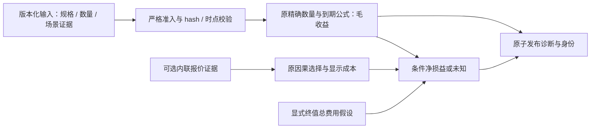

# 独立单腿到期诊断：云端 Rust 验收

本轮完成一个无 View、无指标、无账户预算的单腿到期诊断模块。它回答指定 long call/put 在指定交割价下的条件收益；缺少报价不再阻止毛收益计算。没有生成观点占位物，没有放宽旧契约或证据准入。

## 基线、提交与环境

- 原目标分支 `codex/options-workbench-rust` 的核实基线：`6a6f8211fa8352a66343b015507c8e1bd9d9c941`；原 `work` 分支保留在 `c2aa54af0b39c8a8eb89256b5bee7fd23e0d249e`。
- 第一模块七个提交最终为 `2866f8647f04715f9bd9c1a7cd8ad27bdcff9d3d`，本轮从这个干净基线继续；开始前重跑 Rust 85 tests 全部通过。
- 第一模块已按后续授权正常推送到 `infdahai/zenQuant` 的 `codex/options-rust-iteration-1`。GitHub [run 38135176664](https://github.com/infdahai/zenQuant/actions/runs/38135176664) 对此完整 SHA 返回 `completed/success`，记录见 `first-module-ci.json`。
- 第二模块实现 `86953a9`（core）、`bfad8e8`（CLI/report）、`25cff9e`（测试/fixture）、`4e8b55a`（CI smoke），然后独立提交本文和指南。受测代码/测试/CI 树为 `4e8b55a845a93daf8bc37033c567b4025a46cdfb`；后续文档归档不改变这棵 Rust 树。最终交付提交 SHA 与对应 CI run 在交付消息和该分支的 GitHub Actions 中逐一核对，不以祖先提交通过代替最终 SHA 的结果。
- 仅云工作区 `/workspace/zenQuant`；Linux x86_64，Rust/Cargo 1.90.0，锁定原 `Cargo.lock`。没有调用用户本机 CLI。没有新增 crate 或第三方依赖。

## 模块与依赖边界



新 request/report/scenarios 分别版本化为 `options-terminal-diagnostic-request.rust.v1`、`options-terminal-diagnostic-report.rust.v1`、`options-terminal-scenarios.rust.v1`，模型版本为 `single_paid_long_terminal.rust.v1`。

`terminal_diagnostics` 是新纯函数模块；复用 `inputs` 的规格和报价准入、`costs` 的数量及成本、`expressions` 的终值支持域和 intrinsic。它不经过旧 v1 的观点、候选比较和假设资金准入。`options-workbench` 只增加一个互斥 CLI 模式及报告渲染；继续使用原 `io` / `publication`，没有改动其封存、目录或原子发布逻辑。完整字段与运行方法见 [指南](../../OPTIONS_WORKBENCH_RUST_GUIDE.md#独立单腿到期诊断)。

允许的模型域：单条 BUY、线性 European、到期时点、原有同币种 `LinearCash` 或 `LinearViaFuture` 现金等价模型。规格在截止时已知且到期仍有效、fixing 明确、lot/step 合法；所有场景恰好等于该 spec expiry。via-future 不建立 future lifecycle 或账户权限。公式为 call `max(S-K,0)×Q`，put `max(K-S,0)×Q`；合同数量按 multiplier 换成 base quantity。

净值减去完整显示开仓成本和显式终值总费用假设；终值费用是整条腿的报告币种金额，有自己的 `known_ns` 和 `source_ref`，不假装交易所认证。缺失或迟到报价、fee、FX 只阻止净值，不阻止已可确定的毛收益。场景是独立 revision=1 的带来源/时点快照，绑定 spec hash；不接收未验证的修订链。

结构、身份冲突或未来场景证据导致输入错误且不创建输出。已识别但不支持的产品、SELL、非到期场景在报告中为 `UNSUPPORTED`，整组毛/净收益为空；缺规格知识或 UNKNOWN fixing 为 `NOT_EVALUABLE`。非法 lot 为 `REJECTED`。模型失败时仍可保留独立显示成本，两种证据不互相升级。

`modeled_feasibility=NOT_EVALUABLE/FUNDING_NOT_ASSESSED`；账户和执行 `UNVERIFIED`；raw source `NOT_INDEPENDENTLY_VERIFIED`；执行权限 `NONE`。实际/模拟 PnL、Sharpe、容量、生命周期套利保持 null，不能排行或实盘使用。输入哈希、场景/规格/所选报价哈希，以及原始字节和规范化输入身份均保留。

## 实测结果与消融

以下是数学 fixture 的依赖实验，不是市场 alpha、性能、流动性或账户实测。K=100、Q=0.01、交割价 S=110；开仓 ask=2 的含费显示成本为 0.0203，显式终值总费用为 0.001。六组真实 CLI 均在 `PATH=/nonexistent` 下运行成功；每个结果的输入与场景 hash、完整结果见 `ablation.json`。

| 输入变化 | 毛收益 | 条件净损益 | 净值状态 |
|---|---:|---:|---|
| 完整证据 | 0.1 | 0.0787 | VALID |
| 移除全部报价 | 0.1 | null | NOT_EVALUABLE |
| 移除终值费用假设 | 0.1 | null | NOT_EVALUABLE |
| 终值费用 known_ns 晚于 cutoff | 0.1 | null | NOT_EVALUABLE |
| 只把 ask 改为 3 | 0.1 | 0.0687 | VALID |
| 其中任一场景改为非到期 999 | null | null | UNSUPPORTED |

Rust 原生回归还消融开仓费率、FX 和迟到开仓费用；场景 hash 和所有毛收益不变，输入 hash 改变，净值为空。更新但未来才可见的报价不会被选择；后来已可见但缺费率的报价不能向旧报价借证据。

手算覆盖 call/put，S=0/90/100/110，base/contracts 两种数量单位及 multiplier。新旧单腿模型在相同输入上 outcomes/cost 直接相等。极小边界 `10^-28 × 10^-28 = 10^-56` 精确保留，29 位小数或 65 位有效数字输入拒绝，不以舍入解决。

复杂度取舍与保留标准：

- 保留单个纯函数模块和三个版本化契约，解决终值原本依赖 View/钱包的实际阻碍；验收标准是独立入口、与旧计算一致、同证据确定性及严格失败边界。
- 保留可选报价分支，只为回答条件净损益；移除报价后毛收益不变即为可执行的依赖检验。它不是期权估值器或交易建议。
- 保留显式终值费用及知识时点，避免把毛收益当净值；缺失/迟到必须为空。
- 不增加概率、EV、缓存、线程、通用多腿抽象、DSL、适配器接口或服务。没有可测的当前需求，就没有实现和后续消融负担。
- hash、因果准入、精度限制、UNKNOWN/UNVERIFIED 与原子发布是正确性不变量，始终保留；用失败测试验证，不作为可删除优化项。

## 全部 Rust 验收命令与结果

下列 Cargo 命令从 `rust/` 执行。云环境使用 `PATH=/workspace/.zenquant-cargo/bin:$PATH`、`CARGO_HOME=/workspace/.zenquant-cargo`、`RUSTUP_HOME=/workspace/.zenquant-rustup`；其他环境由已提交的 `rust-toolchain.toml` 选择 1.90.0。二进制 smoke 将 PATH 改为空目录，验证运行不调用 Python 或其他外部程序。

| 命令 | 结果与日志 |
|---|---|
| `cargo test --workspace --locked`（开始前） | 85 passed，`baseline.log` |
| `cargo check --workspace --locked`（初版实现） | 通过 |
| `cargo test --locked -p options-core --test terminal_diagnostics`（初版） | 9 passed，`core-first.log` |
| `cargo test --workspace --locked`（初版完整） | 100 passed，`implementation-test.log` |
| `cargo test --manifest-path rust/Cargo.toml --locked -p options-core --test terminal_diagnostics`（从仓库根执行，增加精度回归后） | 10 passed；最终完整日志也覆盖该套件 |
| `cargo fmt --all --check` | 通过，静默 `fmt.log` |
| `cargo clippy --workspace --all-targets --locked -- -D warnings` | 通过，`final-clippy.log` |
| `cargo test --workspace --locked`（最终） | **101 passed / 0 failed / 0 ignored**，`final-test.log`，含 26 个 CLI 集成 tests 和 9 个 workbench 原子发布/封存故障 tests |
| `cargo build --workspace --locked` | 通过，`build.log` |
| `CARGO_TARGET_DIR=/workspace/zenquant-terminal-validation/clean-target cargo build --workspace --locked --offline` | 全新目标目录、缓存的锁定依赖、离线构建通过，`clean-build.log`；不声称首次安装无需联网 |
| `env PATH=/nonexistent /workspace/zenquant-terminal-validation/clean-target/debug/options-workbench --terminal-request-file /workspace/zenQuant/rust/options-workbench/fixtures/terminal-call-scenarios.json --output-dir /workspace/zenquant-terminal-validation/clean-smoke` | exit 0，三份报告完整 |
| `env PATH=/nonexistent /workspace/zenquant-terminal-validation/clean-target/debug/options-workbench --terminal-request-file /workspace/zenquant-terminal-validation/complete.json --output-dir /workspace/zenquant-terminal-validation/clean-same-input` | exit 0，针对相同字节输入，与原目标目录构建的三份产物逐字节 `cmp` 一致 |
| `git diff --check` | 通过 |

中间测试未出现失败。日志里的 `INCOMPLETE_PUBLICATION` 是竞态/故障测试的预期子进程输出。曾比较 pretty fixture 与规范化实验 JSON 的产物，只有 `request_bytes_sha256` 不同；使用相同字节输入后所有产物一致，确认原始字节身份与语义身份的区别。实验 JSON 准备和归档整理使用 Node 辅助，没有将其引入构建、测试或运行依赖；所有行为均有 Cargo 原生回归。

旧兼容：原 v1 View 必填、场景绑定及严格未知字段拒绝不变；已有三份旧报告 golden 继续通过。新增第一模块完整 quote 报告 golden（仅规范化必然变化的代码身份）也通过。互斥参数双向顺序、跨 schema 误传、重复参数、结构篡改、浮点、hash 不匹配、来源晚到、非法输出路径、已有报告不覆盖、markup 转义和证据身份均经过实际 CLI 测试。

## 文件、交付与剩余边界

必要改动文件：

```text
rust/options-core/src/inputs.rs                      # 仅将现有 validate_spec 可见性设为 pub(crate)
rust/options-core/src/lib.rs                         # 导出新模块
rust/options-core/src/terminal_diagnostics.rs         # 独立输入与条件结果
rust/options-core/tests/terminal_diagnostics.rs       # 10 个原生 tests
rust/options-workbench/src/main.rs                    # 互斥 CLI 模式
rust/options-workbench/src/report.rs                  # 原子发布前的报告渲染
rust/options-workbench/fixtures/terminal-call-scenarios.json
rust/options-workbench/tests/terminal_cli.rs          # 5 个集成 tests
rust/options-workbench/tests/quote_cli.rs             # 第一模块兼容 golden
.github/workflows/rust.yml                           # 增加无外部可执行文件的 terminal smoke
docs/OPTIONS_WORKBENCH_RUST_GUIDE.md
docs/reports/options-terminal-diagnostics-20261011/*   # 本文和验收证据
```

本目录日志仅裁掉末尾多余空行，`SHA256SUMS` 绑定归档字节。原始测试/实验文件在云工作区 `/workspace/zenquant-terminal-validation/`；仓库归档 `report.json` / `identity.json` / `REPORT.md` 来自完整数学实验，包含受测源码身份；没有真实市场或账户数据。

没有改动旧 Python、Go、原 costs/expressions/constraints、原 io/publication 或 Cargo.lock。没有实现账户风控、资金预留、OMS、模拟成交、精确账本、重启恢复、多腿组合、提前平仓、概率/EV、指标或真实数据适配。没有接账户、密钥、订单、PR、合并或部署。

未跑 Python 门禁/pytest、真实封存 panel（云端缺两份固定数据）、历史回测、多 OS 验证或性能基准；Rust 原生测试和 Linux CI 独立覆盖本模块，不把合成证据或旧历史结果冒充这些验收。本模块无需要协调的阻塞。下一最小步骤建议：独立版本化的文件 intent 准入与幂等持久记录，只把人工/算法意图绑定到产品规格和证据身份，先验证重复/冲突及重启重放；随后再接明确的风控预留边界，不一次性搭建 OMS 和完整交易引擎。
