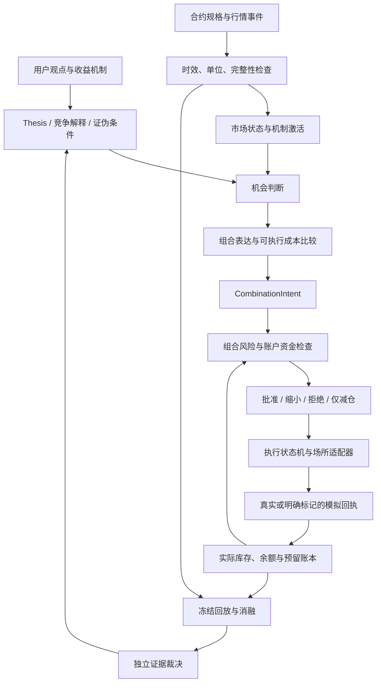

# ZenQuant 期权组合平台：架构与消融实验规格

日期：2026-10-09。版本：`options-platform.design.v1`。

状态：**待用户审阅的设计；尚未实施。** 本文件定义目标架构、研究协议与第一个可独立实施的子系统。它不改变现有 production、Quant V2 冻结判定、OptionsState 权限或实盘准入。

## 1. 从用户任务定义产品

用户希望用一个 MacBook Pro、最多几千 U 的资金，建立能长期研究和交易币圈期权的系统。范围包括多个标的、多个平台、套利、多腿策略、期权与合约组合，以及极端行情开仓。重点是发现失调、选择合适的收益结构、控制失败损失，并通过实验判断能力是否值得保留。

用户实际需要完成六件事：

| 用户任务 | 系统必须给出的答案 | 验收边界 |
| --- | --- | --- |
| 找机会 | 谁在付钱，机会来自什么机制，当前证据是什么？ | 策略名称、成交量或高 APY 不构成收益证据 |
| 选表达 | 同一观点买期权、做价差、做合约或不交易，分别付出什么？ | 显示成本、路径风险、资金占用与到期收益；不只画到期 payoff |
| 判断能否交易 | 最小数量、账户余额、资格、盘口、保证金是否满足？ | 不可交易的漂亮价格不得进入可执行机会榜 |
| 控制损失 | 完整组合、单腿失败、断网、IV 回落分别会怎样？ | 到期最大亏损与途中风险分开呈现 |
| 完成交易 | 成交多少，剩余腿怎么办，什么时候退出？ | 以实际成交更新组合，不能以目标仓位代替库存 |
| 知道系统是否有用 | 哪项能力创造净增量，哪项只是复杂度？ | 同条件对照、消融、前瞻数据；允许明确判定缺证或停止 |

成功标准是：**机会能解释，组合能算清，账户能承受，成交能回放，新增能力能被独立检验。** 收益率和 Sharpe 是有完整收益路径后才能评价的结果，不是设计阶段的承诺。

### 1.1 第一性原理

1. 期权交易交换的是未来状态下的现金流。合约名称相同不代表现金流、结算指数、币种和取价窗口相同。
2. 有收益必须说明补偿来源：承担保险风险、提供流动性、吸收被迫交易，或纠正定价约束失调。高胜率不解释收益来源。
3. 一个观点有多种表达。价格跌得多不代表 Put 值得买；冲击后的 IV、时间价值和交易成本可能吞掉方向判断。
4. 小账户的稀缺资源是可损失资金、跨钱包可用现金、合法最小量和研究时间。名义本金小、权利金低都不等于风险小。
5. 组合在全部成交之前不存在。风控必须处理任意中间库存和失败退出成本。
6. 黑天鹅不能作为可稳定预测的事件。可以研究事前凸性持有、可观测冲击后的响应和压力下的错价，各自有不同成本与证据要求。

目标函数不采用单一“收益最高”：先满足工程与资本硬约束，再比较净增量、尾部损失、资金占用和操作复杂度。

## 2. 当前事实、缺口与方案选择

### 2.1 已有能力的可复用范围

| 当前事实 | 目标中的使用方式 | 不能推导的结论 |
| --- | --- | --- |
| 现有策略输出 TargetPosition，再经风险与执行 | 保留意图、风险、执行的权限分离 | 单标的杠杆目标能表示多腿期权组合 |
| 现有 production/handoff 为 4h confirmed close；实时行情使用 SimulatedGateway | 保护当前链路；新研究域显式隔离 | 已存在期权真实下单或组合 live parity |
| `multi_leg_accounting.py` 只支持同所 BTC/ETH 现货与线性 USDT 永续 | 借鉴 Decimal、不可变状态和事件记账；不原地扩大已冻结语义 | 已有期权、跨所钱包、保证金或到期核对能力 |
| OptionsState sidecar 只作观察，冻结证据不足 | 作为带来源和权限的候选观测 | 获准激活 production 信号或风险乘数 |
| `ablation_evaluation.py` 只登记部分 trend/breakout 移除语义 | 复用保护不变量与证据格式；新增期权实验裁决器 | 用现有 `remove` 标签合法比较不同期权策略或场所 |
| 研究框架有版本身份、trial journal、E/R/O 判定 | 使用相同证据分层，并为期权补充账户与执行契约 | 原 BTC 日收益、风险阈值或 100,000 U 资金可直接套给小期权账户 |

依据：[现有架构](../../ARCHITECTURE.md)、[运行交付规格](../../LIVE_VALIDATION_HANDOFF_SPEC.md)、[综合评价规范](../../RESEARCH_EVALUATION_SPEC.md)、[研究框架指南](../../RESEARCH_FRAMEWORK_GUIDE.md)。这些文件保留当前实现的权威，本规格定义新目标。

### 2.2 当前价格证据如何约束设计

[已封存流动性面板](../../../results/crypto_opportunity/20261009_options_liquidity_panel_v1/REPORT.md)在北京时间 2026-10-09 01:28–01:33 观察了 480 个 BTC 盘口，覆盖三平台四产品。2,586 个合法且通过时效检查的有向数量场景，扣开仓费代理后没有正价差。它们共享合约与报价，不能当作独立交易样本。

这支持“逐合约、逐数量、按费用比较场所”，不支持“跨所套利有盈利证据”。本轮只有约五分钟，指数观测范围约 0.267%，没有黑天鹅样本。策略净收益、Sharpe、持续容量仍为 `null / NOT_EVALUABLE`。真正 30 天组、ETH 和压力窗口也未由这份面板证明。

因此第一子系统先解决准确的合约身份、成本、现金流与失败状态。价格研究保留三平台；不能据此启用跨所做空组合。

### 2.3 备选路径

| 路径 | 优点 | 代价 | 决定 |
| --- | --- | --- | --- |
| 新建隔离期权领域，复用证据规范，逐阶段连接适配器 | 保护 legacy，组合语义完整，可独立验证 | 需要显式转换和新账本契约 | **采用** |
| 把期权塞入现有 TargetPosition 和 signals/sizers | 初始接线少 | 丢失腿、到期、保证金和结算语义；破坏固定插件组合规则 | 不采用 |
| 每个期权策略独立脚本、账本和风控 | 探针容易写 | 比较条件不一致，重复风险，难以产品化 | 仅保留为封存的一次性诊断，不作为产品核心 |

整体工程复杂度：**较高**；第一个子系统：**中等**。全平台交易、多资产、保证金与前瞻验收需要分期交付。Mac 可承担小范围数据归一化、纯计算、事件回放和报告；不把持续可靠的实盘运行或高频做市当作单机研究已解决的问题。

## 3. 目标架构与权限



机会、策略、风控、执行四者不能互相代行权限：

- 机会层解释可能的失调及竞争解释，不发订单。
- 表达层提出完整组合、成本限制与失效条件，不把理论价格当可成交报价。
- 风险层按实际库存、账户模式和未完成订单预留，允许拒绝、缩小或转为减仓。
- 执行层只能实现已批准的组合变化；对冲与失败修复也须在预批准预算内，不能借修复建立新观点。
- 研究 agent 只能生成版本化研究材料、实验与结论；不能改账户风险 policy、实盘模式或准入状态。

### 3.1 四类时钟

| 时钟 | 允许行为 | 边界 |
| --- | --- | --- |
| 行情/异常事件 | 逐事件检查、发现报价失调、标记冲击 | 可发观察与风险事件，不直接成为方向开仓权限 |
| 方向决策 | confirmed bar close 后冻结方向与所用状态 | 当前生产仍为 4h；新期权研究先按显式 clock policy 回放 |
| 执行/对冲 | 用最新有效报价实现冻结 intent，检查残余风险 | 不用新价格走势重新评分方向；对冲只能处理实际已成交风险 |
| 紧急风险 | 随时撤单、停止新风险、在批准范围内减仓 | 行情缺失可能阻止平仓，不能承诺 kill 等于立即归零 |

黑天鹅响应需要量化等待成本。第二阶段可单独预登记 `confirmed_1m_research` 与 `confirmed_4h_research` 的比较，双方都保持收盘确认、下一可用报价和相同资本约束。1m 是**待验证的新研究 policy**，不是修改当前生产基线。时钟比较改变可用信息集，属于独立策略实验，不冒充同信息消融。

非方向报价约束扫描可以实时运行。是否允许其开仓，仍由组合残余 Delta、结算基差、保证金和执行路径决定；“套利”标签不能豁免方向和风险限制。

## 4. 核心契约

所有核心对象不可变、版本化。现金与数量使用固定 Decimal 精度；IV 与估值计算有明确单位、模型版本和容差。纯核心禁止网络、隐含墙钟或未固定随机数。

| 契约 | 必需字段/语义 |
| --- | --- |
| InstrumentSpec | venue、账户可见 instrument ID、产品族、underlying、expiry UTC、strike、C/P、exercise style、报价币/单位、保证金币、结算币、数量单位、multiplier、tick/step/min/max、结算指数及取价窗口、规则有效区间、原始来源 hash |
| MarketEvent / Snapshot | 源事件时间、接收时间、可用时间、源序列/重连代次、book depth、指数/forward/FX 的独立时间与来源、数据质量；展示值与可执行 bid/ask 分开 |
| Thesis | 机制、参与者、市场、激活状态、可观测量、竞争解释、表达候选、失败条件、证伪实验、证据级别 |
| Opportunity | 上述身份与时点、毛/净价格边际、预算数量的 VWAP、费用来源、结算差异、无法执行原因；模型边际与锁定现金流边际分列 |
| CombinationIntent | intent/version、thesis、legs 及整数/合法比例、desired transition、共同数量、方向 cutoff、成本上限、现金与风险预算、期限、腿依赖、失败处理、退出 policy、所用数据/policy hash |
| RiskDecision | approved transition、各钱包预留、最坏中间库存、冲击损失、风险原因、有效期、实际账户状态版本；批准后账户或报价过期必须重验 |
| OrderReceipt / AccountEvent | venue 原 ID、幂等 key、父 intent/leg、订单与实际成交数量、费用币、事件时间和接收顺序、修订/撤销关联；UNKNOWN 不能转换成零成交 |
| EvidenceReport | 数据/代码/会计/策略/执行/风险/协议分别 hash、窗口、样本单位、指标定义、失败及缺证、随机 seed、trial 数、结论权限 |

不要用单一 code hash 同时代表策略与账本；不同策略可比较时，账本、执行和资金规则必须保持同一版本。InstrumentSpec 修订产生新身份，历史不能被现行交易规则覆盖。

### 4.1 合约身份和现金流等价性

把基础数量、报价单位和实际交易单位分开；不能固定“一张就是 1 BTC”，也不能把所有币种统一假设为 1 USD。BTC/ETH 是第一批工程验证对象，注册表不硬编码资产白名单；新资产按元数据、数量、报价质量与账户资金准入。

跨所同 expiry/strike/C-P 只是**候选配对**。现金流等价性报告还需比较结算指数、窗口、币种/兑换、交割事件、费用、纠错条款和账户负债。未验证时只能标“相对定价”，不能标无风险套利。跨所空头不抵消另一个钱包的保证金需求。

结算是版本化事件链。例如 Deribit 当前 ITM 线性与币本位期权可先产生到期 future，再结算；收益可等价于现金 payoff，但回执和费用不能重复入账。币本位 future 的数量单位也不同于期权数量。[Deribit 线性规格](https://support.deribit.com/hc/en-us/articles/31424932728093-Linear-USDC-Options)、[币本位结算规格](https://support.deribit.com/hc/en-us/articles/31424939096093-Inverse-Options)。Bybit 使用 USDT 期权；OKX 的 coin 与 USD 系列需分别确认。[Bybit 规格](https://www.bybit.com/en/help-center/article/Introduction-to-Bybit-Options)、[OKX 规格](https://www.okx.com/en-eu/help/i-okx-options-introduction)。规则核验日期为本规格日期，产品适配器仍需绑定实际 API 与账户模式。

### 4.2 期权状态和定价

先提供可审计小集合：ATM IV、RR25/RR10、BF、期限结构、带期限的 IV−RV 差、成交/报价、OI 与 gross gamma concentration。记录 forward、delta convention、插值方法、源质量与实际 DTE；历史 RV 差不命名为严格的预测 VRP。

`gross gamma`、`estimated dealer gamma`、`observed hedging flow` 使用不同字段与证据标签。OI×Gamma 没有持仓方符号，不能直接生成“做市商压盘/追买”的判断。主动买卖流缺乏可靠 aggressor 或组合识别时保持 UNKNOWN，不用猜测结果替代来源。

定价模型仅用于曲面描述、情景重估及解释。执行成本必须来自有效盘口或实际回执。曲面拟合不在稀疏 strike、过期报价间编造可成交合约。

## 5. 组合账户、风险与执行

### 5.1 账户与估值

账本按 `venue / account / wallet / currency` 保存现金、担保品、已预留订单资金、实际库存、负债、资金费与结算。账户总资产可聚合展示，**可用保证金不能跨钱包聚合冒充可下单余额**。

必须区分：

- 净值、现金、可提现现金、初始/维持保证金、订单预留和借款；保证金占用不是成本或现金流。
- premium 支付、买卖价变化、已实现/未实现 PnL、交易/交割/强平费用、hedge funding、币种估值变化。
- 风险 mark、模型 fair value 与按 bid/ask 深度计算的退出价值；后者深度缺失时为未知，不得用模型净值承诺可退出收入。

长期权损失边界适用于已付清权利金的对应仓位；带合约对冲、借币、卖腿或组合保证金账户有额外风险。完整价差的到期有限亏损，也不保证卖腿途中被交易所给予保证金抵扣。

未知保证金模型、账户资格或 fee tier 时：可研究报价，不能批准带卖腿/合约的新风险。一个钱包不足不能借用其他平台现金绕过；转账须实际事件确认，时间与换汇成本入账。

账户有经济时间与知识时间两条轨迹：迟到成交按收到回执的 journal sequence 更新当前已知库存；历史现金流可按经济时间重建，但不回写当时决策的信息集。重复同 ID 且内容一致不再入账；内容冲突或未知交易修订进入冻结/对账，保留原事件和补偿关联，不静默丢弃实际负债。

### 5.2 风险分层

1. **硬约束**：合法合约与数量、可用资金、信息时效、账户资格、持仓/损失/保证金上限、审计完整性。
2. **路径风险**：每个可能中间库存，spot jump、IV/skew shock、时间流逝、FX/depeg、盘口撤回、单平台故障与撤单竞争。
3. **策略预算**：单 thesis、单标的、单到期、组合净 Delta/Gamma/Vega、跨标的压力相关性、尾部权利金累计消耗。
4. **状态调整**：可选的机制激活/拥挤状态缩放。这一层可消融；上面三层硬边界仍保留。

Greek 使用明确计价与单位。极端波动用完整 payoff/情景重估加可执行退出压力，不用局部 Delta/Gamma 近似当跳跃风险保证。情景集是压力诊断，不覆盖所有潜在损失。

期权组合的 `reduce_only` 以风险约束而非持仓绝对数量定义。关闭保护性 long leg 可能使剩余 short 风险上升，必须拒绝；退出通常先关闭危险 short，再撤保护。即使最终目标更安全，每个中间状态也需通过冻结的路径限制。紧急对冲只能在预批准修复预算内处理实际敞口，不能把新方向开仓包装成 hedge。

研究资金分别测试 1,000 / 3,000 U，使用**同一总资本**的多钱包划分，不为每个平台再造一个全额账户。不配置风险限额时禁止 rankable；示例金额不是实盘风险建议。

首轮工程演示可用：1,000 U 总现金、每 intent 全额权利金与交易费用最多 10 U、滚动 30 天尾部 sleeve 已支付权利金及费用累计最多 20 U、不借币、不卖空。所有组合的 `pending_cash_reserve + active_at_risk_capital` 合计最多 50 U；未成交预留在成交后转为持仓风险资金，不能通过释放订单 reservation 再使用同一额度。第一阶段 long 仓位风险资金按剩余仓位分配的原始 premium 与费用核算，不因模型盈利释放额度，闭合库存后才结束对应占用。其用途是验证“最小合法单超过预算便拒绝”，不是保证能交易 BTC ATM，也不靠扩大预算制造交易数量。3,000 U 情景按同百分比独立回放；收益不会与 1,000 U 案例直接相加。

### 5.3 执行状态机

`DRAFT → VALIDATED → RISK_RESERVED → SUBMITTING → PARTIAL/OPEN → EXITING → CLOSED`。

任何阶段都可进入 `REJECTED / RECONCILING / UNWINDING / FROZEN`。提交超时进入 RECONCILING，以原订单 ID 查询；未知成交不能重新发相同意图造成重复仓位。重启先恢复订单、预留和实际库存，再接受新风险。

每个组合必须定义腿依赖、最大暴露时间、允许残差、撤单条件和修复预算。优先保护腿先成交；保护腿不足不得继续扩大卖腿。平台 combo、多腿 UI 或批量 API 不自动等于原子成交，能力矩阵须引用已验证的 matching/回执语义。跨平台默认非原子。

模拟器需要订单可用时间与报价到达顺序。当前 REST 面板只证明显示报价；无法验证未来保留量、queue position 或真实成交。可以做带证据限制的 taker 情景；maker 没有 queue/成交反馈时不产生“免费成交”的 PnL。部分成交后按剩余规模重新检查成本与预算，拒绝静默补全。

## 6. 收益机制、策略模板与黑天鹅

模板是表达方法，Thesis 才是研究对象。初轮最多八个机制课题，不按币种或模型名字扩张到二十个平铺项目。

| 课题 | 机制与第一问题 | 初始表达/对照 | 主要失败解释 |
| --- | --- | --- | --- |
| M01 逐合约场所选择 | 相同目标交易的净成本有无可持续差异？ | 固定平台 vs 费用/深度感知路由 | 过时报价、成交不到、换币/保证金成本 |
| M02 跨所相对定价 | 报价分割能否覆盖完整持有与失败成本？ | 合法 paired quotes；先观察 | 终值不同、两边资金占用、单腿失败 |
| M03 同所 payoff 约束 | parity/box/vertical 约束是否真被可成交价格破坏？ | 到期现金流校验，含 hedge/carry | forward/借款缺失、费用、到期窗口和资金成本 |
| M04 保险与尾部凸性 | 小额持续付费能否改善净资产路径？ | long put/call/strangle vs cash/线性表达 | theta bleed、错误期限、IV 已贵、盈利不可退出 |
| M05 冲击后响应 | 冲击可观测后是否还有方向/波动边际？ | long option / debit spread / perp / cash | 信号只是已发生收益，IV crush、方向误判 |
| M06 期限与 skew 失调 | 相对曲面是否提供成本后增量？ | calendar/diagonal/vertical 的受限模拟 | surface model 误差、事件溢价合理、前后腿风险 |
| M07 波动风险补偿 | 承担保险风险的收入能否覆盖尾部与资金成本？ | credit spread/covered call 研究 | 小账户无法承受跳跃、保证金抵扣不成立 |
| M08 对冲与 dealer 传导 | 可观测 flow 是否解释风险/执行变化？ | 长凸性固定/规则 hedge；状态条件统计 | OI 符号未知、spot 领先 flow、交易成本吞增量 |

covered call、butterfly、iron condor 等用同一腿/现金流契约逐个准入，不先批量写策略。M07 裸卖不进入首轮可执行集合。大资金 block/RFQ 只作候选数据与能力研究，不作为几千 U 起点。

### 6.1 黑天鹅三种工作流

**事前凸性**：用到期/strike/paid premium 冻结组合，管理滚动权利金消耗与再平衡；报告所有平静等待期间的损失，不能只抽取危机窗口。事件日期可事先知道不等于结果可知。

**冲击后开仓**：记录触发当时已知的价格冲击、流动性、IV 和延迟，confirmed close 后比较不同表达。给出继续、反向与不交易对照；极端行情不强制开单。价格止损可能跳过执行，不能因此把买期权与合约归一成同一严格最大损失。

**压力错价**：先区分真实现金流失调与报价陈旧/交易所中断；剔除后一类假套利。跨所若资金、修复或 settlement basis 无法核验，仅发观察。

界面必须能解释“信号有了，但期权太贵”“方向正确，但净亏损”“理论有边际，但账户不能交易”。黑天鹅标签不放宽硬风险，断连时不盲目追买或补卖腿。

## 7. 消融与对照协议

### 7.1 两类实验不能混淆

**工程偏差诊断**：离线比较 mid/mark 与 executable price、忽略费用与含费用、错误单位与合法单位、过时输入与严格时效，展示乐观假设制造了多少假机会。变体永远 `diagnostic_only=true / rankable=false / live_eligible=false`，不能用于选策略或放松生产检查。

**价值实验**：只移除可选信号/状态/路由/对冲/表达能力，双方保持真实费用、会计、PIT、硬风险和审计。换表达、换时钟、跨资产复制是独立注册的 counterfactual/replication，不能全部冒称 component removal。

现有消融裁决器保留原语义。目标新增 `options-experiment.v1`，登记每种变化允许改变的字段及必须相同的字段；未登记变化、额外调参或身份不匹配使本次比较 INVALID。

### 7.2 冻结比较契约

每轮运行前记录：研究问题、主/次指标、基准、变体、唯一变化、输入来源、时间和事件簇划分、预期最小增量、风险容忍、总资本及钱包分配、clock policy、执行模型、费用/交割/FX/funding、容量数量、代码/协议 hash、随机 seed 与总 trial 预算。

- 同一对照使用共同可用窗口、相同起始现金和硬限额。运行前冻结机会全集及由产品/账户资格等静态事实定义的共同支持集合；不能按运行后余额、库存、风险批准或成交成功筛选样本。
- 策略引起的资金不足、风险拒绝、单腿失败和错失机会都是结果，保留在完整日历/账户比较中。静态配对成本诊断可另报固定共同报价集合，但不能据此审查删掉主账户比较中的失败或等待期间。
- 改策略会自然改变库存路径；不强迫成交完全相同，也不允许事后给失败方案补资金。固定 ex-ante 风险预算，不用未来波动做风险配平。
- 换表达按事前损失/压力预算、可用资金和持有期限比较；Delta/notional/止损不等于相同尾部风险，剩余差异必须报告。
- 场所路由候选需固定账户权限、钱包余额和实际费用，转账不能无时延。离线 hindsight 挑最便宜报价不算可部署路由。
- 同一冲击影响多个合约/资产时以事件簇为独立单位；不同数量重算同一盘口不增加样本数。
- 单组件预筛后最多登记一个重点 2×2 交互实验，例如“激活状态 × 表达选择”。不穷举所有模型与策略组合。
- 状态实验除静态对照外，预登记风险预算/活跃机会匹配的简单或安慰剂对照，区分状态识别与少交易的作用。总账户含等待期的收益与条件机会收益同时报告，不能事后删去未交易日。

### 7.3 第一批八组实验

| ID / 类型 | 主方案 vs 对照 | 需要回答的问题 | 主指标与保留条件 | 当前可用证据 |
| --- | --- | --- | --- | --- |
| A01 路由替换 | 因果成本路由 vs 固定场所 | 比价能否真实节省可交易成本？ | 同目标净成本/成功完成率；计入钱包和失败费用后仍有经济增量，硬风险零违规 | 当前面板可做静态成本诊断；成交与持久性缺证 |
| A02 状态移除 | 机制激活 vs 静态使用同一表达 | 状态是否决定使用时机而非复述收益？ | 配对净增量、最坏事件损失、空仓与覆盖；缺独立事件不裁决 | 需前瞻连续行情与冻结状态 |
| A03 表达替换 | 可选 option/spread/perp/cash vs 固定表达 | 多种工具是否比只买期权更好？ | 同资本/事前预算净增量、资金占用、尾部与退出；风险差异解释完整 | payoff 手算可立即验证；alpha 数据不足 |
| A04 曲面组件移除 | term/skew/RV 组件 vs 简单 ATM IV/价格 | 曲面复杂度有没有独立信息？ | 先预测波动/退出成本的增量与校准，再检验净收益；不让更复杂方案多调参 | 需有效期权曲面历史；当前面板不够 |
| A05 尾部 sleeve 实验 | 全期 tail sleeve vs 不持有（removal）/固定持有（policy counterfactual） | 极端收益是否补偿全年损耗？ | 完整日历净值、权利金消耗、ES/最大事件损失；不能仅以黑天鹅收益 PASS | 合成路径只验证账本/预算；真实长期结果缺证 |
| A06 对冲替换 | 规则触发 hedge vs 固定间隔 hedge | 对冲是不是成本更高的伪改善？ | 净收益差、残余 Delta、资金费与尾部；同限制、持仓和信息截止 | 需 option/perp 同步事件与保证金模型 |
| A07 事件与时间实验 | 因果触发/confirmed 1m/4h vs 冻结规则 | 识别、等待与延迟分别损失多少？ | 误报消耗、漏报、可执行延迟、净事件增量；时钟/触发分别改变，禁止合并寻优 | 需完整已知前信息、实时事件回放；非历史事后标签 |
| A08 复制实验 | 冻结 BTC 机制到 ETH/第二场所 | 学到的是机制还是单市场规律？ | 一次冻结、尺度/元数据转换显式、目标域 OOS 增量；不得用目标域结果回调后仍叫复制 | BTC 工程诊断有数据；ETH/目标域 OOS 缺证 |

A01 首次只验证成本算术与资格过滤；A03/A05 首次只验证现金流和风险行为。其余先做数据可用性审计。当前没有足够样本支持策略收益消融，不能填入臆测 Sharpe。

### 7.4 裁决与样本

每项同时输出 `engineering_status / economic_status / robustness_status / operational_status`。产物完整不使经济证据通过；实盘资格独立。

对有完整连续收益的数据，使用配对日收益时间块 bootstrap；块长度、至少 2,000 次重复和最小有效样本在协议中冻结。稀疏事件用事件簇的 paired resampling，披露簇数、集中度与 leave-one-event-out。一个事件不靠 10,000 个盘口变成可信置信区间。

初轮充分性筛选：普通连续收益至少 180 个有效日，episode 指标至少 30 个闭合组合；事件实验至少 20 个互不重叠且按预定规则划分的事件簇才能进入统计裁决。门槛只是最低检查，不保证罕见尾部证据充分；要求危机覆盖的结论无危机样本仍为 NOT_EVALUABLE。不得人为制造更多交易凑样本。

净收益组件的保留条件是：工程全通过；达到事前经济最小差异；配对净增量 95% 区间支持主假设；资本/尾部不超过冻结容忍；成本和缺数压力仍成立。完整获利策略还须超过同资本现金基准，不能因为相对另一个亏损策略改善就叫盈利。

保险组件单独按预登记的尾部损失改善、保费预算和全日历净值拖累裁决；它可降低平均收益而具有保护价值，不能一律要求平均 PnL 增量为正，也不能把保护价值称为盈利 alpha。路由的成本优势和工程正确性同样使用各自的主指标，不能自动换成策略收益 PASS。区间跨零或样本不足判 INCONCLUSIVE，优先简化当前方案，保留研究问题；不是宣称不存在收益机制。

因子选择、重复尝试和所有失败 trial 都保留，但 trial 记录本身不修正选择偏差。开发/探索阶段的 95% 区间只允许 `ADVANCE_RESEARCH`，不产生确认性的 KEEP 或策略晋级。选择完成后冻结组件、阈值、表达、场所与事件定义，在未触碰的最终 holdout 上确认；不得再次用该 holdout 反馈改参后仍称确认。

确认协议事前登记主假设族，包含同批要裁决的组件、替代对照、交互与必要的净收益主检验。多项确认时使用 Holm step-down，family-wise alpha=0.05；时间块/事件簇检验的 p 值需满足冻结的重采样与有效性条件，缺证则不作校正后的确认。95% 区间用于描述，Holm 主检验通过与经济最小差异都满足才可确认保留。若只确认一个事前冻结的主假设，其余对照均标探索。已反复查看的 2026 数据不重新命名为 fresh OOS。

硬安全在全部情景和 seed 上零违规。经济稳健性按预登记五 seed 和压力矩阵评价，至少 4/5 达到门槛；第五个失败完整报告，不能豁免任一工程失败。合成价格/IV shock、断连、拒单只证明在这些环境中正确响应，不能证明真实 alpha 或未来风险界限。

## 8. 第一个可实施子系统：期权组合核算与诊断回放

这是本规格中下一份实现计划的唯一范围。后续子系统各自编写计划，不把整个目标平台塞入一轮实现。

### 8.1 必须交付

1. 通用 InstrumentSpec 与元数据归一化校验。读三平台封存报价；BTC/ETH 是核算测试资产，不承诺 ETH 当前已采集。币本位/线性规格可表示，不把不支持的产品强行归入支持范围。
2. 组合 intent、账户事件、币种现金与实际仓位 ledger 的纯契约。第一实现只允许**明确标准保证金模式下、全额权利金买入的线性欧式期权**；不借币、不卖腿、不做 perp。范围外合约返回 UNSUPPORTED，而不是近似结算。
3. premium、partial fill、平仓、到期、fee、mark、cash reservation、重复/乱序/修订事件的确定性规则。Deribit 线性到期 future 过渡需要作为可追溯系统结算事件处理；系统产生的瞬时结算头寸不授予用户 futures 交易权限。
4. 单 Call/Put、long straddle/strangle 的 payoff、成本和压力分析；其他模板仅做标记清晰的静态现金流分析，不进入执行模拟。
5. 按实际可用余额、合法最小量、完整 VWAP 和必要指数/FX 时效，输出 VALID/REJECTED/NOT_EVALUABLE；小预算无法容纳一个最小单也必须正常完成报告。
6. 诊断 replay：手工已知答案事件 + 封存 BTC 报价观测。分开输出数学验证、静态成本与模拟情景；没有可达成交证据不产出可排名 PnL。
7. 工程偏差报告与 A01 的静态成本对照。冻结数据和语义；第一期价值裁决保持 INCONCLUSIVE，除非额外取得足够且合规的独立证据。

P1 的余额、标准账户模式、费用和能力来自带来源标记的手算 fixture 或明确冻结的代理假设，没有读取真实账户。结果分开记录 `input_validity / modeled_feasibility / account_eligibility / execution_evidence`；VALID 只修饰已检查的输入或模型可行性，不能合并成“真实账户可交易”。公开费率代理仅支持诊断；没有实际账户能力或可核验费用上界时，对应资格/真实成本为 NOT_EVALUABLE。不得读取凭证自动补齐这些缺口。

### 8.2 模块边界与依赖方向（拟新增）

| 模块路径 | 责任 | 依赖与边界 |
| --- | --- | --- |
| `zenquant/options/contracts.py` | InstrumentSpec、intent、事件及结果类型 | 纯值对象，无网络；不更改 `zenquant/domain/models.py` |
| `zenquant/options/payoffs.py` | 已登记产品现金流、到期规则及手算校验 | 只依赖 contracts；不输出订单或保证金准入 |
| `zenquant/options/ledger.py` | 实际现金、库存、事件幂等和预留 | contracts/payoffs；不调用旧 multi_leg 账本假装共享语义 |
| `zenquant/options/costs.py` | 合法数量、费用、VWAP/FX/时效 | 消费规范化 snapshot，无 I/O |
| `zenquant/options/risk.py` | 第一阶段全额权利金与中间库存边界 | ledger/costs/contracts；不修改旧 RiskOverlay |
| `zenquant/research/options_platform/` | 封存数据适配、诊断回放、协议与报告 | 单向依赖 options 核心与通用证据工具；不会被 legacy runtime import |
| `tests/options/` | 独立核算、单位、时效、风险及回放验证 | 手算 fixture 与状态断言，不以生产函数算期望答案 |

这些是目标路径，未创建。`options` 核心不依赖 research、UI、exchange client 或历史 backtest；research adapter 不修改封存产物。传输/账户适配器、margin models、订单执行状态机和用户界面属于后续阶段。

### 8.3 必须通过的验收

| 验收 | 最小案例与判据 |
| --- | --- |
| 数量/报价单位 | 基础数量、张数、multiplier、tick/step；相同 symbol 不混产品族；非法最小量拒绝 |
| 手算会计 | long C/P、部分成交、部分平仓、OTM/ITM、费用币；逐事件现金与库存守恒，不能重复扣 premium |
| 到期与修订 | 期权→到期 future→现金事件的关联、幂等、顺序与规则版本；不重复收交割费；未知修订冻结而不丢账 |
| 资金 | 预算 10 U 但最小单需 16 U 则拒绝；多个 intent 不复用相同已预留现金；跨钱包现金不自动搬运 |
| 数据健康 | 盘口、新旧指数、FX、时间偏差、缺深度、重复/乱序；禁止未来数据和把 UNKNOWN 当零 |
| 组合途中 | 双 long 腿只成交一腿、断网、取消与成交竞争；只管理实际库存，不模拟自动补齐 |
| 确定性 | 同事件/config 逐事件状态 hash 一致，checkpoint/restart 回放一致；本地模拟与 replay 共用核心 |
| 诊断权限 | 乐观假设结果不能 rankable；范围外卖腿/perp/inverse/未知账户模式不能进入执行或自动晋级 |
| 旧路径回归 | import boundaries、golden、plugin/legacy parity 与完整 harness 通过；不重新生成 golden 掩盖差异 |

单位和核算容差按币种 precision 固定。报告中的数学净值、退出估值、可用现金都注明定义；缺退出深度不能把数学盈利作为可兑现收入。

### 8.4 后续顺序与准入

| 阶段 | 交付 | 进入下一阶段前的要求 |
| --- | --- | --- |
| P1 | 本节的纯契约、linear long ledger、静态成本与诊断 replay | 数学/风险/确定性及旧路径 gate；不等于策略晋级 |
| P2 | 有界公开数据采集、BTC/ETH 连续序列、事件状态与组合表达比较 | 预算、时效、重连、来源和严格截止验收；显式采集时长与范围 |
| P3 | 单所 short-leg/perp/margin 模型、组合执行模拟与失败修复 | 账户模式/保证金/费用证据，中间库存、资金路径与异常全通过 |
| P4 | 冻结研究候选的前瞻 paper、用户组合分析与审计面板 | 明确模拟成交权限与偏差、足够新样本、独立证据裁决 |
| P5 | 人工确认实盘适配器，再讨论限定自动执行 | 用户实盘授权、账户资格、真实订单/reconcile/kill 验收；没有默认升级 |

跨所实际套利、其他资产、credit 策略、inverse 交易核算、maker queue、自动 delta hedge 各自登记支持范围。优先顺序由净增量与可验证性决定，不由策略数量决定。

P1 不需要账户、凭证或 GPU；使用现有 Python 环境与本地封存资料。之后需公开数据接口；带卖腿及实盘阶段另需账户可见规格、真实 fee tier、账户模式、保证金/回执接口。跨所转账、外部历史数据采购或会话外定时采集都不是本次设计默认开启的服务。

## 9. 使用与维护

首个用户界面先由 CLI/报告承载：输入观点/Thesis 与预算，列出各表达的可用数据、成本、最大到期亏损、压力路径与拒绝原因。未来面板使用同一计算结果，不在 UI 藏定价或风险公式。

配置分层：`instrument metadata / account capability / fees / risk policy / strategy template / experiment protocol`。所有配置参与身份 hash；临时关闭组件生成新实验身份，不能覆盖基准。策略与风险逻辑变更须有行为测试、说明和明确准入。

复核已有证据（离线，无账户与新增 HTTP）：

```sh
python3 results/crypto_opportunity/20261009_options_liquidity_panel_v1/analyze.py --verify
python3 results/crypto_opportunity/20261009_options_liquidity_panel_v1/verify_offline.py
```

新子系统尚未实现，因此不存在新运行命令或配置开关。实现计划须补上实际 CLI、测试入口、结果 schema 和 rollout；不得把设计路径写成已经可运行。

## 10. 设计审查记录

2026-10-09 自审完成：用户范围包含多资产/套利/策略/黑天鹅；第一期范围可独立实施；数据、核算、执行、经济和运行结论分开；消融不删除硬约束；时钟与结算规则显式。没有更改 legacy 或冻结研究状态，拟新增路径均标为未创建。

两项独立规格审查均返回 **PASS_SCOPE_ONLY**：

- `options_architecture_risk_review`：已关闭离线 VALID/真实账户资格混用、成交后释放预留导致预算复用两项歧义；补充知识时间、组合减仓及结算规则。
- `options_architecture_ablation_review`：已关闭按政策结果筛选共同支持、多重比较/预筛选择控制两项阻断；保险价值与盈利 alpha 单独裁决。

现有封存面板的离线复现与故障回归本轮均通过，未发新增 HTTP：复现 493 GET、480 盘口、2,586 个时效有效场景、扣开仓费代理后 0 个正价差。校验只复核已有观测，不构成新策略实验。文档链接与格式检查另作交付验证；本次没有产品代码，因此不声称新子系统或完整 harness 已通过。

审查通过只表示规格中的问题已被处理，不表示工程已实现或收益已证明。用户审阅本文件后才能进入第一子系统的详细实现计划。
