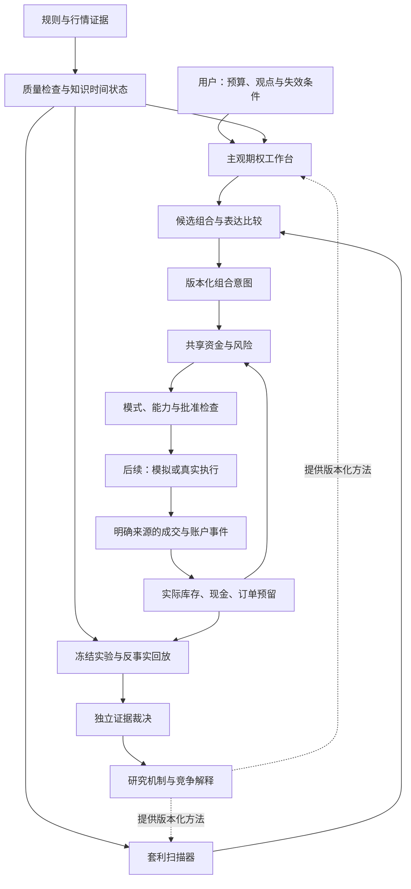
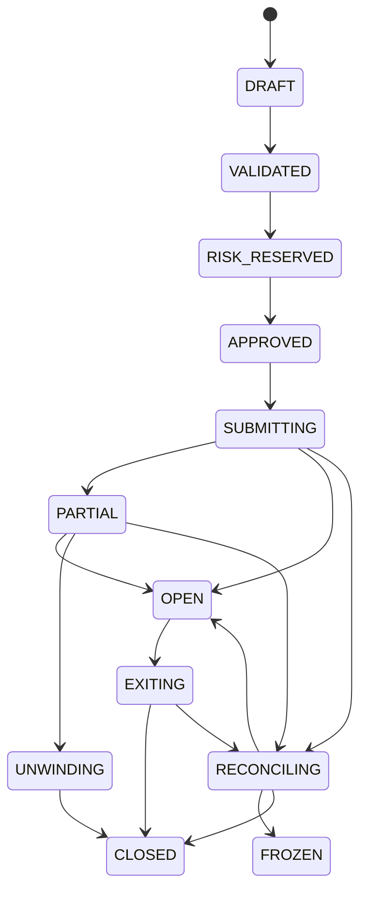

# ZenQuant 期权交易工作台：套利与主观交易架构

日期：2026-10-09。版本：`options-workbench.design.v1`。

**状态：架构提案，待产品负责人审阅。** 本轮仅交付设计与审查材料。图中的账户接入、OMS、paper/live 均为后续模块，没有实现或取得交易权限。

## 1. 用户任务与设计结论

服务一个使用 MacBook Pro、约 1,000–3,000 U 的技术型交易者。产品支持多资产、多场所期权；BTC 是第一机制验证对象，ETH 是冻结条件后的复制对象，资产不是写死的产品边界。

用户需要两种入口：

1. **套利扫描器**：发现价格关系异常，判断它属于现金流约束、跨所相对价格还是统计相对价值；解释小账户能否承担完整交易。
2. **主观期权工作台**：先记录方向、幅度、期限与失效判断，再比较期权表达；覆盖事前凸性、冲击后交易及高胜率场景。

两入口共用合约、报价、组合表达、资金、风险与账本。用户最终看到的是一张可复核的决策单：**依据是什么、付多少钱、可能如何亏损、账户是否容纳、怎样退出，以及何时应当不交易。**

架构成功的标准是相同事件与配置产生相同决策，资金不重复使用，交易失败可以解释，观点与成交可以分别复盘。盈利、Sharpe 与资金容量要由后续真实数据和冻结实验决定；本设计没有这些结论。

## 2. 与现有工程的关系

| 已有或拟议能力 | 本设计如何使用 | 当前边界 |
| --- | --- | --- |
| [P1 期权核心](../../../zenquant/options/contracts.py)及 costs/payoffs/ledger/risk | 复用 Decimal、不可变对象、长期权成本、核算与预算行为 | 支持已登记的全额付清 linear European long 模板；不是订单执行器 |
| [P1 实施计划](../plans/2026-10-09-options-kernel-p1.md) | 作为已实施范围的依据 | 卖腿、perp、inverse 执行及真实账户资格未完成 |
| [P2 数据设计（历史归档）](../../research-archive/20261031-local-consolidation/snapshot/working/docs/superpowers/specs/2026-10-09-options-data-p2-design.md.txt) | 行情证据子系统：公开有界采样、封存、连续性与知识时间回放 | 尚未实施；首批八合约不覆盖所有套利结构或尾部期限 |
| [原平台设计](2026-10-09-options-platform-design.md) | 保留 intent-before-orders、风险重写、四时钟与消融原则 | 本文细化产品入口和责任边界，不改旧规格的冻结内容 |
| legacy 策略、风险与插件 | 保持原生产路径和固定组合规则 | 新工作台通过独立契约接入，不将研究代码接入旧 hot path |

已有三平台短时 BTC 面板只是报价与代理费用诊断，不能作为持续套利或期权获利证据。P1 的 `VALID` 也不代表账户可交易；其执行权限继续为 `NONE`。

本设计不重写封存的 P2 规格或报告。P2 的保险实验与这里的独立尾部盈利是不同目标；新增目标需新实验 ID、协议与参考账户，不能沿用保险结果获得盈利标签。

## 3. 方案选择

| 方案 | 优点 | 代价 | 选择 |
| --- | --- | --- | --- |
| 两入口、共享纯核心、模块化单体 | 小账户有统一风险；代码和事件可回放；单 Mac 可起步 | 需要先明确契约与证据状态 | **采用** |
| 每种策略一个独立 bot | 单个原型快 | 资金、账户事实与故障处理重复；组合风险容易漏算 | 留作隔离研究 worker，不承担真实资金 |
| AI 自动选市场、观点及订单的大平台 | 探索范围宽 | 同时引入数据、模型、执行和权限问题，难以归因 | 先让 agent 提出并证伪研究假设 |

整体是长期产品蓝图，分成独立交付包。近期只读工作台复杂度中等；账户、卖腿及真实多腿执行复杂度较高，分别设计和验收。不会以一份实施计划把整张蓝图一次建完。

## 4. 总体架构

研究平面维护 `Thesis → 竞争解释 → 实验 → 裁决`；交易平面维护 `观点/异常 → 组合 → 风险 → 事件 → 核算`。研究结论只能产生新候选版本，不能自动改变运行策略、账户风险或交易权限。

| 层 | 负责什么 | 不代行的职责 |
| --- | --- | --- |
| 用户入口 | 登记观点、查看异常、比较表达、选择 NO_TRADE | 不在界面计算交易逻辑或写账本 |
| 机会与表达 | 判断边际类型，构造完整腿组合与退出约定 | 不用模型价格承诺成交，不发订单 |
| 纯期权核心 | 合约、数量、现金流、成本、风险与状态转换 | 无网络、数据库、隐含墙钟或非固定随机数 |
| 应用协调器 | 命令、版本检查、原子预留、权限与持久化 | 不自行产生新方向观点 |
| 场所适配器 | 行情/账户/订单协议与原始回执 | 不绕过意图、风险或授权 |
| 证据系统 | 冻结语义、比较结果、记录失败与裁决 | 不把工程通过变成盈利或实盘准入 |

依赖方向：UI/CLI/研究工具/适配器 → 应用协调器 → 纯核心 → 值合同。核心不反向 import UI、研究或交易 SDK。初期没有云、GPU、Redis 或分布式服务依赖。

状态分析是可选的机制使用条件：期限/曲面、波动冲击、流动性与拥挤分别保留来源、截止和缺证状态。初期用可解释规则，状态持续时间是研究特征；未经校准的分数不显示为概率。公开 OI 的 gross gamma、估计 dealer gamma 和观测 hedge flow 分列，不能用 OI 推定做市商头寸符号。行情可用性属于硬门，市场激活判断属于可消融的方法层。

策略表现变差时，诊断分别检查观点/机制变化、状态不适用、执行摩擦、数据实现问题与正常统计波动；不让一次回撤自动触发换模型或放宽风险。研究 agent 的职责是设计能区分这些解释的实验。

## 5. 套利入口：三种主张分开

| 分类 | 研究对象 | 必须证明什么 |
| --- | --- | --- |
| 现金流约束候选 | 同所 vertical、box、parity 等状态现金流边界 | 合约身份、全域 payoff、资金时点、费用/融资边界，以及完整交易路径 |
| 跨所相对价格 | 不同平台的相似期权报价 | 指数/结算/币种等价性、共同知识截止、合法数量 VWAP、双钱包资金和非原子失败成本 |
| 统计相对价值 | term/skew/IV 与预测波动的关系 | 冻结模型与持有规则、样本外增量、误差、成本和尾部风险 |

“哪个平台买同一目标期权更便宜”属于采购成本优化。输出分列 `displayed_cost_edge`、`model_edge` 和有明确履约/融资条件的 `cashflow_bound`；缺证为 null，不用一个套利评分合并它们。

同到期、同终值变量的线性欧式现金流证明，应检查分段节点和尾部斜率；有限情景网格只作压力诊断。不同到期、指数、inverse 或融资现金流须另建证明域。永续 funding 未锁定时不能当固定到期 future。理论现金流约束成立仍有开仓失败、履约及交易所风险。

候选卡至少展示：合约身份、合法最小量、完整支出/费用来源、峰值占资、残余风险、退出方法、缺证原因及失效时间。分腿合成报价不等于存在同价格的 combo book。

Deribit 官方描述原生 combo 可以单个订单同时匹配多条腿；具体产品、组合 ID、比例、订单类型和回执语义仍要逐项核验，不能外推全部 USDC 结构可用。原子匹配不消除未成交组合数量、退出拆腿及账户保证金风险。[Combo Books](https://support.deribit.com/hc/en-us/articles/31424954956061-Combo-Books)

能力足够时，同所 native combo 是优先研究的执行表达；跨所默认非原子。混合买卖腿的部分 combo 有费用优惠，双买结构不能自动套用同一优惠；费用绑定规则版本与实际账户证据。[Deribit Fees](https://support.deribit.com/hc/en-us/articles/25944746248989-Fees)

首期可做约束与成本诊断；含卖腿的候选保持研究身份，不绕过 P1 不支持卖腿的事实。box 或 parity 缺合约/hedge/融资字段时明确 NOT_EVALUABLE，不临时扩表凑出结构。

## 6. 主观入口：先观点，后表达

观点合同包含：标的、机制、方向/波动判断、期限、幅度或分布、概率来源、失效条件、最大损失预算、不交易条件、版本和知识截止。后来修改是新版本，不能覆盖原预测。观点修订、交易判断和成交事件使用不同记录。

没有概率时，工作台只报告情景损益、盈亏平衡与预算占用，不伪造期望收益、胜率或校准。用户输入概率则标为主观条件；隐含风险中性概率不自动成为真实发生概率。终值分布不足以评价提前退出、IV crush 或止损路径。

表达按支持范围展示：

- 已有 long call/put/straddle/strangle：可以核算已登记的线性欧式长期权；所有腿合计预算与单腿中间库存均检查。
- spread、option+perp、inverse：属于未来能力；数学模型支持、账户资格和执行支持分别显示，缺失模块不补造数据。
- cash：同币种不交易基准，不默认赚息或借贷。

同观点比较固定信息集、期限、起始总资本与事前风险预算。Delta 相同、名义规模相同或合约止损都不等于相同尾部风险；无法严格匹配的差异明确报告。各表达是互斥参考账户，不把它们的收益相加。

### 6.1 黑天鹅与高胜率

| 场景 | 盈利或效用目标 | 必须计入的失败 |
| --- | --- | --- |
| 事前买凸性 | 极端事件收益补偿整个等待期支出 | 反复归零、期限不对、预算耗尽、不能退出 |
| 可观测冲击后开仓 | 剩余行情边际超过已抬高的保险成本 | 追在 IV 高点、走势反转、延迟与宽价差 |
| 恐慌后反转 | 方向与时间窗口适合所选表达 | 方向正确但 IV 下跌/时间损耗使期权亏损 |
| 现有敞口保护 | 减少外生持仓的尾部损失与回撤 | 全年保费和净值拖累；避损不算独立盈利 |

保护实验先冻结被保护仓位和其管理规则；没有该敞口就只做独立期权账户。收益同时按总账户资本和投入权利金展示，不能用权利金上的高倍数掩盖账户收益或等待损耗。

高胜率场景仍须报告平均盈利、平均亏损、最大事件损失、费用及完整样本。卖保险形成的小赢大亏分布不因胜率高而取得较低风险标签。V1 不从裸卖开始。

## 7. 核心对象与证据能力

用扩展 envelope 包装 P1 合同，避免直接把现有四种 long 模板改成未经验证的通用实盘合同。

| 对象 | 最小责任 |
| --- | --- |
| `View` / `Thesis` | 不可变观点或研究假设、竞争解释、证伪条件、截止和评价事件 |
| `ScenarioSet` | 终值/路径、价格/IV/时间/流动性/FX 假设、预测与压力的区分、可为空的概率 |
| `Opportunity` / `ConstraintCertificate` | 异常类型、规格版本、现金流证明域、方向盘口成本、缺证和拒绝原因 |
| `ExpressionCandidate` | 完整腿、合法比例、支出、退出、风险差异及支持状态；不是订单 |
| `IntentEnvelope` | P1 intent 或明确不支持的候选；版本、目标变化、成本上限、方向截止、退出/修复 policy 和 hash |
| `CapabilityEvidence` | 数据、模型、产品账户与执行能力分别绑定 venue/product/account/instrument、来源、版本及有效期 |
| `AccountSnapshot` / `Reservation` | 实际库存/余额/未知订单、资金和风险占用、对账状态、单调账本版本 |
| `RiskDecision` / `Approval` | 准许的确切意图版本、变更边界、数据/账户/policy 版本、预留与有效期 |
| `DecisionRecord` / `ExecutionEvent` | 选择、NO_TRADE、修订与真实/模拟回执分开；费用币、幂等身份、经济和知识时间 |
| `EvidenceReport` | 数据/会计/风险/方法/执行/协议各自 hash、样本单位、失败覆盖、结论权限 |

每项结果分列 `input_validity / model_support / modeled_feasibility / account_eligibility / execution_evidence`，不用单个 PASS。产品能力和运行模式是两个维度：

| 模式 | 可以做什么 | 对真实资金的权限 |
| --- | --- | --- |
| research | 封存数据、模型诊断、实验与隔离 fixture 账本 | 无 |
| decision_support | 观点和表达比较；未来在授权范围内读取账户 | 无订单、无真实预留 |
| paper | 隔离模拟账户与明确模拟回执 | 无；paper 收益不进入 live 余额 |
| live | 后续限定账户/产品/预算的真实交易 | 单独验收及用户授权才存在 |

仅修改 mode 配置不能取得 live 权限。研究 agent 不能访问私钥/订单适配器、改账户 policy 或晋级候选；将来执行进程及文件权限与研究区隔离，配合协调器和适配器的命令校验，不能只靠 prompt。

## 8. 共享资金、风险与生命周期

两入口使用同一份总资本，按机制设置子预算，另有全局上限。各 venue/account/wallet/currency 独立检查现金、保证金和未完成订单；总净值展示不能成为跨所可用保证金。转账须实际到账，模型盈利和预计退出收入不能当现金。

风险 policy 同时约束合法数量、全额支出、累计保费损耗、集中度、极端压力、中间库存与修复费用。1,000 / 3,000 U 是独立实验账户；已有 1% 等数字仅在其冻结实验 profile 内有效，本设计不把它们改成默认实盘限额。

订单预留与持仓风险额度是两种占用。成交后将预留转换为库存占用，不能因为支出已支付就重新释放全部额度。关闭当前仓位可以减少持仓占用，已实现亏损、费用和滚动保费仍然保留。

图是未来执行的简化投影；另有 REJECTED/EXPIRED，异常修订可重开对账，终态不等于历史永不变化。首期诊断只到草案，不产生真实预留或提交。

1. 协调器按账户/账本版本，在单事务内预留全部所需资金。两入口并发争用同一预算时，失配方必须重算。
2. 批准绑定确切 intent、risk、capability、policy 和数据版本。提交前报价/账户过期须重验，不能拿旧卡片的批准发单。
3. 风险可拒绝、缩量、只减仓。仅在已批准的同 payoff 比例缩放范围内自动缩小；改变方向、腿比、保护、退出或修复条件则产生新版本并重新确认。
4. 提交前持久化稳定 client order ID 与命令。超时/崩溃先查原 ID，未知成交不得按零重发。不能可靠查询/幂等的适配器不准入 live。
5. 部分成交以实际库存重算。退出保护腿可能扩大卖腿风险，不能将数量下降等同于减仓；修复只能在批准预算内处理已有敞口。
6. 未提交预留可按规则过期；已提交/UNKNOWN 不因 TTL、撤单请求或断网释放。原始冲突回执保留并冻结受影响新风险。
7. 缺退出报价表示退出价值未知；缺退出成交表示库存未关闭。CLOSED 需要相关订单/库存/结算链与现金费用对账，未知负债保留占用。
8. 重启先恢复日志、订单、持仓与资金并对账，旧批准不自动恢复发送权限。Mac 休眠和断网按失联处理；kill 停新风险，不承诺立即平仓。

将来接入实盘时，人工外部仓位也属于账户风险。内部 reservation 与交易所冻结金额须按订单对应，避免漏计或重复计；余额差异未解释时冻结受影响的新风险。

## 9. 时钟与持久化

- 行情可逐事件发现异常；方向观点随时记录为草案，形成方向意图遵守显式 confirmed-bar policy。当前生产仍为 4h。
- 更快 confirmed clock 是独立研究 policy；改变信息集与等待成本，不冒充单组件消融或静默更改 legacy。
- 执行时钟实现冻结意图；风险时钟随时停止新风险或处理实际敞口，不重新生成方向。
- source、received、available 和 durable 时间分开。晚到数据或观点修订不能回写历史决策。

公开行情沿用 P2 的 raw journal、manifest 和外部 SHA pin。未来账户使用本地 SQLite 单写入 journal/outbox：命令、预留、授权及 outbox 在本地事务提交；网络发送和回执是后续事件，承认其与本地事务不能原子化。

checkpoint 是可重建投影，需验证后缀回放等于全量。修订用关联事件，不覆盖原始记录。UI 只读投影并提交结构化命令，不能写余额或订单状态；密钥不进入配置、日志或研究结果。账户持久化的具体迁移和备份属于后续账户子规格。

## 10. 消融与评价

观点质量、表达价值、执行质量和资金可行性分别评价。方向正确但期权亏损、表达合理但未成交、信号有效但预算拒绝，都应成为可解释结果。

| 实验 | 唯一变化或比较 | 能回答什么 |
| --- | --- | --- |
| 状态组件移除 | 固定表达有/无可选状态过滤；加预算/活跃率匹配的简单对照 | 是识别了机制，还是仅仅少交易 |
| 表达替换 | 同观点、期限、事前预算下固定表达 vs 合法表达选择 | 期权表达是否创造成本后增量；属于反事实比较 |
| 路由替换 | 固定场所 vs 因果费用/深度路由 | 节省多少完成交易成本，付出多少失败与等待 |
| combo 表达替换 | 同腿同信息下原生 combo vs 保守逐腿路径 | 是否减少失衡、修复和占资；需具体能力与回执 |
| 尾部盈利实验 | 完整日历的独立尾部账户 vs 同资本现金 | 极端盈利能否补偿持续损耗 |
| 保护实验 | 冻结外生仓位有/无保护 | 保险的尾部改善与净值代价，单独裁决 |
| 时钟/资产复制 | 更快确认时钟或冻结后 BTC→ETH | 新 policy/迁移是否成立；不是同信息消融 |

真实费用、PIT、合法数量、会计、钱包资金、硬风险与审计不可移除。mid/免费/旧报价的乐观变体只用于解释假机会，永久 `diagnostic_only=true`。

记录全部已登记观点、候选、拒绝、撤回、NO_TRADE 与等待期。人工未登记的想法无法恢复，必须披露登记覆盖与自主选择偏差。一个冲击的不同 strike、数量和平台不增加独立事件数。

比较冻结机会全集、共同静态资格、信息、资本、退出、执行模型和 trial 预算；不能按成交成功、余额充足或事后盈利筛样本。动态资金不足和失败是策略结果。净损益分解支出、卖出/结算、费用、FX 与资金成本，未闭合/缺证不归零。

沿用原平台的探索/确认、稳健性和多重检验边界。没有完整连续收益不填 Sharpe；没有危机样本不裁决黑天鹅盈利；压力仿真只证明工程响应。研究结论不会自动取得资金分配权限。

## 11. 交付顺序与可验收切片

| 交付包 | 用户能获得什么 | 范围与准入 |
| --- | --- | --- |
| D1 数据证据 | 当时可见的规格/报价、连续段、缺口与固定 cutoff | 按 P2 单独规格与计划，有界公开采样；无账户和订单 |
| D2 两入口只读工作台 | 观点单、表达/成本对照、异常原因与决策时间线 | 可先用封存输入；仅已有 long 模板核算及约束诊断，不作盈利榜 |
| D3 账户与隔离 paper | 共用资金、版本化批准、模拟回执和故障恢复 | 独立账户规格；资格、外部仓位、UNKNOWN、重启与对账验收 |
| D4 同所受限组合 | 卖腿核算、保证金与精确 combo 能力 | 产品/账户/撮合逐项验收；有限 payoff 不代替 IM/MM 证明 |
| D5 限定 live 与跨所扩展 | 获授权的限定交易闭环；之后再处理双钱包非原子路径 | 全仓 gate、独立风险/执行验收与用户具体授权 |

近期用户界面只需三个视图：观点/异常、表达决策单、事件时间线。先用 CLI/静态报告承载纯比较，不先铺大型曲面终端。

后续实施模块按职责落在 `zenquant/options/` 的纯合同/表达/约束计算、`zenquant/research/options_platform/` 的协议/比较/报告和独立 app/adapters 中。具体文件划分在每个交付包的实施计划冻结，避免先创建空模块。

验收重点：无概率不出 EV；观点修订不覆盖历史；缺合约不补造；合法量与预算拒绝；相同事件回放一致；两入口资金竞争；保护腿被重写；partial/UNKNOWN/cancel-fill；退出缺证不释放；checkpoint/restart 不重复发单；paper/live 隔离。

D1/D2 不需要私钥、交易账户或云服务；公开资料及封存 corpus 足够开始。D3 以后才按阶段需要获授权的只读账户、真实 fee/账户模式和隔离模拟环境；真实交易凭证只进入获授权执行适配器。

## 12. 本轮交付与未完成事项

本轮用三个隔离 agent 审查套利、主观交易与共享底座，主 agent 汇总，再独立审查完整规格。研究材料位于 [本轮目录](../../../results/options_platform/trading_architecture_20261009/)。没有运行行情采集、读取账户、写产品代码或下单。

既有全仓 A/C/E 阻断仍按原记录存在，本轮文档审查不修复或豁免它们，也没有重新运行完整代码 gate。合并、部署与真实交易均不因架构设计完成而获准。

下一步是产品负责人审阅此规格，之后只为选中的近期交付包写实施计划。盈利机会的优先级、实盘预算与账户模式，要依相应证据和单独决策确认。
